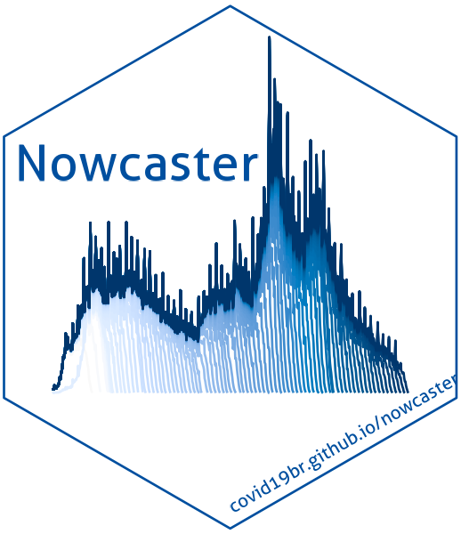
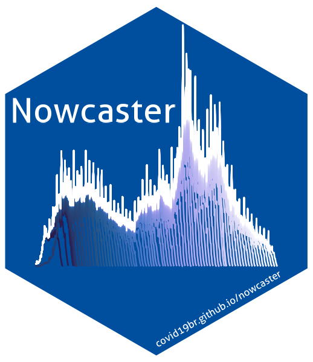

<!-- README.md is generated from README.Rmd. Please edit that file -->

<a href='https://github.com/covid19br/nowcaster'></a>
<a href='https://github.com/covid19br/nowcaster'></a>

<!-- badges: start -->

[](https://CRAN.R-project.org/package=nowcaster)
[](https://cran.r-project.org/web/checks/check_results_nowcaster.html)
[](https://CRAN.R-project.org/package=nowcaster)
[](https://github.com/covid19br/nowcaster/actions/workflows/R-CMD-check.yaml)
[](https://lifecycle.r-lib.org/articles/stages.html#stable)
[](https://www.gnu.org/licenses/gpl-3.0)
<!-- badges: end -->

`nowcaster` provides statistical models for correcting notification
delays in epidemiological data. It estimates the number of events, such
as cases or deaths, that have already happened but have not been
reported yet, using the empirical delay distribution between the date of
onset and the date of report.

Every notification system has a delay between the date of onset of an
event and its date of report. `nowcaster` fits a negative binomial model
to the delay triangle, with smooth effects for the time of onset and for
the reporting delay, following [Bastos et
al. (2019)](https://doi.org/10.1002/sim.8303). The package was built
during the Covid-19 pandemic for the Brazilian Severe Acute Respiratory
Illness (SARI) surveillance system, SIVEP-Gripe, and works with any line
list that has a date of onset and a date of report.

## Installation

Install the released version from CRAN:

``` r
install.packages("nowcaster")
```

Or the development version from GitHub:

``` r
# install.packages("remotes")
remotes::install_github("covid19br/nowcaster")
```

### Dependencies

`nowcaster` has two workhorse functions:

- `nowcasting_inla()` fits the model in a fully Bayesian way with
  [`INLA`](https://www.r-inla.org/download-install), which is not on
  CRAN and has to be installed separately:

``` r
install.packages("INLA",
                 repos = c(getOption("repos"),
                           INLA = "https://inla.r-inla-download.org/R/stable"),
                 dep = TRUE)
```

- `nowcasting_mgcv()` fits the model as a GAM with
  [`mgcv`](https://CRAN.R-project.org/package=mgcv), installed together
  with `nowcaster`.

## Example

``` r
library(nowcaster)

# SARI cases from Belo Horizonte, Brazil, shipped with the package
data(sragBH)

nowcast <- nowcasting_inla(dataset = sragBH,
                           date_onset = DT_SIN_PRI,
                           date_report = DT_DIGITA)

# Median and 50% / 95% intervals of the number of cases per week of onset
head(nowcast$total)
```

See [Get
Started](https://covid19br.github.io/nowcaster/articles/nowcaster.html)
for a full walk-through, [Nowcasting with
mgcv](https://covid19br.github.io/nowcaster/articles/2_nowcasting_mgcv.html)
for the `mgcv` version and the
[articles](https://covid19br.github.io/nowcaster/articles/) on
age-structured nowcasting and forecasting.

## Citation

Run `citation("nowcaster")` to cite the package and the method it
implements.

## Similar initiatives

Other R packages for nowcasting:

- [epinowcast](https://package.epinowcast.org/)
- [surveillance](https://surveillance.r-forge.r-project.org/pkgdown/index.html)
