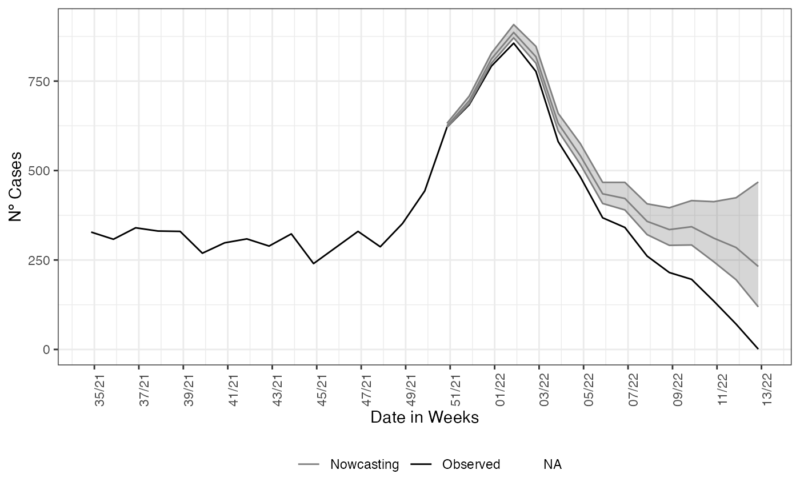
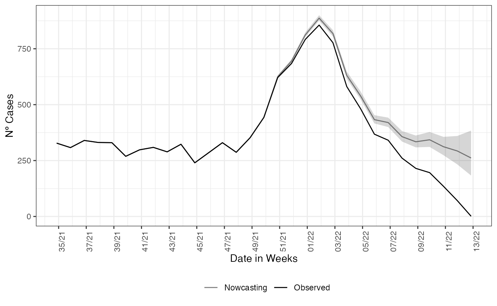
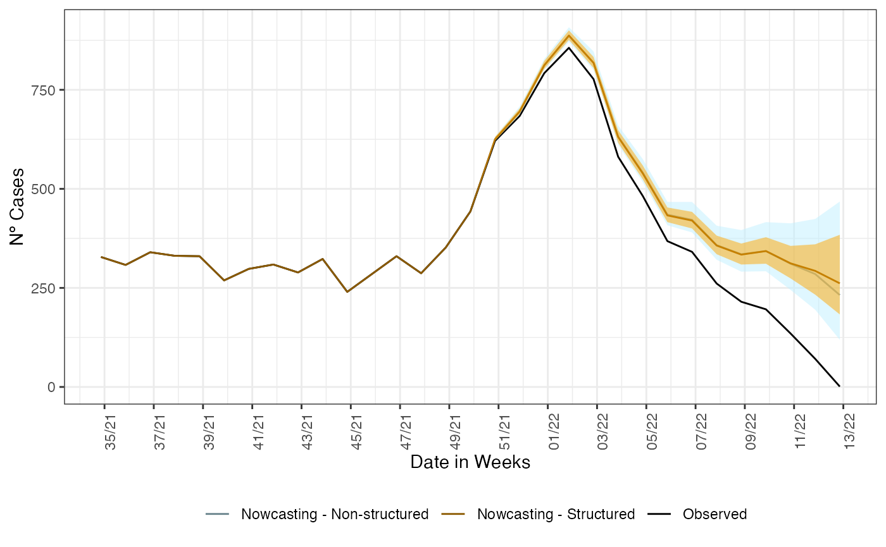

# Nowcasting on Structured data

## TL;DR

This is a longer article explaining the workings and the choices behind
the nowcasting model and its advantages and limitations.

## As Before…

As in the [Get
Started](https://covid19br.github.io/nowcaster/articles/nowcaster.html)
we start by loading the package and its lazy data, by:

\
[`library`](https://rdrr.io/r/base/library.html)`(`[`nowcaster`](https://covid19br.github.io/nowcaster/)`)`\
`# Loading Belo Horizonte SARI data set`\
[`data`](https://rdrr.io/r/utils/data.html)`(``sragBH``)`

## Non-structured data

The [Get
Started](https://covid19br.github.io/nowcaster/articles/nowcaster.html)
example is done on non-structured data, here we give a more detailed
description of this type of data and how it can change the nowcasting.

When we call the
[`nowcasting_inla()`](https://covid19br.github.io/nowcaster/reference/nowcasting_inla.md)
function, it has by default the parameterization to take the data and
estimate with a non-structured data form. The estimate fits a negative
binomial distribution, NegBinom(\lambda\_{t,d}, \phi), to the cases
count at time t with delay d, \phi is the dispersion parameter. The rate
\lambda\_{t,d} is then parametric in a log-linear format by a constant
term added by structured delay random effects and structured time random
effects. This is the whole premise of nowcasting, we model the case
counts at time t given the case count at that time and past values as
well as given the delay distribution of that count.

Hence, the model is given by the following:

Y\_{t,d} \sim NegBinom(\lambda\_{t,d}, \phi), \\\\ \log(\lambda\_{t,d})
= \alpha + \beta_t + \gamma_d, \\\\ \beta_t := u_t - u\_{(t-1)} -
u\_{(t-2)} \sim N(0,\tau\_{\beta}); \gamma_d := u_d - u\_{(d-1)} \sim
N(0, \tau\_{\gamma})\\\\ t=1,2,\ldots,T, \\\\ d=1,2,\ldots,D,

Where the intercept \alpha follows a Gaussian distribution with a very
large variance, \beta_t follows a second order random walk with
precision \tau\_\beta, while \gamma_d a first-order random walk with
precision \tau\_\gamma. The model is then completed by INLA default
prior distributions for \phi, \tau\_\beta, and \tau\_\gamma. See
[`nbinomial`](https://inla.r-inla-download.org/r-inla.org/doc/likelihood/likelihood-example.pdf),
[`rw1`](https://inla.r-inla-download.org/r-inla.org/doc/latent/rw1.pdf)
and
[`rw2`](https://inla.r-inla-download.org/r-inla.org/doc/latent/rw1.pdf)
INLA help pages.

The call of the function is straightforward, it simply needs a data set
as input, here the `LazyData` loaded in the namespace of the package.
The function has 3 mandatory parameters, `dataset` to parse the data set
to be nowcasted, `date_onset` for parsing the column name which is the
date of onset of symptoms and `date_report` which parses the column name
for the date of report of the cases. Here this columns are “DT_SIN_PRI”
and “DT_DIGITA”, respectively. Need for two dates is due to we are
modeling the delay as part of the nowcasting estimation, usually
nowcasting models assuming a delay distribution and apply it to the
cases observed.

\
`nowcasting_bh_no_age`` ``<-`` `[`nowcasting_inla`](https://covid19br.github.io/nowcaster/reference/nowcasting_inla.md)`(``dataset ``=`` ``sragBH``, `\
`                                        date_onset ``=`` ``DT_SIN_PRI``, `\
`                                        date_report ``=`` ``DT_DIGITA``)`\
[`head`](https://rdrr.io/r/utils/head.html)`(``nowcasting_bh_no_age``$``total``)`\
`#> ``# A tibble: 6 × 7`\
`#>    Time dt_event   Median    LI    LS   LIb   LSb`\
`#>   ``<int>`` ``<date>``      ``<dbl>`` ``<dbl>`` ``<dbl>`` ``<dbl>`` ``<dbl>`\
`#> ``1``    17 2021-12-19    625  621   633    623   627`\
`#> ``2``    18 2021-12-26    695  688   708    692   699`\
`#> ``3``    19 2022-01-02    811  800   829    807   817`\
`#> ``4``    20 2022-01-09    887  870   909.   881   894`\
`#> ``5``    21 2022-01-16    819  800   846    811   827`\
`#> ``6``    22 2022-01-23    631  608.  659    623   640`

The above calling will return only the nowcasting estimate and its
Confidence Interval (CI) for two different credibility levels, `LIb` and
`LSb` are the max and min CI, respectively, with credibility of 50% and
`LI` and `LS` are the max and min CI, respectively, with credibility of
95%.

The `nowcasting_inla` has the option to return the curve on which the
window of action of the model was set, if the `data.by.week` parameter
is flagged as `TRUE` it returns on the second element of the output
list, the summarized data by week.

\
`nowcasting_bh_no_age`` ``<-`` `[`nowcasting_inla`](https://covid19br.github.io/nowcaster/reference/nowcasting_inla.md)`(``dataset ``=`` ``sragBH``, `\
`                                        date_onset ``=`` ``DT_SIN_PRI``, `\
`                                        date_report ``=`` ``DT_DIGITA``, `\
`                                        data.by.week ``=`` ``T``)`\
[`head`](https://rdrr.io/r/utils/head.html)`(``nowcasting_bh_no_age``$``data``)`\
`#> ``# A tibble: 6 × 4`\
`#>   dt_event   delay     Y  Time`\
`#>   ``<date>``     ``<dbl>`` ``<dbl>`` ``<int>`\
`#> ``1`` 2021-08-29     0    13     1`\
`#> ``2`` 2021-08-29     1    51     1`\
`#> ``3`` 2021-08-29     2   127     1`\
`#> ``4`` 2021-08-29     3    55     1`\
`#> ``5`` 2021-08-29     4    26     1`\
`#> ``6`` 2021-08-29     5    15     1`

This element is the counts of cases by each delay days. It is known as
the delay triangle, if we table the delay amount against the date of
onset of first symptoms, we can see the pattern of the delay for the
cases.

\
[`library`](https://rdrr.io/r/base/library.html)`(`[`dplyr`](https://dplyr.tidyverse.org)`)`\
\
`data_triangle`` ``<-`` ``nowcasting_bh_no_age``$``data`` ``|>`` `\
`  `[`filter`](https://dplyr.tidyverse.org/reference/filter.html)`(``delay`` ``<`` ``30``)`` ``|>`` `\
`  `[`arrange`](https://dplyr.tidyverse.org/reference/arrange.html)`(``delay``)`` ``|>`` `\
`  `[`select`](https://dplyr.tidyverse.org/reference/select.html)`(``-``Time``)`\
\
`data_triangle`` ``|>`` `\
`  `[`filter`](https://dplyr.tidyverse.org/reference/filter.html)`(``dt_event`` ``>=`` ``(`[`max`](https://rdrr.io/r/base/Extremes.html)`(``dt_event``)`` ``-`` ``84``)``,`\
`         ``delay`` ``<=`` ``10``)`` ``|>`` `\
`  ``tidyr``::`[`spread`](https://tidyr.tidyverse.org/reference/spread.html)`(``key ``=`` ``delay``, value ``=`` ``Y``)`\
`#> ``# A tibble: 13 × 12`\
`` #>    dt_event     `0`   `1`   `2`   `3`   `4`   `5`   `6`   `7`   `8`   `9`  `10` ``\
`#>    ``<date>``     ``<dbl>`` ``<dbl>`` ``<dbl>`` ``<dbl>`` ``<dbl>`` ``<dbl>`` ``<dbl>`` ``<dbl>`` ``<dbl>`` ``<dbl>`` ``<dbl>`\
`#> `` 1`` 2022-01-02    20   106   114   109    98   113    72    69    27    19    18`\
`#> `` 2`` 2022-01-09     7   105   152   104   135   109    83    66    27    30    18`\
`#> `` 3`` 2022-01-16    10   139   101   135   103    90    70    51    17    28    33`\
`#> `` 4`` 2022-01-23    15    98   121    77    69    79    29    37    28    28    ``NA`\
`#> `` 5`` 2022-01-30    11    87    99    73    76    38    36    40    22    ``NA``    ``NA`\
`#> `` 6`` 2022-02-06    16    76    77    62    37    30    35    35    ``NA``    ``NA``    ``NA`\
`#> `` 7`` 2022-02-13     7    85    59    45    69    47    29    ``NA``    ``NA``    ``NA``    ``NA`\
`#> `` 8`` 2022-02-20    20    52    72    44    27    46    ``NA``    ``NA``    ``NA``    ``NA``    ``NA`\
`#> `` 9`` 2022-02-27    12    63    48    40    52    ``NA``    ``NA``    ``NA``    ``NA``    ``NA``    ``NA`\
`#> ``10`` 2022-03-06    12    56    72    56    ``NA``    ``NA``    ``NA``    ``NA``    ``NA``    ``NA``    ``NA`\
`#> ``11`` 2022-03-13    15    56    64    ``NA``    ``NA``    ``NA``    ``NA``    ``NA``    ``NA``    ``NA``    ``NA`\
`#> ``12`` 2022-03-20    11    60    ``NA``    ``NA``    ``NA``    ``NA``    ``NA``    ``NA``    ``NA``    ``NA``    ``NA`\
`#> ``13`` 2022-03-27     1    ``NA``    ``NA``    ``NA``    ``NA``    ``NA``    ``NA``    ``NA``    ``NA``    ``NA``    ``NA`

We just look at the amount of cases with than 10 weeks of delay or less
and 84 days before the latest date. The default maximum is 30 weeks
delay considered at nowcasting estimation.

If this element is groped and summarized by the onset of symptoms date,
here `DT_SIN_PRI`, it is the epidemiological curve observed. To example
it, we plot the estimate and the epidemiological curve all together.

\
[`library`](https://rdrr.io/r/base/library.html)`(`[`ggplot2`](https://ggplot2.tidyverse.org)`)`\
\
`data_by_week`` ``<-`` ``nowcasting_bh_no_age``$``data`` ``|>`` `\
`  ``dplyr``::`[`group_by`](https://dplyr.tidyverse.org/reference/group_by.html)`(``dt_event``)`` ``|>`` `\
`  ``dplyr``::`[`reframe`](https://dplyr.tidyverse.org/reference/reframe.html)`(`\
`    observed ``=`` `[`sum`](https://rdrr.io/r/base/sum.html)`(``Y``, na.rm ``=`` ``T``)`\
`  ``)`` ``|>`\
`  ``dplyr``::`[`filter`](https://dplyr.tidyverse.org/reference/filter.html)`(``dt_event`` ``>=`` `[`max`](https://rdrr.io/r/base/Extremes.html)`(``dt_event``)``-``270``)`\
\
`nowcasting_bh_no_age``$``total`` ``|>`` `\
`  `[`filter`](https://dplyr.tidyverse.org/reference/filter.html)`(``dt_event`` ``>=`` ``(`[`max`](https://rdrr.io/r/base/Extremes.html)`(``dt_event``)``-``270``)``)`` ``|>`` `\
`  `[`ggplot`](https://ggplot2.tidyverse.org/reference/ggplot.html)`(`[`aes`](https://ggplot2.tidyverse.org/reference/aes.html)`(``x ``=`` ``dt_event``, y ``=`` ``Median``, col ``=`` ``'Nowcasting'``)``)`` ``+`\
`  `[`geom_line`](https://ggplot2.tidyverse.org/reference/geom_path.html)`(``data ``=`` ``data_by_week``, `\
`            `[`aes`](https://ggplot2.tidyverse.org/reference/aes.html)`(``x ``=`` ``dt_event``, y ``=`` ``observed``, col ``=`` ``'Observed'``)``)``+`\
`  `[`geom_ribbon`](https://ggplot2.tidyverse.org/reference/geom_ribbon.html)`(`[`aes`](https://ggplot2.tidyverse.org/reference/aes.html)`(``ymin ``=`` ``LI``, ymax ``=`` ``LS``, col ``=`` ``NA``)``, alpha ``=`` ``0.2``, show.legend ``=`` ``F``)``+`\
`  `[`geom_line`](https://ggplot2.tidyverse.org/reference/geom_path.html)`(``)``+`\
`  `[`theme_bw`](https://ggplot2.tidyverse.org/reference/ggtheme.html)`(``)``+`\
`  `[`theme`](https://ggplot2.tidyverse.org/reference/theme.html)`(``legend.position ``=`` ``"bottom"``, axis.text.x ``=`` `[`element_text`](https://ggplot2.tidyverse.org/reference/element.html)`(``angle ``=`` ``90``)``)`` ``+`\
`  `[`scale_color_manual`](https://ggplot2.tidyverse.org/reference/scale_manual.html)`(``values ``=`` `[`c`](https://rdrr.io/r/base/c.html)`(``'grey50'``, ``'black'``)``, name ``=`` ``''``)``+`\
`  `[`scale_x_date`](https://ggplot2.tidyverse.org/reference/scale_date.html)`(``date_breaks ``=`` ``'2 weeks'``, date_labels ``=`` ``'%V/%y'``, name ``=`` ``'Date in Weeks'``)``+`\
`  `[`labs`](https://ggplot2.tidyverse.org/reference/labs.html)`(``x ``=`` ``''``, y ``=`` ``'Nº Cases'``)`

## Structured data, Age

The first improvement we have done on the baseline model for nowcasting
with a non-structured data is to have the same model for categorical
class of the case counts, due to the epidemiological course of
SARS-CoV-2, we expect to different ages having different delays
distribution. We call this kind of looking into to the data as the
structured data, as the data now have identifiers for time, delay and
the age class of the cases. To the structured data we fit again a
Negative binomial distribution to the cases count at time t with delay
d. Differently, from the non-structured case the model now gives random
effects to the delay distribution and time distribution by each of the
age-class chosen by the user to break the data. The model has the form
now:

Y\_{t,d,a} \sim NegBinom(\lambda\_{t,d,a}, \phi), \\\\
\log(\lambda\_{t,d,a}) = \alpha_a + \beta\_{t,a} + \gamma\_{d,a}, \\\\
\beta\_{t,a} := u_t - u\_{(t-1)} - u\_{(t-2)} \sim N(0,\tau\_{a,
\beta}); \gamma\_{d,a} := u_d - u\_{(d-1)} \sim N(0, \tau\_{a, \gamma})
\\\\ t=1,2,\ldots,T, \\\\ d=1,2,\ldots,D, \\\\ a=1,2,\ldots,A

where each age class, a, has an intercept \alpha_a following a Gaussian
distribution with a very large variance, the time-age random effects,
\beta\_{t,a}, follow a joint multivariate Gaussian distribution with a
separable variance components an independent Gaussian term for the age
classes with precision \tau\_{a,\beta} and a second order random walk
term for the time with precision \tau\_{\beta}. Analogously, the
delay-age random effects, \gamma\_{d,a}, follow a joint multivariate
Gaussian distribution with a separable variance components an
independent Gaussian term for the age classes with precision
\tau\_{a,\gamma} and a first order random walk term for the time with
precision \tau\_{\gamma}. The model is then completed by INLA default
prior distributions for \phi, \tau\_{a,\beta}, \tau\_{a,\gamma},
\tau\_{a,\beta} and \tau\_\gamma. See
[`nbinomial`](https://inla.r-inla-download.org/r-inla.org/doc/likelihood/likelihood-example.pdf),
[`rw1`](https://inla.r-inla-download.org/r-inla.org/doc/latent/rw1.pdf)
and
[`rw2`](https://inla.r-inla-download.org/r-inla.org/doc/latent/rw1.pdf)
INLA help pages.

This new model corrects the delay taking into account the effects of age
classes and the interactions of each age class between time and also
delay. Now the model needs a flag indicating which is the column on the
data set which will be used to break the data into age classes and
another parameter flagging on how the age classes will be split. This is
given by the parameters `age_col` and `bins_age`. We also pass two
additional parameters, `data.by.week` to return the epidemiological
curve out of window of action of nowcasting estimate and `return.age` to
inform we desire a nowcasting result in two ways, the total aggregation
estimate and the age-stratified estimate. The calling of the function
has the following form:

\
`nowcasting_bh_age`` ``<-`` `[`nowcasting_inla`](https://covid19br.github.io/nowcaster/reference/nowcasting_inla.md)`(``dataset ``=`` ``sragBH``, `\
`                                     bins_age ``=`` ``"10 years"``,`\
`                                     data.by.week ``=`` ``T``, `\
`                                     date_onset ``=`` ``DT_SIN_PRI``, `\
`                                     date_report ``=`` ``DT_DIGITA``,`\
`                                     age_col ``=`` ``Idade``)`

Each of the estimates returned by `nowcasting_inla` has the same form as
in the non-structured case. On the nowcasting estimates, it returns a
`data.frame` with the posterior median and 50% and 95% credible
intervals, (LIb and LSb) and (LI and LS) respectively.

\
[`library`](https://rdrr.io/r/base/library.html)`(`[`ggplot2`](https://ggplot2.tidyverse.org)`)`\
\
`dados_by_week`` ``<-`` ``nowcasting_bh_age``$``data`` ``|>`` `\
`  ``dplyr``::`[`group_by`](https://dplyr.tidyverse.org/reference/group_by.html)`(``dt_event``)`` ``|>`` `\
`  ``dplyr``::`[`reframe`](https://dplyr.tidyverse.org/reference/reframe.html)`(`\
`    observed ``=`` `[`sum`](https://rdrr.io/r/base/sum.html)`(``Y``, na.rm ``=`` ``T``)`\
`  ``)`` ``|>`\
`  ``dplyr``::`[`filter`](https://dplyr.tidyverse.org/reference/filter.html)`(``dt_event`` ``>=`` `[`max`](https://rdrr.io/r/base/Extremes.html)`(``dt_event``)``-``270``)`\
\
\
`nowcasting_bh_age``$``total`` ``|>`` `\
`  `[`ggplot`](https://ggplot2.tidyverse.org/reference/ggplot.html)`(``)``+`\
`  `[`geom_line`](https://ggplot2.tidyverse.org/reference/geom_path.html)`(`[`aes`](https://ggplot2.tidyverse.org/reference/aes.html)`(``x ``=`` ``dt_event``, y ``=`` ``Median``, `\
`                col ``=`` ``'Nowcasting'``)``)``+`\
`  `[`geom_line`](https://ggplot2.tidyverse.org/reference/geom_path.html)`(``data ``=`` ``dados_by_week``, `\
`            `[`aes`](https://ggplot2.tidyverse.org/reference/aes.html)`(``x ``=`` ``dt_event``, y ``=`` ``observed``, `\
`                col ``=`` ``"Observed"``)``)``+`\
`  `[`geom_ribbon`](https://ggplot2.tidyverse.org/reference/geom_ribbon.html)`(`[`aes`](https://ggplot2.tidyverse.org/reference/aes.html)`(``x ``=`` ``dt_event``, y ``=`` ``Median``,`\
`                  ymin ``=`` ``LI``, ymax ``=`` ``LS``)``, `\
`              alpha ``=`` ``0.2``, show.legend ``=`` ``F``)``+`\
`  `[`theme_bw`](https://ggplot2.tidyverse.org/reference/ggtheme.html)`(``)``+`\
`  `[`theme`](https://ggplot2.tidyverse.org/reference/theme.html)`(``legend.position ``=`` ``"bottom"``, axis.text.x ``=`` `[`element_text`](https://ggplot2.tidyverse.org/reference/element.html)`(``angle ``=`` ``90``)``)``+`\
`  `[`scale_color_manual`](https://ggplot2.tidyverse.org/reference/scale_manual.html)`(``values ``=`` `[`c`](https://rdrr.io/r/base/c.html)`(``'grey50'``, ``'black'``)``, name ``=`` ``''``)``+`\
`  `[`scale_x_date`](https://ggplot2.tidyverse.org/reference/scale_date.html)`(``date_breaks ``=`` ``'2 weeks'``, date_labels ``=`` ``'%V/%y'``, name ``=`` ``'Date in Weeks'``)``+`\
`  `[`labs`](https://ggplot2.tidyverse.org/reference/labs.html)`(``x ``=`` ``''``, y ``=`` ``'Nº Cases'``)`

For sake of completeness we plot both estimates together to check how
different they are.

\
\
\
[`ggplot`](https://ggplot2.tidyverse.org/reference/ggplot.html)`(``)``+`\
`  `[`geom_line`](https://ggplot2.tidyverse.org/reference/geom_path.html)`(``data ``=`` ``dados_by_week``, `\
`            `[`aes`](https://ggplot2.tidyverse.org/reference/aes.html)`(``x ``=`` ``dt_event``, y ``=`` ``observed``, `\
`                color ``=`` ``"Observed"``)``)``+`\
`  `[`geom_line`](https://ggplot2.tidyverse.org/reference/geom_path.html)`(``data ``=`` ``nowcasting_bh_no_age``$``total`` ``|>`` `\
`              `[`filter`](https://dplyr.tidyverse.org/reference/filter.html)`(``dt_event`` ``>=`` ``(`[`max`](https://rdrr.io/r/base/Extremes.html)`(``dt_event``)``-``270``)``)``,`\
`            `[`aes`](https://ggplot2.tidyverse.org/reference/aes.html)`(``x ``=`` ``dt_event``, y ``=`` ``Median``, `\
`                color ``=`` ``'Nowcasting - Non-structured'``)``)``+`\
`  `[`geom_ribbon`](https://ggplot2.tidyverse.org/reference/geom_ribbon.html)`(``data ``=`` ``nowcasting_bh_no_age``$``total`` ``|>`` `\
`              `[`filter`](https://dplyr.tidyverse.org/reference/filter.html)`(``dt_event`` ``>=`` ``(`[`max`](https://rdrr.io/r/base/Extremes.html)`(``dt_event``)``-``270``)``)``,`\
`              `[`aes`](https://ggplot2.tidyverse.org/reference/aes.html)`(``x ``=`` ``dt_event``, y ``=`` ``Median``,`\
`                  ymin ``=`` ``LI``, ymax ``=`` ``LS``,`\
`                  fill ``=`` ``"Nowcasting - Non-structured"``)``, `\
`              alpha ``=`` ``0.5``, show.legend ``=`` ``F``)``+`\
`  `[`geom_line`](https://ggplot2.tidyverse.org/reference/geom_path.html)`(``data ``=`` ``nowcasting_bh_age``$``total`` ``|>`` `\
`              `[`filter`](https://dplyr.tidyverse.org/reference/filter.html)`(``dt_event`` ``>=`` ``(`[`max`](https://rdrr.io/r/base/Extremes.html)`(``dt_event``)``-``270``)``)``,`\
`            `[`aes`](https://ggplot2.tidyverse.org/reference/aes.html)`(``x ``=`` ``dt_event``, y ``=`` ``Median``, `\
`                color ``=`` ``'Nowcasting - Structured'``)``)``+`\
`  `[`geom_ribbon`](https://ggplot2.tidyverse.org/reference/geom_ribbon.html)`(``data ``=`` ``nowcasting_bh_age``$``total`` ``|>`` `\
`              `[`filter`](https://dplyr.tidyverse.org/reference/filter.html)`(``dt_event`` ``>=`` ``(`[`max`](https://rdrr.io/r/base/Extremes.html)`(``dt_event``)``-``270``)``)``,`\
`              `[`aes`](https://ggplot2.tidyverse.org/reference/aes.html)`(``x ``=`` ``dt_event``, y ``=`` ``Median``,`\
`                  ymin ``=`` ``LI``, ymax ``=`` ``LS``,`\
`                  fill ``=`` ``"Nowcasting - Structured"``)``, `\
`              alpha ``=`` ``0.5``, show.legend ``=`` ``F``)``+`\
`  `[`theme_bw`](https://ggplot2.tidyverse.org/reference/ggtheme.html)`(``)``+`\
`  `[`theme`](https://ggplot2.tidyverse.org/reference/theme.html)`(``legend.position ``=`` ``"bottom"``, `\
`        axis.text.x ``=`` `[`element_text`](https://ggplot2.tidyverse.org/reference/element.html)`(``angle ``=`` ``90``)``)``+`\
`  `[`scale_color_manual`](https://ggplot2.tidyverse.org/reference/scale_manual.html)`(``values ``=`` `[`c`](https://rdrr.io/r/base/c.html)`(``"lightblue4"``, `\
`                                ``"orange4"``, `\
`                                ``"black"``)``,`\
`                     name ``=`` ``""``)``+`\
`  `[`scale_fill_manual`](https://ggplot2.tidyverse.org/reference/scale_manual.html)`(``values ``=`` `[`c`](https://rdrr.io/r/base/c.html)`(``"lightblue1"``, `\
`                                ``"orange1"``, `\
`                                ``"black"``)``,`\
`                    name ``=`` ``""``)``+`\
`  `[`scale_x_date`](https://ggplot2.tidyverse.org/reference/scale_date.html)`(``date_breaks ``=`` ``'2 weeks'``, `\
`               date_labels ``=`` ``'%V/%y'``, `\
`               name ``=`` ``'Date in Weeks'``)``+`\
`  `[`labs`](https://ggplot2.tidyverse.org/reference/labs.html)`(``x ``=`` ``''``, `\
`       y ``=`` ``'Nº Cases'``)`

The nowcasting when using the age information is narrower and shows a
less decreasing tendency at the end of the time series. This is due to
as each age classes have a nowcasting model acting on it, it can capture
effects once mascaraed when not breaking it by age.

## Conclusion

Over this vignette we learned how to use the
[`nowcasting_inla()`](https://covid19br.github.io/nowcaster/reference/nowcasting_inla.md)
and how `nowcaster` can employ two different models, one without
considering differences of delay by age class and another considering
differences of delay per age classes. Finally, we compared both
estimates, showing that the model that uses the age class information to
nowcasting produce narrower estimates
