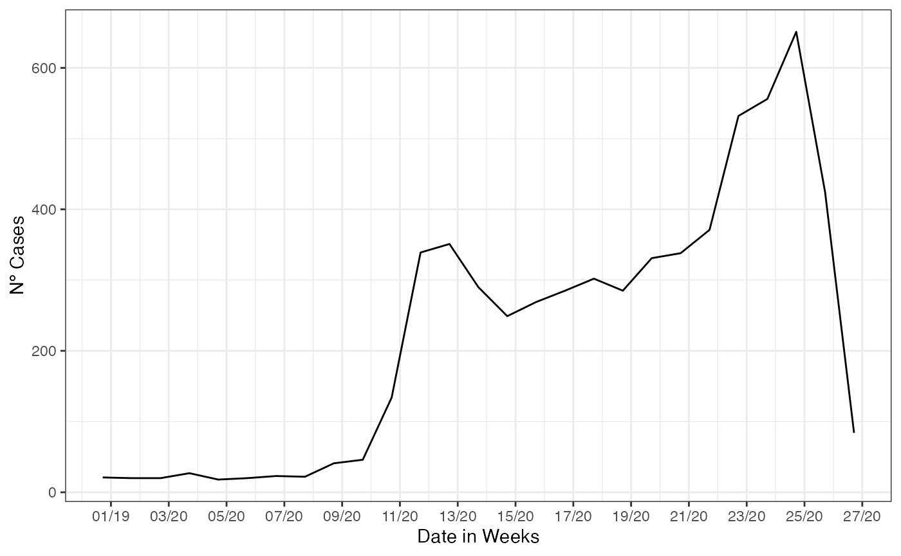
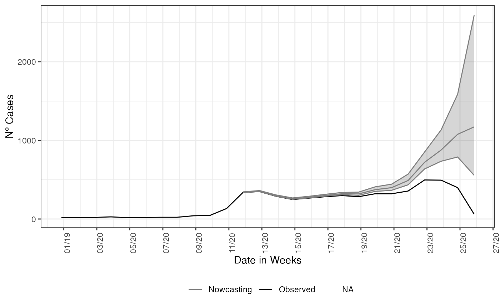
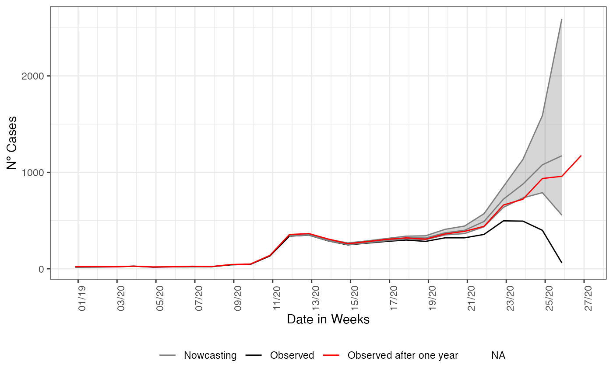

# Nowcasting for decision making

## TL;DR

This is a short example showing how helpful can be a to use nowcasting
estimate to help the decision-making process

## Nowcasting as a tool to support decision making

Nowcasting a rising curve or a curve on any other moment can give
quantitative support for decision making, during the public health
crises, the most needed is a way to anticipate, at least, what it is
happening at the moment. Nowcasting is the tool for this type of
questioning and can gives insights on the data to support needed
decisions.

We start this section by cutting the original data at a moment of
apparent decaying of the SARI hospitalization, for the city of Belo
Horizonte, which had a prompt starting response to the Covid-19
pandemic. The pressure on the health system there took more time than
the rest of the country, and the data at same time were showing a decay.
We filter all cases entered until 4th of July of 2020 by the date of
digitization, a date that the cases shows up in the database.

\
[`library`](https://rdrr.io/r/base/library.html)`(`[`tidyverse`](https://tidyverse.tidyverse.org)`)`\
[`library`](https://rdrr.io/r/base/library.html)`(`[`lubridate`](https://lubridate.tidyverse.org)`)`\
[`library`](https://rdrr.io/r/base/library.html)`(`[`nowcaster`](https://covid19br.github.io/nowcaster/)`)`\
\
`## To see Nowcasting as if we were on the verge of rise in the curve`\
[`data`](https://rdrr.io/r/utils/data.html)`(``"sragBH"``)`\
`srag_now``<-``sragBH`` ``|>`` `\
`  `[`filter`](https://dplyr.tidyverse.org/reference/filter.html)`(``DT_DIGITA`` ``<=`` ``"2020-07-04"``)`\
\
`# We now call an internal function to construct a count of cases by age to each date of onset`\
`data_by_week`` ``<-`` ``nowcaster``:::`[`data.w_no_age`](https://covid19br.github.io/nowcaster/reference/data.w_no_age.md)`(``dataset ``=`` ``srag_now``, `\
`                              date_onset ``=`` ``DT_SIN_PRI``, `\
`                              date_report ``=`` ``DT_DIGITA``)`` ``|>`` `\
`  `[`group_by`](https://dplyr.tidyverse.org/reference/group_by.html)`(``date_onset``)`` ``|>`` `\
`  `[`tally`](https://dplyr.tidyverse.org/reference/count.html)`(``)`\
\
`data_by_week`` ``|>``  `\
`  `[`ggplot`](https://ggplot2.tidyverse.org/reference/ggplot.html)`(`[`aes`](https://ggplot2.tidyverse.org/reference/aes.html)`(``x ``=`` ``date_onset``, `\
`             y ``=`` ``n``)``)``+`\
`  `[`geom_line`](https://ggplot2.tidyverse.org/reference/geom_path.html)`(``)``+`\
`  `[`theme_bw`](https://ggplot2.tidyverse.org/reference/ggtheme.html)`(``)``+`\
`  `[`labs`](https://ggplot2.tidyverse.org/reference/labs.html)`(``x ``=`` ``'Date of onset of symptons'``, `\
`       y ``=`` ``'Nº Cases'``)``+`\
`  `[`scale_color_manual`](https://ggplot2.tidyverse.org/reference/scale_manual.html)`(``values ``=`` `[`c`](https://rdrr.io/r/base/c.html)`(``'grey50'``, ``'black'``)``, `\
`                     name ``=`` ``''``)``+`\
`  `[`scale_x_date`](https://ggplot2.tidyverse.org/reference/scale_date.html)`(``date_breaks ``=`` ``'2 weeks'``, `\
`               date_labels ``=`` ``'%V/%y'``, `\
`               name ``=`` ``'Date in Weeks'``)`

On this filtered data, we estimate the cases already that started its
date of onset of symptoms but were not yet reported, so there not in the
database. We just pass to the `nowcasting_inla` function, the data set
filtered, flag for the columns where are the `date_onset` and
`date_report`, we add the flag for the function return back the epidemic
curve by epiweek.

\
`nowcasting_bh_no_age`` ``<-`` `[`nowcasting_inla`](https://covid19br.github.io/nowcaster/reference/nowcasting_inla.md)`(``dataset ``=`` ``srag_now``, `\
`                                        date_onset ``=`` ``DT_SIN_PRI``, `\
`                                        date_report ``=`` ``DT_DIGITA``, `\
`                                        data.by.week ``=`` ``T``)`\
[`head`](https://rdrr.io/r/utils/head.html)`(``nowcasting_bh_no_age``$``data``)`\
`#> ``# A tibble: 6 × 4`\
`#>   dt_event   delay     Y  Time`\
`#>   ``<date>``     ``<dbl>`` ``<dbl>`` ``<int>`\
`#> ``1`` 2019-12-29     0     1     1`\
`#> ``2`` 2019-12-29     1     2     1`\
`#> ``3`` 2019-12-29     2     4     1`\
`#> ``4`` 2019-12-29     3     5     1`\
`#> ``5`` 2019-12-29     4     2     1`\
`#> ``6`` 2019-12-29     5     2     1`

Before we see the result of the nowcasting estimate we take a look on
intermediate part of the process of nowcasting, the delay triangle,
which sets the objects for nowcasting. The delay triangle is only a
table where each unique amount of delay, (i.e. integer numbers of days
or weeks) has passed between date of onset and date of report spread
over each date of onset. The part that is closer to the present has less
counts and has a lower amount of delay, this trivial due to, as the
system takes time to process the cases, the most newer cases are lesser
than the older ones, that already time to be processed.

From the data in weekly format we mount the counts of cases by the
amount of delay. By tabling the delay amount against the data of onset
of first symptoms, to see the pattern of the delay for the cases.

\
[`library`](https://rdrr.io/r/base/library.html)`(`[`dplyr`](https://dplyr.tidyverse.org)`)`\
\
`data_triangle`` ``<-`` ``nowcasting_bh_no_age``$``data`` ``|>`` `\
`  `[`filter`](https://dplyr.tidyverse.org/reference/filter.html)`(``delay`` ``<`` ``30``)`` ``|>`` `\
`  `[`arrange`](https://dplyr.tidyverse.org/reference/arrange.html)`(``delay``)`` ``|>`` `\
`  `[`select`](https://dplyr.tidyverse.org/reference/select.html)`(``-``Time``)`\
\
`data_triangle`` ``|>`` `\
`  `[`filter`](https://dplyr.tidyverse.org/reference/filter.html)`(``dt_event`` ``>=`` ``(`[`max`](https://rdrr.io/r/base/Extremes.html)`(``dt_event``)`` ``-`` ``84``)``,`\
`         ``delay`` ``<=`` ``10``)`` ``|>`` `\
`  ``tidyr``::`[`spread`](https://tidyr.tidyverse.org/reference/spread.html)`(``key ``=`` ``delay``, value ``=`` ``Y``)`\
`#> ``# A tibble: 13 × 12`\
`` #>    dt_event     `0`   `1`   `2`   `3`   `4`   `5`   `6`   `7`   `8`   `9`  `10` ``\
`#>    ``<date>``     ``<dbl>`` ``<dbl>`` ``<dbl>`` ``<dbl>`` ``<dbl>`` ``<dbl>`` ``<dbl>`` ``<dbl>`` ``<dbl>`` ``<dbl>`` ``<dbl>`\
`#> `` 1`` 2020-03-29    23    76    70    18    27    20    16    15    11     6     2`\
`#> `` 2`` 2020-04-05    15   103    38    25    24     8    10     8     5     4     7`\
`#> `` 3`` 2020-04-12    24    79    63    30    23    21     7    12     3     4     0`\
`#> `` 4`` 2020-04-19    17   111    80    22    15    10    16     3     5     5    ``NA`\
`#> `` 5`` 2020-04-26    22   143    51    26    17    16     4    12     7    ``NA``    ``NA`\
`#> `` 6`` 2020-05-03    39   106    87    24     9     5     8     6    ``NA``    ``NA``    ``NA`\
`#> `` 7`` 2020-05-10    37   154    68    32     8    12    10    ``NA``    ``NA``    ``NA``    ``NA`\
`#> `` 8`` 2020-05-17    31   153    80    20    22    15    ``NA``    ``NA``    ``NA``    ``NA``    ``NA`\
`#> `` 9`` 2020-05-24    41   154    70    67    24    ``NA``    ``NA``    ``NA``    ``NA``    ``NA``    ``NA`\
`#> ``10`` 2020-05-31    34   174   191    98    ``NA``    ``NA``    ``NA``    ``NA``    ``NA``    ``NA``    ``NA`\
`#> ``11`` 2020-06-07    22   240   232    ``NA``    ``NA``    ``NA``    ``NA``    ``NA``    ``NA``    ``NA``    ``NA`\
`#> ``12`` 2020-06-14    44   355    ``NA``    ``NA``    ``NA``    ``NA``    ``NA``    ``NA``    ``NA``    ``NA``    ``NA`\
`#> ``13`` 2020-06-21    61    ``NA``    ``NA``    ``NA``    ``NA``    ``NA``    ``NA``    ``NA``    ``NA``    ``NA``    ``NA`

We just look at the amount of cases with 30 weeks of delay or less, it
is the default maximum delay considered at nowcasting estimation. It can
be changed by the parameter `Dmax`.

If this element is grouped by and summarized by the onset of symptoms
date, here `DT_SIN_PRI`, it is the epidemiological curve observed. To
example it, we plot the estimate and the epidemiological curve all
together.

\
[`library`](https://rdrr.io/r/base/library.html)`(`[`ggplot2`](https://ggplot2.tidyverse.org)`)`\
\
`dados_by_week`` ``<-`` ``nowcasting_bh_no_age``$``data`` ``|>`` `\
`  ``dplyr``::`[`group_by`](https://dplyr.tidyverse.org/reference/group_by.html)`(``dt_event``)`` ``|>`` `\
`  ``dplyr``::`[`reframe`](https://dplyr.tidyverse.org/reference/reframe.html)`(`\
`    observed ``=`` `[`sum`](https://rdrr.io/r/base/sum.html)`(``Y``, na.rm ``=`` ``T``)`\
`  ``)`\
\
`nowcasting_bh_no_age``$``total`` ``|>`` `\
`  `[`ggplot`](https://ggplot2.tidyverse.org/reference/ggplot.html)`(`[`aes`](https://ggplot2.tidyverse.org/reference/aes.html)`(``x ``=`` ``dt_event``, y ``=`` ``Median``, `\
`             col ``=`` ``'Nowcasting'``)``)`` ``+`\
`  `[`geom_line`](https://ggplot2.tidyverse.org/reference/geom_path.html)`(``data ``=`` ``dados_by_week``, `\
`            `[`aes`](https://ggplot2.tidyverse.org/reference/aes.html)`(``x ``=`` ``dt_event``, y ``=`` ``observed``, `\
`                col ``=`` ``'Observed'``)``)``+`\
`  `[`geom_ribbon`](https://ggplot2.tidyverse.org/reference/geom_ribbon.html)`(`[`aes`](https://ggplot2.tidyverse.org/reference/aes.html)`(``ymin ``=`` ``LI``, ymax ``=`` ``LS``, col ``=`` ``NA``)``, `\
`              alpha ``=`` ``0.2``, `\
`              show.legend ``=`` ``F``)``+`\
`  `[`geom_line`](https://ggplot2.tidyverse.org/reference/geom_path.html)`(``)``+`\
`  `[`theme_bw`](https://ggplot2.tidyverse.org/reference/ggtheme.html)`(``)``+`\
`  `[`theme`](https://ggplot2.tidyverse.org/reference/theme.html)`(``legend.position ``=`` ``"bottom"``, `\
`        axis.text.x ``=`` `[`element_text`](https://ggplot2.tidyverse.org/reference/element.html)`(``angle ``=`` ``90``)``)`` ``+`\
`  `[`scale_color_manual`](https://ggplot2.tidyverse.org/reference/scale_manual.html)`(``values ``=`` `[`c`](https://rdrr.io/r/base/c.html)`(``'grey50'``, ``'black'``)``, `\
`                     name ``=`` ``''``)``+`\
`  `[`scale_x_date`](https://ggplot2.tidyverse.org/reference/scale_date.html)`(``date_breaks ``=`` ``'2 weeks'``, `\
`               date_labels ``=`` ``'%V/%y'``, `\
`               name ``=`` ``'Date in Weeks'``)``+`\
`  `[`labs`](https://ggplot2.tidyverse.org/reference/labs.html)`(``x ``=`` ``''``, `\
`       y ``=`` ``'Nº Cases'``)`

And as expected, the nowcasting estimated a rising on curve when it were
observed a decaying. Adding to the plot what actually has happened in
that period, with the data inserted after the period for when the
nowcasting estimated the rising in the curve for SARI hospitalizations.

\
`nowcasting_bh_no_age``$``total`` `[`%>%`](https://magrittr.tidyverse.org/reference/pipe.html)` `\
`  `[`ggplot`](https://ggplot2.tidyverse.org/reference/ggplot.html)`(`[`aes`](https://ggplot2.tidyverse.org/reference/aes.html)`(``x ``=`` ``dt_event``, y ``=`` ``Median``, col ``=`` ``'Nowcasting'``)``)`` ``+`\
`  `[`geom_line`](https://ggplot2.tidyverse.org/reference/geom_path.html)`(``data ``=`` ``dados_by_week``, `\
`            `[`aes`](https://ggplot2.tidyverse.org/reference/aes.html)`(``x ``=`` ``dt_event``, y ``=`` ``observed``, col ``=`` ``'Observed'``)``)``+`\
`  `[`geom_ribbon`](https://ggplot2.tidyverse.org/reference/geom_ribbon.html)`(`[`aes`](https://ggplot2.tidyverse.org/reference/aes.html)`(``ymin ``=`` ``LI``, ymax ``=`` ``LS``, col ``=`` ``NA``)``, `\
`              alpha ``=`` ``0.2``, `\
`              show.legend ``=`` ``F``)``+`\
`  `[`geom_line`](https://ggplot2.tidyverse.org/reference/geom_path.html)`(``)``+`\
`  `[`geom_line`](https://ggplot2.tidyverse.org/reference/geom_path.html)`(`` data ``=`` ``sragBH`` `[`%>%`](https://magrittr.tidyverse.org/reference/pipe.html)\
`               `[`filter`](https://dplyr.tidyverse.org/reference/filter.html)`(``DT_SIN_PRI`` ``<=`` ``"2020-07-04"``)`` `[`%>%`](https://magrittr.tidyverse.org/reference/pipe.html)` `\
`               `[`mutate`](https://dplyr.tidyverse.org/reference/mutate.html)`(`\
`                 D_SIN_PRI_2 ``=`` ``DT_SIN_PRI`` ``-`` `[`as.numeric`](https://rdrr.io/r/base/numeric.html)`(`[`format`](https://rdrr.io/r/base/format.html)`(``DT_SIN_PRI``, ``"%w"``)``)`\
`               ``)`` `[`%>%`](https://magrittr.tidyverse.org/reference/pipe.html)` `\
`               `[`group_by`](https://dplyr.tidyverse.org/reference/group_by.html)`(``D_SIN_PRI_2``)`` `[`%>%`](https://magrittr.tidyverse.org/reference/pipe.html)` `\
`               `[`tally`](https://dplyr.tidyverse.org/reference/count.html)`(``)``, `\
`             mapping ``=`` `[`aes`](https://ggplot2.tidyverse.org/reference/aes.html)`(``x ``=`` ``D_SIN_PRI_2``, y ``=`` ``n``, `\
`                           color ``=`` ``"Observed after one year"``)``)`` ``+`` `\
`  `[`theme_bw`](https://ggplot2.tidyverse.org/reference/ggtheme.html)`(``)`` ``+`\
`  `[`theme`](https://ggplot2.tidyverse.org/reference/theme.html)`(``legend.position ``=`` ``"bottom"``, `\
`        axis.text.x ``=`` `[`element_text`](https://ggplot2.tidyverse.org/reference/element.html)`(``angle ``=`` ``90``)``)`` ``+`\
`  `[`scale_color_manual`](https://ggplot2.tidyverse.org/reference/scale_manual.html)`(``values ``=`` `[`c`](https://rdrr.io/r/base/c.html)`(``'grey50'``, ``'black'``, ``'red'``)``, `\
`                     name ``=`` ``''``)``+`\
`  `[`scale_x_date`](https://ggplot2.tidyverse.org/reference/scale_date.html)`(``date_breaks ``=`` ``'2 weeks'``, `\
`               date_labels ``=`` ``'%V/%y'``, `\
`               name ``=`` ``'Date in Weeks'``)``+`\
`  `[`labs`](https://ggplot2.tidyverse.org/reference/labs.html)`(``x ``=`` ``''``, `\
`       y ``=`` ``'Nº Cases'``)`

This end the first simple example when estimating the already started
events but not yet reported (i.e. nowcasting). The relevance of
nowcasting for public health decision is given by the understanding that
what is present on the databases are only a picture of the real time
situation. The above graph can help policy makers on what decisions they
can take in face of a rising curve of cases, hospitalizations or deaths.

## Conclusion

On this vignettes we make the case for using nowcasting as a helping
tool for decision making, by accessing the estimate with data a year
after it was observed we check the goodness of the estimates produced,
showing the nowcasting had produced at the time of observation of the
data a good estimate of the true number of cases happening.
