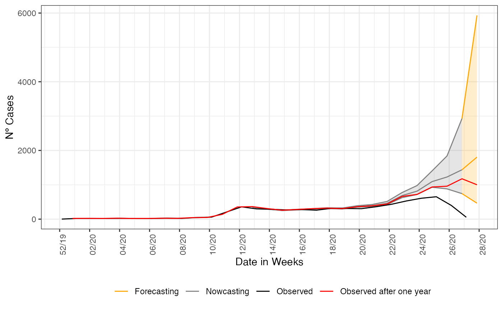
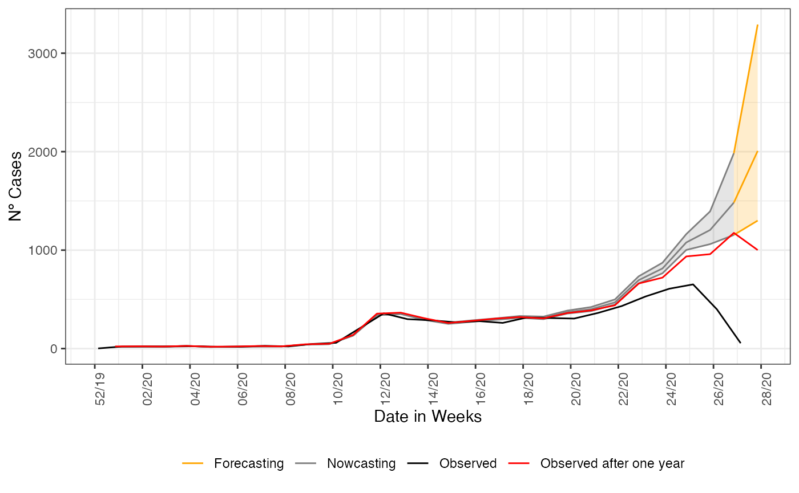

# Beyond Nowcasting, Forecasting

## TL;DR

After having learned how nowcasting works, we add unobserved dates to
our delay triangle and forecasting, i.e. project the number of cases
beyond the data already observed.

## Forecasting

Nowcasting is the estimation of the events that are already started but
not yet reported. In epidemiology, the events as like cases of an
infectious disease that has onset its first symptoms but are not yet
captured from the notification system. Forecasting is simply the
estimation of the events that are not yet started its onset of first
symptoms, i.e. cases that are in a probable incubation period. From the
data structure that any databases has is basically the cases that has a
date of onset greater than present date. In the language of delay
triangle, forecasting will be only to estimate the part that is
completely unobserved.

## Parameter K \> 0

The `nowcasting_inla` function has a functional parameter that flags to
the model parsed to `inla` to construct the delay triangle with dates
greater than the present date. This is done by the setting the `K`
parameter to a value greater than 0, like K = 1,2,3,\dots. We proceed as
in any other example of nowcasting. We will forecasting as was done for
nowcasting in the article [Nowcasting for decision
making](https://covid19br.github.io/nowcaster/articles/2_nowcasting_importance.html).

First, we cut the lazy data loaded with the namespace of the package to
a date of interest, more details on why we cut on this date see the
article [Nowcasting for decision
making](https://covid19br.github.io/nowcaster/articles/2_nowcasting_importance.html).
And after this we parse to the `nowcasting_inla` function the date of
onset and date of report columns, a flag for returning a data.frame with
the cases counts by week and setting the `K` parameter to a desired
forecasting horizon, here we forecast one week ahead of the present
date.

Before forecasting, we construct the case counts curve from the lazy
data, by using the internal function `data.w_no_age`, we construct the
curve by summarizing the case counts by each date of onset of first
symptoms present at the database.

\
[`library`](https://rdrr.io/r/base/library.html)`(`[`tidyverse`](https://tidyverse.tidyverse.org)`)`\
[`library`](https://rdrr.io/r/base/library.html)`(`[`lubridate`](https://lubridate.tidyverse.org)`)`\
[`library`](https://rdrr.io/r/base/library.html)`(`[`nowcaster`](https://covid19br.github.io/nowcaster/)`)`\
\
`## To see Nowcasting as if we were on the verge of rise in the curve`\
[`data`](https://rdrr.io/r/utils/data.html)`(``"sragBH"``)`\
`srag_now`` ``<-`` ``sragBH`` ``|>`` `\
`  `[`filter`](https://dplyr.tidyverse.org/reference/filter.html)`(``DT_DIGITA`` ``<=`` ``"2020-07-06"``)`\
\
`data_by_week`` ``<-`` ``nowcaster``:::`[`data.w_no_age`](https://covid19br.github.io/nowcaster/reference/data.w_no_age.md)`(``dataset ``=`` ``srag_now``, `\
`                             date_onset ``=`` ``DT_SIN_PRI``, `\
`                             date_report ``=`` ``DT_DIGITA``, `\
`                             K ``=`` ``0``)`` ``|>`` `\
`  `[`group_by`](https://dplyr.tidyverse.org/reference/group_by.html)`(``date_onset``)`` ``|>`` `\
`  `[`tally`](https://dplyr.tidyverse.org/reference/count.html)`(``)`\
\
`data_by_week`` ``|>``  `\
`  `[`ggplot`](https://ggplot2.tidyverse.org/reference/ggplot.html)`(`[`aes`](https://ggplot2.tidyverse.org/reference/aes.html)`(``x ``=`` ``date_onset``, `\
`             y ``=`` ``n``)``)``+`\
`  `[`geom_line`](https://ggplot2.tidyverse.org/reference/geom_path.html)`(``)``+`\
`  `[`theme_bw`](https://ggplot2.tidyverse.org/reference/ggtheme.html)`(``)``+`\
`  `[`labs`](https://ggplot2.tidyverse.org/reference/labs.html)`(``x ``=`` ``'Date of onset of symptons'``, `\
`       y ``=`` ``'Nº Cases'``)``+`\
`  `[`scale_color_manual`](https://ggplot2.tidyverse.org/reference/scale_manual.html)`(``values ``=`` `[`c`](https://rdrr.io/r/base/c.html)`(``'grey50'``, ``'black'``)``, `\
`                     name ``=`` ``''``)``+`\
`  `[`scale_x_date`](https://ggplot2.tidyverse.org/reference/scale_date.html)`(``date_breaks ``=`` ``'2 weeks'``, `\
`               date_labels ``=`` ``'%V/%y'``, `\
`               name ``=`` ``'Date in Weeks'``)`

Now, to forecast one week ahead we just flag the `K = 1`, and proceed as
in normal nowcasting calling, the code is:

\
`nowcasting_bh_no_age`` ``<-`` `[`nowcasting_inla`](https://covid19br.github.io/nowcaster/reference/nowcasting_inla.md)`(``dataset ``=`` ``srag_now``, `\
`                                        date_onset ``=`` ``DT_SIN_PRI``, `\
`                                        date_report ``=`` ``DT_DIGITA``, `\
`                                        data.by.week ``=`` ``T``, `\
`                                        K ``=`` ``1``)`\
[`head`](https://rdrr.io/r/utils/head.html)`(``nowcasting_bh_no_age``$``data``)`\
`#> ``# A tibble: 6 × 4`\
`#>   dt_event   delay     Y  Time`\
`#>   ``<date>``     ``<dbl>`` ``<dbl>`` ``<int>`\
`#> ``1`` 2019-12-29     0     1     1`\
`#> ``2`` 2019-12-29     1     2     1`\
`#> ``3`` 2019-12-29     2     4     1`\
`#> ``4`` 2019-12-29     3     5     1`\
`#> ``5`` 2019-12-29     4     2     1`\
`#> ``6`` 2019-12-29     5     2     1`

To visualize the forecast we plot the observed curve and the nowcasting
and forecasting estimate, change the colors for each part. We plot
together the nowcasting and forecasting estimate, the curve observed one
year later, to validate the estimate done.

\
\
`## Nowcasting estimate filtering`\
`nowcasting_estimate``<-``nowcasting_bh_no_age``$``total`` ``|>`` `\
`  `[`filter`](https://dplyr.tidyverse.org/reference/filter.html)`(``dt_event`` ``<=`` ``"2020-06-28"``)`\
`## Forecasting estimate filtering`\
`forecasting_estimate``<-``nowcasting_bh_no_age``$``total`` ``|>`` `\
`  `[`filter`](https://dplyr.tidyverse.org/reference/filter.html)`(``dt_event`` ``>=`` ``"2020-06-28"``)`\
\
`## One year after observed`\
`data_one_year_after``<-``sragBH`` `[`%>%`](https://magrittr.tidyverse.org/reference/pipe.html)\
`  `[`filter`](https://dplyr.tidyverse.org/reference/filter.html)`(``DT_SIN_PRI`` ``<=`` ``"2020-07-11"``)`` `[`%>%`](https://magrittr.tidyverse.org/reference/pipe.html)` `\
`  `[`mutate`](https://dplyr.tidyverse.org/reference/mutate.html)`(`\
`    D_SIN_PRI_2 ``=`` ``DT_SIN_PRI`` ``-`` `[`as.numeric`](https://rdrr.io/r/base/numeric.html)`(`[`format`](https://rdrr.io/r/base/format.html)`(``DT_SIN_PRI``, ``"%w"``)``)`\
`  ``)`` `[`%>%`](https://magrittr.tidyverse.org/reference/pipe.html)` `\
`  `[`group_by`](https://dplyr.tidyverse.org/reference/group_by.html)`(``D_SIN_PRI_2``)`` `[`%>%`](https://magrittr.tidyverse.org/reference/pipe.html)` `\
`  `[`tally`](https://dplyr.tidyverse.org/reference/count.html)`(``)`\
\
\
`## Plotting`\
`nowcasting_estimate`` ``|>`` `\
`  `[`ggplot`](https://ggplot2.tidyverse.org/reference/ggplot.html)`(`[`aes`](https://ggplot2.tidyverse.org/reference/aes.html)`(``x ``=`` ``dt_event``, y ``=`` ``Median``, col ``=`` ``"Nowcasting"``)``)``+`\
`  `[`geom_line`](https://ggplot2.tidyverse.org/reference/geom_path.html)`(``)``+`\
`  `[`geom_ribbon`](https://ggplot2.tidyverse.org/reference/geom_ribbon.html)`(`[`aes`](https://ggplot2.tidyverse.org/reference/aes.html)`(``ymin ``=`` ``LI``, ymax ``=`` ``LS``, col ``=`` ``"Nowcasting"``, fill ``=`` ``"Nowcasting"``)``, `\
`              alpha ``=`` ``0.2``, `\
`              show.legend ``=`` ``F``)``+`\
`  `[`geom_line`](https://ggplot2.tidyverse.org/reference/geom_path.html)`(``data ``=`` ``forecasting_estimate``, `\
`            `[`aes`](https://ggplot2.tidyverse.org/reference/aes.html)`(``x ``=`` ``dt_event``, y ``=`` ``Median``, col ``=`` ``"Forecasting"``)``)``+`\
`  `[`geom_ribbon`](https://ggplot2.tidyverse.org/reference/geom_ribbon.html)`(``data ``=`` ``forecasting_estimate``, `\
`              `[`aes`](https://ggplot2.tidyverse.org/reference/aes.html)`(``ymin ``=`` ``LI``, ymax ``=`` ``LS``, col ``=`` ``"Forecasting"``, fill ``=`` ``"Forecasting"``)``, `\
`              alpha ``=`` ``0.2``,`\
`              show.legend ``=`` ``F``)``+`\
`  `[`geom_line`](https://ggplot2.tidyverse.org/reference/geom_path.html)`(``data ``=`` ``data_by_week``, `\
`            `[`aes`](https://ggplot2.tidyverse.org/reference/aes.html)`(``date_onset``, y ``=`` ``n``, col ``=`` ``'Observed'``)``)``+`\
`  `[`geom_line`](https://ggplot2.tidyverse.org/reference/geom_path.html)`(``data ``=`` ``data_one_year_after``, `\
`            mapping ``=`` `[`aes`](https://ggplot2.tidyverse.org/reference/aes.html)`(``x ``=`` ``D_SIN_PRI_2``, y ``=`` ``n``, `\
`                          color ``=`` ``"Observed after one year"``)``)`` ``+`` `\
`  `[`theme_bw`](https://ggplot2.tidyverse.org/reference/ggtheme.html)`(``)`` ``+`\
`  `[`theme`](https://ggplot2.tidyverse.org/reference/theme.html)`(``legend.position ``=`` ``"bottom"``, `\
`        axis.text.x ``=`` `[`element_text`](https://ggplot2.tidyverse.org/reference/element.html)`(``angle ``=`` ``90``)``)`` ``+`\
`  `[`scale_color_manual`](https://ggplot2.tidyverse.org/reference/scale_manual.html)`(``values ``=`` `[`c`](https://rdrr.io/r/base/c.html)`(``'orange'``,``'grey50'``, ``'black'``, ``'red'``)``, `\
`                     name ``=`` ``''``)``+`\
`  `[`scale_fill_manual`](https://ggplot2.tidyverse.org/reference/scale_manual.html)`(``values ``=`` `[`c`](https://rdrr.io/r/base/c.html)`(``'orange'``,``'grey50'``)``, `\
`                     name ``=`` ``''``)``+`\
`  `[`scale_x_date`](https://ggplot2.tidyverse.org/reference/scale_date.html)`(``date_breaks ``=`` ``'2 weeks'``, `\
`               date_labels ``=`` ``'%V/%y'``, `\
`               name ``=`` ``'Date in Weeks'``)``+`\
`  `[`labs`](https://ggplot2.tidyverse.org/reference/labs.html)`(``x ``=`` ``''``, `\
`       y ``=`` ``'Nº Cases'``)`

## Uncertainty grows

As we try to forecasting longer ahead of the present date, the
uncertainty has to grow. This is saw by the opening of the confidence
intervals on the last graph. Although it is wide the realized curve
still falls inside it, indicating that is assertive on the tendency of
the curve at least. This can be taken to support decision making when
planning ahead of the present date. To any other forecasting horizon
further than 1 week ahead, the confidence interval will be wider than
this, to help a little we can try a forecasting with an imposed
structured on the data. Now, we forecasting parsing the columns for age
to the nowcasting function, this can reduce the opening of the
confidence interval.

\
`nowcasting_bh_age`` ``<-`` `[`nowcasting_inla`](https://covid19br.github.io/nowcaster/reference/nowcasting_inla.md)`(``dataset ``=`` ``srag_now``, `\
`                                     date_onset ``=`` ``DT_SIN_PRI``, `\
`                                     date_report ``=`` ``DT_DIGITA``, `\
`                                     data.by.week ``=`` ``T``,`\
`                                     K ``=`` ``1``,`\
`                                     age_col ``=`` ``Idade``)`\
[`head`](https://rdrr.io/r/utils/head.html)`(``nowcasting_bh_age``$``data``)`\
`#> ``# A tibble: 6 × 5`\
`#>   dt_event   delay fx_etaria     Y  Time`\
`#>   ``<date>``     ``<dbl>`` ``<fct>``     ``<dbl>`` ``<int>`\
`#> ``1`` 2019-12-29     0 1             0     1`\
`#> ``2`` 2019-12-29     0 2             0     1`\
`#> ``3`` 2019-12-29     0 3             0     1`\
`#> ``4`` 2019-12-29     0 4             0     1`\
`#> ``5`` 2019-12-29     0 5             0     1`\
`#> ``6`` 2019-12-29     0 6             0     1`

And we plot the nowcasting estimate and forecasting estimate again:

\
\
`## Nowcasting estimate filtering`\
`nowcasting_estimate``<-``nowcasting_bh_age``$``total`` ``|>`` `\
`  `[`filter`](https://dplyr.tidyverse.org/reference/filter.html)`(``dt_event`` ``<=`` ``"2020-06-28"``)`\
`## Forecasting estimate filtering`\
`forecasting_estimate``<-``nowcasting_bh_age``$``total`` ``|>`` `\
`  `[`filter`](https://dplyr.tidyverse.org/reference/filter.html)`(``dt_event`` ``>=`` ``"2020-06-28"``)`\
\
`## Plotting`\
`nowcasting_estimate`` ``|>`` `\
`  `[`ggplot`](https://ggplot2.tidyverse.org/reference/ggplot.html)`(`[`aes`](https://ggplot2.tidyverse.org/reference/aes.html)`(``x ``=`` ``dt_event``, y ``=`` ``Median``, col ``=`` ``"Nowcasting"``)``)``+`\
`  `[`geom_line`](https://ggplot2.tidyverse.org/reference/geom_path.html)`(``)``+`\
`  `[`geom_ribbon`](https://ggplot2.tidyverse.org/reference/geom_ribbon.html)`(`[`aes`](https://ggplot2.tidyverse.org/reference/aes.html)`(``ymin ``=`` ``LI``, ymax ``=`` ``LS``, col ``=`` ``"Nowcasting"``, fill ``=`` ``"Nowcasting"``)``, `\
`              alpha ``=`` ``0.2``, `\
`              show.legend ``=`` ``F``)``+`\
`  `[`geom_line`](https://ggplot2.tidyverse.org/reference/geom_path.html)`(``data ``=`` ``forecasting_estimate``, `\
`            `[`aes`](https://ggplot2.tidyverse.org/reference/aes.html)`(``x ``=`` ``dt_event``, y ``=`` ``Median``, col ``=`` ``"Forecasting"``)``)``+`\
`  `[`geom_ribbon`](https://ggplot2.tidyverse.org/reference/geom_ribbon.html)`(``data ``=`` ``forecasting_estimate``, `\
`              `[`aes`](https://ggplot2.tidyverse.org/reference/aes.html)`(``ymin ``=`` ``LI``, ymax ``=`` ``LS``, col ``=`` ``"Forecasting"``, fill ``=`` ``"Forecasting"``)``, `\
`              alpha ``=`` ``0.2``,`\
`              show.legend ``=`` ``F``)``+`\
`  `[`geom_line`](https://ggplot2.tidyverse.org/reference/geom_path.html)`(``data ``=`` ``data_by_week``, `\
`            `[`aes`](https://ggplot2.tidyverse.org/reference/aes.html)`(``date_onset``, y ``=`` ``n``, col ``=`` ``'Observed'``)``)``+`\
`  `[`geom_line`](https://ggplot2.tidyverse.org/reference/geom_path.html)`(``data ``=`` ``data_one_year_after``, `\
`            mapping ``=`` `[`aes`](https://ggplot2.tidyverse.org/reference/aes.html)`(``x ``=`` ``D_SIN_PRI_2``, y ``=`` ``n``, `\
`                          color ``=`` ``"Observed after one year"``)``)`` ``+`` `\
`  `[`theme_bw`](https://ggplot2.tidyverse.org/reference/ggtheme.html)`(``)`` ``+`\
`  `[`theme`](https://ggplot2.tidyverse.org/reference/theme.html)`(``legend.position ``=`` ``"bottom"``, `\
`        axis.text.x ``=`` `[`element_text`](https://ggplot2.tidyverse.org/reference/element.html)`(``angle ``=`` ``90``)``)`` ``+`\
`  `[`scale_color_manual`](https://ggplot2.tidyverse.org/reference/scale_manual.html)`(``values ``=`` `[`c`](https://rdrr.io/r/base/c.html)`(``'orange'``,``'grey50'``, ``'black'``, ``'red'``)``, `\
`                     name ``=`` ``''``)``+`\
`  `[`scale_fill_manual`](https://ggplot2.tidyverse.org/reference/scale_manual.html)`(``values ``=`` `[`c`](https://rdrr.io/r/base/c.html)`(``'orange'``,``'grey50'``)``, `\
`                     name ``=`` ``''``)``+`\
`  `[`scale_x_date`](https://ggplot2.tidyverse.org/reference/scale_date.html)`(``date_breaks ``=`` ``'2 weeks'``, `\
`               date_labels ``=`` ``'%V/%y'``, `\
`               name ``=`` ``'Date in Weeks'``)``+`\
`  `[`labs`](https://ggplot2.tidyverse.org/reference/labs.html)`(``x ``=`` ``''``, `\
`       y ``=`` ``'Nº Cases'``)`

## Conclusion

On this vignette we explored the forecasting estimates that the model
can produces. We have add the `K` parameter different than 0 meaning we
want an estimate that goes beyond the partial unobserved data. We
further compared forecasting produced considering age class as another
predictor, as explored on the [Nowcasting on Structured
data](https://covid19br.github.io/nowcaster/articles/1_structured_data.html),
we fit a model to each of the age classes present on the data but now we
make use of `K` equals to 1, meaning to add a line of complete
unobserved dates to the delay triangle.
