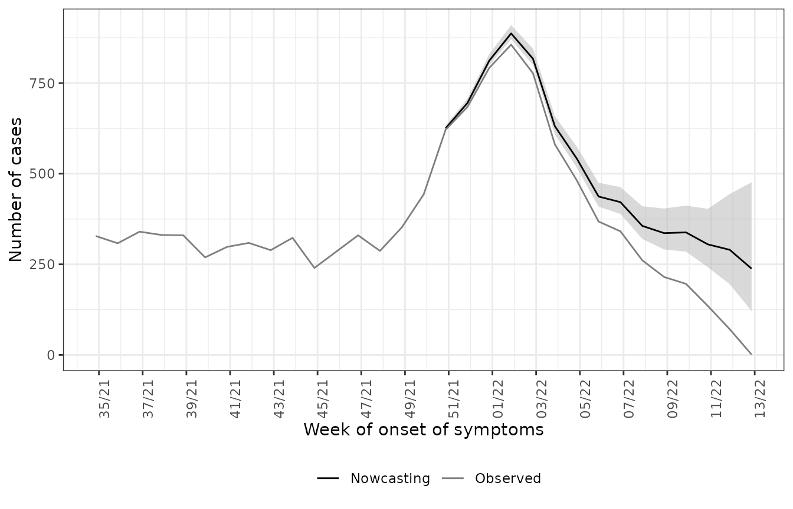
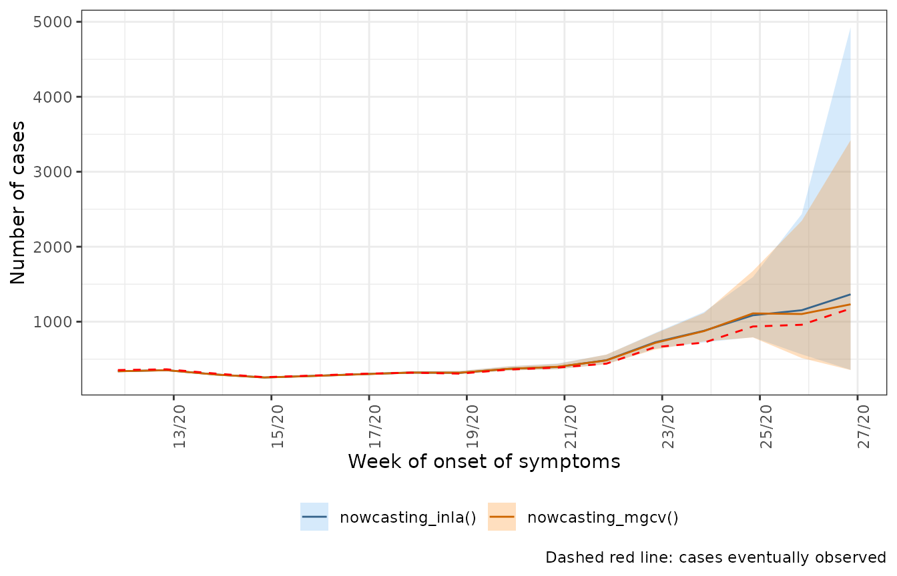

# nowcasting_inla() or nowcasting_mgcv()

## Two functions, one model

`nowcaster` has two workhorse functions that fit the same model: a
negative binomial model for the delay triangle, with a smooth effect for
the week of onset and another for the reporting delay.

- [`nowcasting_inla()`](https://covid19br.github.io/nowcaster/reference/nowcasting_inla.md)
  fits it in a fully Bayesian way with
  [`INLA`](https://www.r-inla.org/download-install), with random walk
  priors for the time and delay effects.
- [`nowcasting_mgcv()`](https://covid19br.github.io/nowcaster/reference/nowcasting_mgcv.md)
  fits it as a generalised additive model with
  [`mgcv`](https://CRAN.R-project.org/package=mgcv), with penalised
  splines for the time and delay effects.

Both take the same main arguments and return the same output, so
switching from one to the other is a matter of changing the function
name. In this article each example is shown for both functions: **use
the tabs above each code block to switch between them**. Choosing a tab
switches all the examples on the page.

|  | [`nowcasting_inla()`](https://covid19br.github.io/nowcaster/reference/nowcasting_inla.md) | [`nowcasting_mgcv()`](https://covid19br.github.io/nowcaster/reference/nowcasting_mgcv.md) |
|----|----|----|
| Fitting engine | `INLA` (not on CRAN) | `mgcv` (on CRAN, installed with `nowcaster`) |
| Time and delay effects | random walks (`rw2`, `rw1`) | penalised thin plate splines |
| Uncertainty | posterior samples of the latent field and hyperparameters | samples of the coefficients, dispersion fixed at its estimate |
| Extra options | `zero_inflated`, `timeREmodel`, `INLAoutput`, `WAIC`, `DIC` | `method.group.gam` |

## Data

``` r

library(nowcaster)
library(dplyr)
library(ggplot2)

data(sragBH)

# A helper to plot an estimate together with the curve observed at the time
plot_nowcast <- function(estimate, observed) {
  ggplot(estimate, aes(x = dt_event)) +
    geom_ribbon(aes(ymin = LI, ymax = LS), fill = "grey70", alpha = 0.5) +
    geom_line(aes(y = Median, colour = "Nowcasting")) +
    geom_line(data = observed, aes(y = observed, colour = "Observed")) +
    scale_colour_manual(values = c(Nowcasting = "black", Observed = "grey50"),
                        name = "") +
    scale_x_date(date_breaks = "2 weeks", date_labels = "%V/%y") +
    labs(x = "Week of onset of symptoms", y = "Number of cases") +
    theme_bw() +
    theme(legend.position = "bottom", axis.text.x = element_text(angle = 90))
}
```

## Nowcasting

### Fit

- INLA
- mgcv

``` r

now_inla <- nowcasting_inla(dataset = sragBH,
                            date_onset = DT_SIN_PRI,
                            date_report = DT_DIGITA,
                            data.by.week = TRUE)
head(now_inla$total)
```

    #> # A tibble: 6 × 7
    #>    Time dt_event   Median    LI    LS   LIb   LSb
    #>   <int> <date>      <dbl> <dbl> <dbl> <dbl> <dbl>
    #> 1    17 2021-12-19    625   621  633    623   627
    #> 2    18 2021-12-26    695   687  708    692   698
    #> 3    19 2022-01-02    812   800  829    807   817
    #> 4    20 2022-01-09    887   871  908    881   893
    #> 5    21 2022-01-16    818   799  846.   811   826
    #> 6    22 2022-01-23    629   610  660    621   639

``` r

now_mgcv <- nowcasting_mgcv(dataset = sragBH,
                            date_onset = DT_SIN_PRI,
                            date_report = DT_DIGITA,
                            data.by.week = TRUE)
head(now_mgcv$total)
```

    #> # A tibble: 6 × 7
    #>    Time dt_event   Median    LI    LS   LIb   LSb
    #>   <int> <date>      <dbl> <dbl> <dbl> <dbl> <dbl>
    #> 1    17 2021-12-19    625   621   633   623   627
    #> 2    18 2021-12-26    695   687   707   692   698
    #> 3    19 2022-01-02    812   800   830   807   817
    #> 4    20 2022-01-09    887   871   910   881   894
    #> 5    21 2022-01-16    817   800   845   811   826
    #> 6    22 2022-01-23    631   609   659   623   640

### Plot

The delay triangle in the element `data` is the same for both functions;
summing over the delays gives the curve observed at the time of the last
record.

- INLA
- mgcv

``` r

observed <- now_inla$data |>
  group_by(dt_event) |>
  summarise(observed = sum(Y, na.rm = TRUE))

plot_nowcast(now_inla$total, observed)
```


``` r

observed <- now_mgcv$data |>
  group_by(dt_event) |>
  summarise(observed = sum(Y, na.rm = TRUE))

plot_nowcast(now_mgcv$total, observed)
```



## Nowcasting by age

With `age_col` both functions fit the structured model, with time and
delay effects for each age class.
[`nowcasting_inla()`](https://covid19br.github.io/nowcaster/reference/nowcasting_inla.md)
uses an independent effect per age class for the random walks;
[`nowcasting_mgcv()`](https://covid19br.github.io/nowcaster/reference/nowcasting_mgcv.md)
uses a factor smooth (`method.group.gam = "fs"`, the default) or one
smooth per age class (`method.group.gam = "by"`).

### Fit

- INLA
- mgcv

``` r

now_age_inla <- nowcasting_inla(dataset = sragBH,
                                date_onset = DT_SIN_PRI,
                                date_report = DT_DIGITA,
                                age_col = Idade,
                                bins_age = "10 years")
head(now_age_inla$age)
```

    #> # A tibble: 6 × 9
    #>    Time dt_event   fx_etaria fx_etaria.num Median    LI    LS   LIb   LSb
    #>   <int> <date>     <fct>             <dbl>  <dbl> <dbl> <dbl> <dbl> <dbl>
    #> 1    17 2021-12-19 1                     1    123   122   126   122   123
    #> 2    17 2021-12-19 2                     2     15    15    16    15    15
    #> 3    17 2021-12-19 3                     3     20    20    22    20    20
    #> 4    17 2021-12-19 4                     4     30    30    31    30    30
    #> 5    17 2021-12-19 5                     5     29    29    31    29    30
    #> 6    17 2021-12-19 6                     6     68    68    70    68    69

``` r

now_age_mgcv <- nowcasting_mgcv(dataset = sragBH,
                                date_onset = DT_SIN_PRI,
                                date_report = DT_DIGITA,
                                age_col = Idade,
                                bins_age = "10 years")
head(now_age_mgcv$age)
```

    #> # A tibble: 6 × 9
    #>    Time dt_event   fx_etaria fx_etaria.num Median    LI    LS   LIb   LSb
    #>   <int> <date>     <fct>             <dbl>  <dbl> <dbl> <dbl> <dbl> <dbl>
    #> 1    17 2021-12-19 1                     1    123   122   126   122   124
    #> 2    17 2021-12-19 2                     2     15    15    17    15    15
    #> 3    17 2021-12-19 3                     3     20    20    22    20    20
    #> 4    17 2021-12-19 4                     4     30    30    31    30    30
    #> 5    17 2021-12-19 5                     5     29    29    31    29    30
    #> 6    17 2021-12-19 6                     6     68    68    70    68    69

## Forecasting

With `K > 0` both functions also forecast the weeks after the last onset
week. Here we cut the data on 4 July 2020 and forecast one week ahead.

``` r

srag_2020 <- sragBH |>
  filter(DT_DIGITA <= as.Date("2020-07-04"))
```

### Fit

- INLA
- mgcv

``` r

fc_inla <- nowcasting_inla(dataset = srag_2020,
                           date_onset = DT_SIN_PRI,
                           date_report = DT_DIGITA,
                           K = 1)
tail(fc_inla$total, 3)
```

    #> # A tibble: 3 × 7
    #>    Time dt_event   Median    LI    LS   LIb   LSb
    #>   <int> <date>      <dbl> <dbl> <dbl> <dbl> <dbl>
    #> 1    25 2020-06-14  1086.  793  1595.  964. 1252.
    #> 2    26 2020-06-21  1153   564. 2435.  905  1484.
    #> 3    27 2020-06-28  1364.  358. 4927.  894. 2140.

``` r

fc_mgcv <- nowcasting_mgcv(dataset = srag_2020,
                           date_onset = DT_SIN_PRI,
                           date_report = DT_DIGITA,
                           K = 1)
tail(fc_mgcv$total, 3)
```

    #> # A tibble: 3 × 7
    #>    Time dt_event   Median    LI    LS   LIb   LSb
    #>   <int> <date>      <dbl> <dbl> <dbl> <dbl> <dbl>
    #> 1    25 2020-06-14  1110.  790  1677   982. 1262 
    #> 2    26 2020-06-21  1102.  515. 2345.  852. 1408.
    #> 3    27 2020-06-28  1232.  355. 3421.  825. 1774.

## Comparing the estimates

Putting both estimates on the same plot, together with the curve that
was eventually observed, shows how close they are.

``` r

eventually_observed <- sragBH |>
  mutate(dt_event = DT_SIN_PRI - as.numeric(format(DT_SIN_PRI, "%w"))) |>
  count(dt_event, name = "observed")

both <- bind_rows(
  fc_inla$total |> mutate(model = "nowcasting_inla()"),
  fc_mgcv$total |> mutate(model = "nowcasting_mgcv()")
)

ggplot(both, aes(x = dt_event)) +
  geom_ribbon(aes(ymin = LI, ymax = LS, fill = model), alpha = 0.25) +
  geom_line(aes(y = Median, colour = model)) +
  geom_line(data = eventually_observed |>
              filter(dt_event >= min(both$dt_event),
                     dt_event <= max(both$dt_event)),
            aes(y = observed), colour = "red", linetype = "dashed") +
  scale_colour_manual(values = c("steelblue4", "darkorange3"), name = "") +
  scale_fill_manual(values = c("steelblue2", "darkorange1"), name = "") +
  scale_x_date(date_breaks = "2 weeks", date_labels = "%V/%y") +
  labs(x = "Week of onset of symptoms", y = "Number of cases",
       caption = "Dashed red line: cases eventually observed") +
  theme_bw() +
  theme(legend.position = "bottom", axis.text.x = element_text(angle = 90))
```



The width of the 95% intervals in the most recent weeks:

``` r

both |>
  group_by(model) |>
  slice_tail(n = 4) |>
  mutate(width_95 = LS - LI) |>
  select(model, dt_event, Median, LI, LS, width_95)
```

    #> # A tibble: 8 × 6
    #> # Groups:   model [2]
    #>   model             dt_event   Median    LI    LS width_95
    #>   <chr>             <date>      <dbl> <dbl> <dbl>    <dbl>
    #> 1 nowcasting_inla() 2020-06-07   879   724. 1130.     406.
    #> 2 nowcasting_inla() 2020-06-14  1086.  793  1595.     802.
    #> 3 nowcasting_inla() 2020-06-21  1153   564. 2435.    1871.
    #> 4 nowcasting_inla() 2020-06-28  1364.  358. 4927.    4569.
    #> 5 nowcasting_mgcv() 2020-06-07   875   737. 1115.     378.
    #> 6 nowcasting_mgcv() 2020-06-14  1110.  790  1677      887 
    #> 7 nowcasting_mgcv() 2020-06-21  1102.  515. 2345.    1830.
    #> 8 nowcasting_mgcv() 2020-06-28  1232.  355. 3421.    3066.

## Which one to use

- [`nowcasting_mgcv()`](https://covid19br.github.io/nowcaster/reference/nowcasting_mgcv.md)
  needs only CRAN packages. It is a good default when `INLA` is not
  available or for routine use.
- [`nowcasting_inla()`](https://covid19br.github.io/nowcaster/reference/nowcasting_inla.md)
  is the fully Bayesian version of the model. It propagates the
  uncertainty of all parameters, including the dispersion, and offers
  the options of the original model (zero-inflation, other latent models
  for time, model comparison with WAIC and DIC).

The two functions share the data preparation and the summary of the
trajectories, so differences between their estimates come from the model
fit only.
