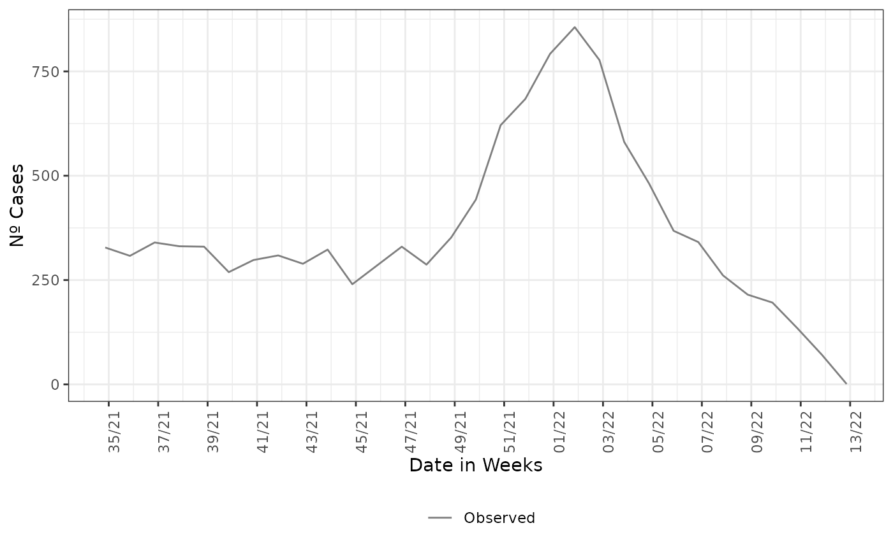
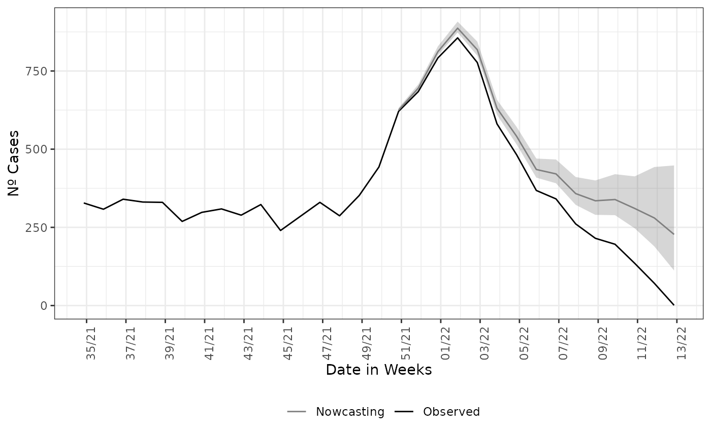

# Get Started

## First example

When the package is loaded it provides a Lazy Data file, `sragBH`, it is
an anonymized records of Severe Acute Respiratory Illness notified in
the city of Belo Horizonte, since March 2020 to April 2022. To load it
basically write:

``` r

library(nowcaster)
# Loading Belo Horizonte SARI data set
data(sragBH)
```

And we take a look on the data:

``` r

head(sragBH)
```

    #>   DT_SIN_PRI  DT_DIGITA CLASSI_FIN EVOLUCAO CO_MUN_RES Idade fx_etaria
    #> 1 2020-02-11 2020-03-05          4        1     310620    59   50 - 59
    #> 2 2020-01-21 2020-02-06          4        1     310620    79   70 - 79
    #> 3 2020-03-30 2020-04-17          4        1     310620    72   70 - 79
    #> 4 2020-03-26 2020-04-02          4        1     310620    82      80 +
    #> 5 2020-03-20 2020-04-13          4        1     310620    50   50 - 59
    #> 6 2020-04-07 2020-04-22          5        1     310620    74   70 - 79

It is a data.frame with 7 variables and 65,404 observations. We will
make use of only the first two columns, “DT_SIN_PRI” (date of onset
symptoms) and “DT_DIGITA” (recording date) as well the column “Idade”
(age in years) to make age structured nowcasting.

The call of the function is straightforward, it simply needs a data set
as input, here the `LazyData` loaded in the namespace of the package.
The function has 3 mandatory parameters, `dataset` for the parsing of
the data set to be nowcasted, `date_onset` for parsing the column name
which is the date of onset of symptoms and `date_report` which parses
the column name for the date of report of the cases. Here this columns
are “DT_SIN_PRI” and “DT_DIGITA”, respectively.

### Nowcasting estimate

Use the tabs to see the same analysis with
[`nowcasting_inla()`](https://covid19br.github.io/nowcaster/reference/nowcasting_inla.md)
(INLA) or with
[`nowcasting_mgcv()`](https://covid19br.github.io/nowcaster/reference/nowcasting_mgcv.md)
(mgcv). Choosing a tab switches all the tabs on the page.

- INLA
- mgcv

``` r

nowcasting_bh_no_age <- nowcasting_inla(dataset = sragBH, 
                                        date_onset = "DT_SIN_PRI", 
                                        date_report = "DT_DIGITA", 
                                        data.by.week = T)
head(nowcasting_bh_no_age$total)
```

    #> # A tibble: 6 × 7
    #>    Time dt_event   Median    LI    LS   LIb   LSb
    #>   <int> <date>      <dbl> <dbl> <dbl> <dbl> <dbl>
    #> 1    17 2021-12-19    625   621  632    623  627 
    #> 2    18 2021-12-26    695   687  707.   692  699 
    #> 3    19 2022-01-02    812   800  829.   807  817 
    #> 4    20 2022-01-09    887   873  908    881  893 
    #> 5    21 2022-01-16    818   799  844.   811  827 
    #> 6    22 2022-01-23    631   610  658.   623  639.

``` r

nowcasting_bh_no_age_mgcv <- nowcasting_mgcv(dataset = sragBH, 
                                        date_onset = "DT_SIN_PRI", 
                                        date_report = "DT_DIGITA", 
                                        data.by.week = T)
head(nowcasting_bh_no_age_mgcv$total)
```

    #> # A tibble: 6 × 7
    #>    Time dt_event   Median    LI    LS   LIb   LSb
    #>   <int> <date>      <dbl> <dbl> <dbl> <dbl> <dbl>
    #> 1    17 2021-12-19    625   621   633   623   627
    #> 2    18 2021-12-26    695   687   708   691   698
    #> 3    19 2022-01-02    812   801   829   807   817
    #> 4    20 2022-01-09    888   872   909   881   894
    #> 5    21 2022-01-16    818   798   844   810   826
    #> 6    22 2022-01-23    630   608   659   622   639

### The observed epidemic curve

This calling will return for the first element, `total`, the nowcasting
estimate (`Median`) and its intervals at two levels: `LIb` and `LSb` are
the lower and upper limits of the 50% interval, and `LI` and `LS` are
the lower and upper limits of the 95% interval. For
[`nowcasting_inla()`](https://covid19br.github.io/nowcaster/reference/nowcasting_inla.md)
these are posterior credible intervals.

On the second element, `data`, it returns the data to be grouped and
summarized to give the epidemic curve, we can take a look on this
element.

- INLA
- mgcv

``` r

library(ggplot2)
library(dplyr)

dados_by_week <- nowcasting_bh_no_age$data |> 
  dplyr::group_by(dt_event) |> 
  dplyr::reframe(
    observed = sum(Y, na.rm = T)
  ) |>
  dplyr::filter(dt_event >= max(dt_event)-270)

dados_by_week |> 
  ggplot()+
  geom_line(data = dados_by_week, 
            aes(dt_event, 
                y = observed, 
                col = 'Observed'))+
  theme_bw()+
  theme(legend.position = "bottom", 
        axis.text.x = element_text(angle = 90)) +
  scale_color_manual(values = c('grey50', 'black'), 
                     name = '')+
  scale_x_date(date_breaks = '2 weeks', 
               date_labels = '%V/%y', 
               name = 'Date in Weeks')+
  labs(x = '', 
       y = 'Nº Cases')
```


``` r

library(ggplot2)
library(dplyr)

dados_by_week_mgcv <- nowcasting_bh_no_age_mgcv$data |> 
  dplyr::group_by(dt_event) |> 
  dplyr::reframe(
    observed = sum(Y, na.rm = T)
  ) |>
  dplyr::filter(dt_event >= max(dt_event)-270)

dados_by_week_mgcv |> 
  ggplot()+
  geom_line(data = dados_by_week_mgcv, 
            aes(dt_event, 
                y = observed, 
                col = 'Observed'))+
  theme_bw()+
  theme(legend.position = "bottom", 
        axis.text.x = element_text(angle = 90)) +
  scale_color_manual(values = c('grey50', 'black'), 
                     name = '')+
  scale_x_date(date_breaks = '2 weeks', 
               date_labels = '%V/%y', 
               name = 'Date in Weeks')+
  labs(x = '', 
       y = 'Nº Cases')
```



### Nowcasting and the observed curve

After this element is grouped and summarized by the onset of symptoms
date, here `DT_SIN_PRI`, it is the epidemiological curve observed. To
illustrate how the estimate compares with the observed curve, we plot
the estimate and the epidemiological curve all together.

- INLA
- mgcv

``` r

nowcasting_bh_no_age$total |> 
  ggplot(aes(x = dt_event, y = Median, 
             col = 'Nowcasting')) +
  geom_line(data = dados_by_week, 
            aes(y = observed, 
                col = 'Observed'))+
  geom_ribbon(aes(ymin = LI, ymax = LS), colour = NA, 
              alpha = 0.2, 
              show.legend = F)+
  geom_line()+
  theme_bw()+
  theme(legend.position = "bottom", 
        axis.text.x = element_text(angle = 90)) +
  scale_color_manual(values = c('grey50', 'black'), 
                     name = '')+
  scale_x_date(date_breaks = '2 weeks', 
               date_labels = '%V/%y', 
               name = 'Date in Weeks')+
  labs(x = '', 
       y = 'Nº Cases')
```



``` r

nowcasting_bh_no_age_mgcv$total |> 
  ggplot(aes(x = dt_event, y = Median, 
             col = 'Nowcasting')) +
  geom_line(data = dados_by_week_mgcv, 
            aes(y = observed, 
                col = 'Observed'))+
  geom_ribbon(aes(ymin = LI, ymax = LS), colour = NA, 
              alpha = 0.2, 
              show.legend = F)+
  geom_line()+
  theme_bw()+
  theme(legend.position = "bottom", 
        axis.text.x = element_text(angle = 90)) +
  scale_color_manual(values = c('grey50', 'black'), 
                     name = '')+
  scale_x_date(date_breaks = '2 weeks', 
               date_labels = '%V/%y', 
               name = 'Date in Weeks')+
  labs(x = '', 
       y = 'Nº Cases')
```


## Next steps

This is an example where the estimate was done without considering any
type of structure in data, which is the first assumption for the
nowcasting. For further details on each of the nowcasting models behind
each function, see the articles [Nowcasting with
INLA](https://covid19br.github.io/nowcaster/articles/1_nowcasting_inla.html)
and [Nowcasting with
mgcv](https://covid19br.github.io/nowcaster/articles/2_nowcasting_mgcv.html).
