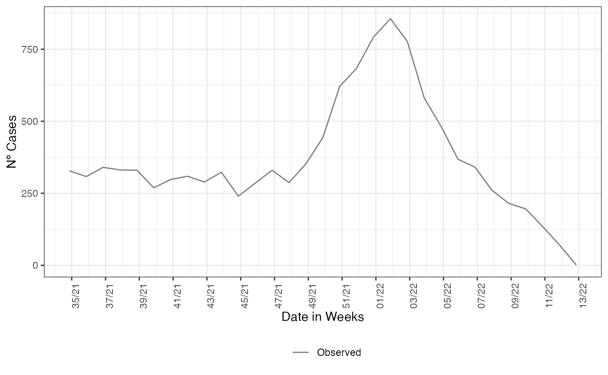
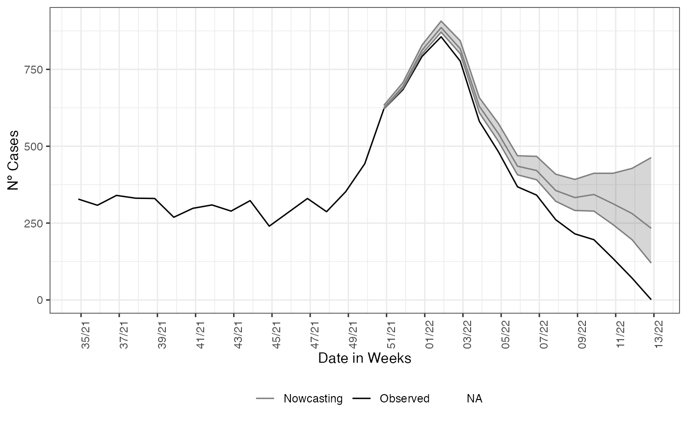

# Get Started

## First example on

When the package is loaded it provides a Lazy Data file, `sariBH`, it is
a anonymized records of Severe Acute Respiratory Illness notified in the
city of Belo Horizonte, since March 2020 to April 2022. To load it
basically write:

\
[`library`](https://rdrr.io/r/base/library.html)`(`[`nowcaster`](https://covid19br.github.io/nowcaster/)`)`\
`# Loading Belo Horizonte SARI data set`\
[`data`](https://rdrr.io/r/utils/data.html)`(``sragBH``)`

And we take a look on the data:

\
[`head`](https://rdrr.io/r/utils/head.html)`(``sragBH``)`\
`#>   DT_SIN_PRI  DT_DIGITA CLASSI_FIN EVOLUCAO CO_MUN_RES Idade fx_etaria`\
`#> 1 2020-02-11 2020-03-05          4        1     310620    59   50 - 59`\
`#> 2 2020-01-21 2020-02-06          4        1     310620    79   70 - 79`\
`#> 3 2020-03-30 2020-04-17          4        1     310620    72   70 - 79`\
`#> 4 2020-03-26 2020-04-02          4        1     310620    82      80 +`\
`#> 5 2020-03-20 2020-04-13          4        1     310620    50   50 - 59`\
`#> 6 2020-04-07 2020-04-22          5        1     310620    74   70 - 79`

It is a data.frame with 7 variables and 65,404 observations. We will
make use of only the first two columns, “DT_SIN_PRI” (date of onset
symptoms) and “DT_DIGITA” (recording date) as well the column “Idade”
(age in years) to make age structured nowcasting.

The call of the function is straightforward, it simply needs a data set
as input, here the `LazyData` loaded in the namespace of the package.
The function has 3 mandatory parameters, `dataset` for the parsing of
the data set to be nowcasted, `date_onset` for parsing the column name
which is the date of onset of symptoms and `date_report` which parses
the column name for the date of report of the cases. Here this columns
are “DT_SIN_PRI” and “DT_DIGITA”, respectively.

\
`nowcasting_bh_no_age`` ``<-`` `[`nowcasting_inla`](https://covid19br.github.io/nowcaster/reference/nowcasting_inla.md)`(``dataset ``=`` ``sragBH``, `\
`                                        date_onset ``=`` ``"DT_SIN_PRI"``, `\
`                                        date_report ``=`` ``"DT_DIGITA"``, `\
`                                        data.by.week ``=`` ``T``)`\
[`head`](https://rdrr.io/r/utils/head.html)`(``nowcasting_bh_no_age``$``total``)`\
`#> ``# A tibble: 6 × 7`\
`#>    Time dt_event   Median    LI    LS   LIb   LSb`\
`#>   ``<int>`` ``<date>``      ``<dbl>`` ``<dbl>`` ``<dbl>`` ``<dbl>`` ``<dbl>`\
`#> ``1``    17 2021-12-19    625   621  633    623   627`\
`#> ``2``    18 2021-12-26    695   688  707    692   699`\
`#> ``3``    19 2022-01-02    812   800  829    807   816`\
`#> ``4``    20 2022-01-09    886   871  907.   880   892`\
`#> ``5``    21 2022-01-16    817   801  843    811   826`\
`#> ``6``    22 2022-01-23    630   609  658    622   639`

This calling will return for the first element the nowcasting estimate
and its Confidence Interval (CI) for two different Credible interval,
`LIb` and `LSb` are the max and min CI, respectively, with credibility
of 50% and `LI` and `LS` are the max and min CI, respectively, with
credibility of 95%.

On the second element it returns the data to be grouped and summarized
to give the epidemic curve, we can take a look on this element.

\
[`library`](https://rdrr.io/r/base/library.html)`(`[`ggplot2`](https://ggplot2.tidyverse.org)`)`\
[`library`](https://rdrr.io/r/base/library.html)`(`[`dplyr`](https://dplyr.tidyverse.org)`)`\
\
`dados_by_week`` ``<-`` ``nowcasting_bh_no_age``$``data`` ``|>`` `\
`  ``dplyr``::`[`group_by`](https://dplyr.tidyverse.org/reference/group_by.html)`(``dt_event``)`` ``|>`` `\
`  ``dplyr``::`[`reframe`](https://dplyr.tidyverse.org/reference/reframe.html)`(`\
`    observed ``=`` `[`sum`](https://rdrr.io/r/base/sum.html)`(``Y``, na.rm ``=`` ``T``)`\
`  ``)`` ``|>`\
`  ``dplyr``::`[`filter`](https://dplyr.tidyverse.org/reference/filter.html)`(``dt_event`` ``>=`` `[`max`](https://rdrr.io/r/base/Extremes.html)`(``dt_event``)``-``270``)`\
\
`dados_by_week`` ``|>`` `\
`  `[`ggplot`](https://ggplot2.tidyverse.org/reference/ggplot.html)`(``)``+`\
`  `[`geom_line`](https://ggplot2.tidyverse.org/reference/geom_path.html)`(``data ``=`` ``dados_by_week``, `\
`            `[`aes`](https://ggplot2.tidyverse.org/reference/aes.html)`(``dt_event``, `\
`                y ``=`` ``observed``, `\
`                col ``=`` ``'Observed'``)``)``+`\
`  `[`theme_bw`](https://ggplot2.tidyverse.org/reference/ggtheme.html)`(``)``+`\
`  `[`theme`](https://ggplot2.tidyverse.org/reference/theme.html)`(``legend.position ``=`` ``"bottom"``, `\
`        axis.text.x ``=`` `[`element_text`](https://ggplot2.tidyverse.org/reference/element.html)`(``angle ``=`` ``90``)``)`` ``+`\
`  `[`scale_color_manual`](https://ggplot2.tidyverse.org/reference/scale_manual.html)`(``values ``=`` `[`c`](https://rdrr.io/r/base/c.html)`(``'grey50'``, ``'black'``)``, `\
`                     name ``=`` ``''``)``+`\
`  `[`scale_x_date`](https://ggplot2.tidyverse.org/reference/scale_date.html)`(``date_breaks ``=`` ``'2 weeks'``, `\
`               date_labels ``=`` ``'%V/%y'``, `\
`               name ``=`` ``'Date in Weeks'``)``+`\
`  `[`labs`](https://ggplot2.tidyverse.org/reference/labs.html)`(``x ``=`` ``''``, `\
`       y ``=`` ``'Nº Cases'``)`

After this element is groped by and summarized by the onset of symptoms
date, here `DT_SIN_PRI`, it is the epidemiological curve observed. To
example how the estimate compares with the observed curve, we plot the
estimate and the epidemiological curve all together.

\
\
`nowcasting_bh_no_age``$``total`` ``|>`` `\
`  `[`ggplot`](https://ggplot2.tidyverse.org/reference/ggplot.html)`(`[`aes`](https://ggplot2.tidyverse.org/reference/aes.html)`(``x ``=`` ``dt_event``, y ``=`` ``Median``, `\
`             col ``=`` ``'Nowcasting'``)``)`` ``+`\
`  `[`geom_line`](https://ggplot2.tidyverse.org/reference/geom_path.html)`(``data ``=`` ``dados_by_week``, `\
`            `[`aes`](https://ggplot2.tidyverse.org/reference/aes.html)`(``y ``=`` ``observed``, `\
`                col ``=`` ``'Observed'``)``)``+`\
`  `[`geom_ribbon`](https://ggplot2.tidyverse.org/reference/geom_ribbon.html)`(`[`aes`](https://ggplot2.tidyverse.org/reference/aes.html)`(``ymin ``=`` ``LI``, ymax ``=`` ``LS``, col ``=`` ``NA``)``, `\
`              alpha ``=`` ``0.2``, `\
`              show.legend ``=`` ``F``)``+`\
`  `[`geom_line`](https://ggplot2.tidyverse.org/reference/geom_path.html)`(``)``+`\
`  `[`theme_bw`](https://ggplot2.tidyverse.org/reference/ggtheme.html)`(``)``+`\
`  `[`theme`](https://ggplot2.tidyverse.org/reference/theme.html)`(``legend.position ``=`` ``"bottom"``, `\
`        axis.text.x ``=`` `[`element_text`](https://ggplot2.tidyverse.org/reference/element.html)`(``angle ``=`` ``90``)``)`` ``+`\
`  `[`scale_color_manual`](https://ggplot2.tidyverse.org/reference/scale_manual.html)`(``values ``=`` `[`c`](https://rdrr.io/r/base/c.html)`(``'grey50'``, ``'black'``)``, `\
`                     name ``=`` ``''``)``+`\
`  `[`scale_x_date`](https://ggplot2.tidyverse.org/reference/scale_date.html)`(``date_breaks ``=`` ``'2 weeks'``, `\
`               date_labels ``=`` ``'%V/%y'``, `\
`               name ``=`` ``'Date in Weeks'``)``+`\
`  `[`labs`](https://ggplot2.tidyverse.org/reference/labs.html)`(``x ``=`` ``''``, `\
`       y ``=`` ``'Nº Cases'``)`

This is an example were the estimate was done without considering any
type of structure in data, which is the first assumption for the
nowcasting.
