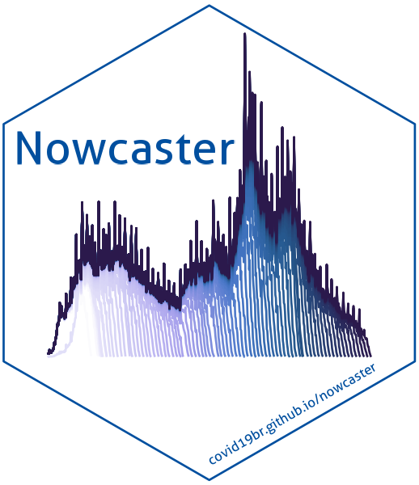
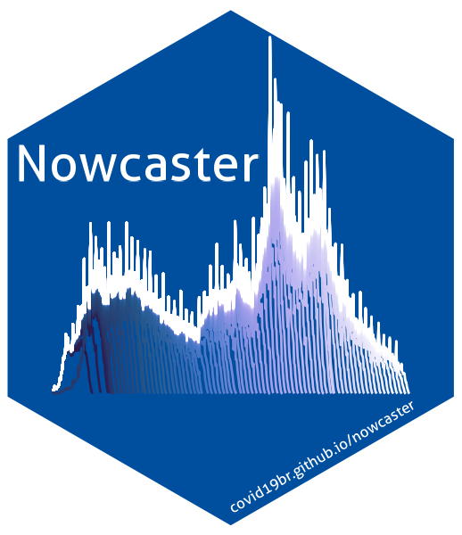

# Nowcaster

`nowcaster`: Statistical Models for Notification Delay Correction of
Epidemiological Data.

The package wraps statistical models to estimate not yet reported data
using empirical delay distribution either from individual-level data or
from the differences of aggregated time series of cases. `nowcaster` it
was built for and during epidemiological emergency use, it was
constructed for the Brazilian Severe Acute Respiratory Illness (SARI)
surveillance system (SIVEP-Gripe), at the time of Covid-19 pandemic.

Every single system of notification has an intrinsic delay between the
`date of onset` of the event and the `date of report`. `nowcaster` can
estimate how many counts of any epidemiological data of interest
(*i.e.*, daily cases and deaths counts) by fitting a negative binomial
model to the time steps of delay between onset date of the event,
(*i.e.*, date of first symptoms for cases or date of occurrence of
death) and the date of report (*i.e.*, date of notification of the case
or death).

# Installing

You can install direct from CRAN:

\
[`install.packages`](https://rdrr.io/r/utils/install.packages.html)`(``"nowcaster"``)`

Or you can install the developing version directly from GitHub:

\
`devtools``::`[`install_github`](https://remotes.r-lib.org/reference/install_github.html)`(``"https://github.com/covid19br/nowcaster"``)`

If you have any problem installing, please refer to next section on the
dependencies of the package.

# Dependencies

`nowcaster` is based on the
[`R-INLA`](https://www.r-inla.org/download-install) and
[`mgcv`](https://cran.r-project.org/web/packages/mgcv/index.html).
Please make sure you have stable version of those packages to be able to
fully work with `nowcaster`

Installing `INLA`:

\
[`install.packages`](https://rdrr.io/r/utils/install.packages.html)`(``"INLA"``, repos``=`[`c`](https://rdrr.io/r/base/c.html)`(`[`getOption`](https://rdrr.io/r/base/options.html)`(``"repos"``)``, INLA``=``"https://inla.r-inla-download.org/R/stable"``)``, dep``=``TRUE``)`

Installing `mgcv`:

\
[`install.packages`](https://rdrr.io/r/utils/install.packages.html)`(``"mgcv"``)`

# Similar Initiatives

There are other alternative packages, that can produce nowcasting
estimation, here it is some options:

- [Epinowcast](https://package.epinowcast.org/)
- [Surveillance](https://surveillance.r-forge.r-project.org/pkgdown/index.html)
