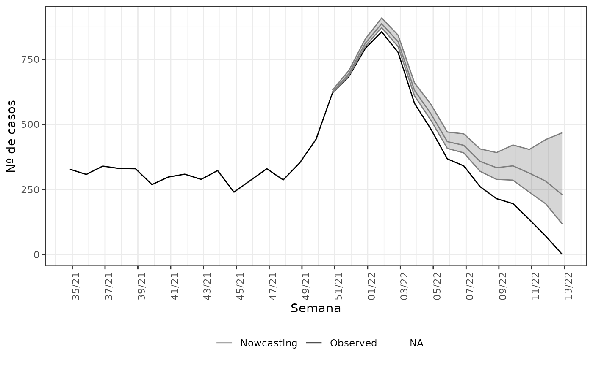
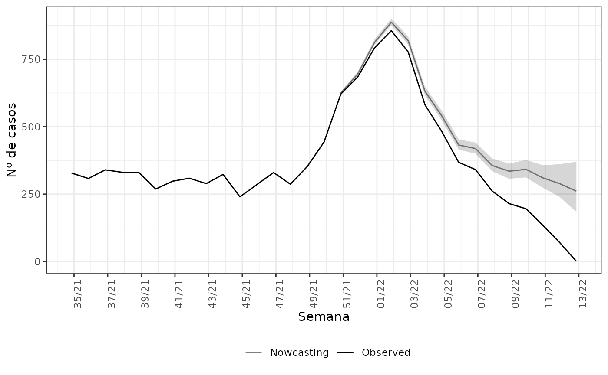
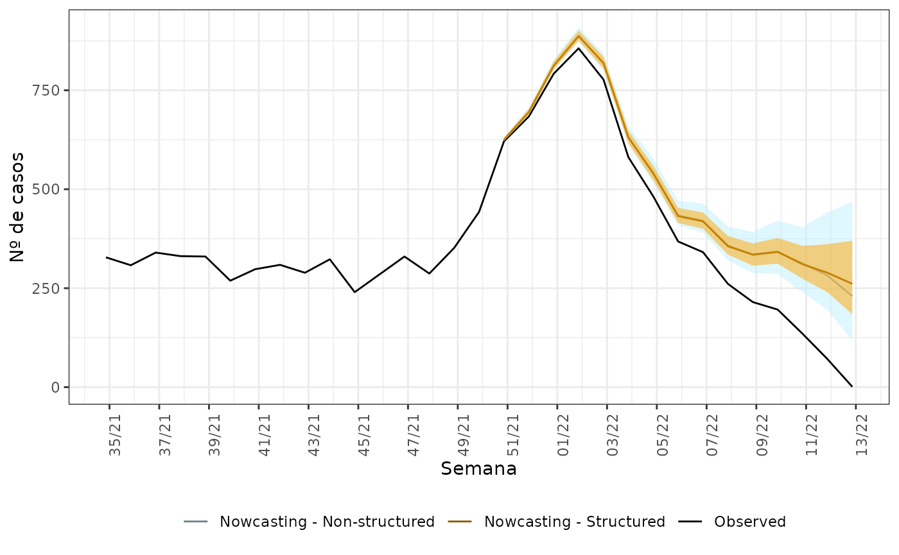

# Nowcasting com INLA

## Resumo

Este é um artigo mais longo que explica o funcionamento e as escolhas
por trás do modelo de nowcasting com INLA, suas vantagens e limitações.

## Como antes…

Como em [Primeiros
passos](https://covid19br.github.io/nowcaster/pt/articles/nowcaster.html),
começamos carregando o pacote e seus dados:

``` r

library(nowcaster)
# Loading Belo Horizonte SARI data set
data(sragBH)
```

## Dados não estruturados

O exemplo de [Primeiros
passos](https://covid19br.github.io/nowcaster/pt/articles/nowcaster.html)
usa dados não estruturados. Aqui descrevemos em mais detalhes esse tipo
de dado e como ele pode mudar o nowcasting.

Ao chamar a função
[`nowcasting_inla()`](https://covid19br.github.io/nowcaster/pt/reference/nowcasting_inla.md),
sua parametrização padrão estima o modelo com os dados na forma não
estruturada. A estimativa ajusta uma distribuição binomial negativa,
NegBinom(\lambda\_{t,d}, \phi), à contagem de casos no tempo t com
atraso d, sendo \phi o parâmetro de dispersão. A taxa \lambda\_{t,d} é
então escrita de forma log-linear como um termo constante somado a
efeitos aleatórios estruturados de atraso e de tempo. Esta é toda a
premissa do nowcasting: modelamos as contagens de casos no tempo t dada
a contagem naquele tempo e os valores passados, assim como a
distribuição do atraso dessa contagem.

Assim, o modelo é dado por:

Y\_{t,d} \sim NegBinom(\lambda\_{t,d}, \phi), \\ \log(\lambda\_{t,d}) =
\alpha + \beta_t + \gamma_d, \\ \beta_t := u_t - u\_{(t-1)} - u\_{(t-2)}
\sim N(0,\tau\_{\beta}); \gamma_d := u_d - u\_{(d-1)} \sim N(0,
\tau\_{\gamma})\\ t=1,2,\ldots,T, \\ d=1,2,\ldots,D,

Onde o intercepto \alpha segue uma distribuição Gaussiana com variância
muito grande, \beta_t segue um passeio aleatório de segunda ordem com
precisão \tau\_\beta e \gamma_d um passeio aleatório de primeira ordem
com precisão \tau\_\gamma. O modelo é completado pelas distribuições a
priori padrão do INLA para \phi, \tau\_\beta e \tau\_\gamma. Veja as
páginas de ajuda do INLA para
[`nbinomial`](https://inla.r-inla-download.org/r-inla.org/doc/likelihood/likelihood-example.pdf),
[`rw1`](https://inla.r-inla-download.org/r-inla.org/doc/latent/rw1.pdf)
e
[`rw2`](https://inla.r-inla-download.org/r-inla.org/doc/latent/rw1.pdf).

A chamada da função é direta: ela precisa apenas de um conjunto de dados
como entrada, aqui o `LazyData` carregado no *namespace* do pacote. A
função tem 3 parâmetros obrigatórios: `dataset`, o conjunto de dados a
ser corrigido, `date_onset`, o nome da coluna com a data de início dos
sintomas, e `date_report`, o nome da coluna com a data de notificação
dos casos. Aqui essas colunas são “DT_SIN_PRI” e “DT_DIGITA”,
respectivamente. As duas datas são necessárias porque modelamos o atraso
como parte da estimativa do nowcasting; em geral, modelos de nowcasting
assumem uma distribuição de atraso e a aplicam aos casos observados.

``` r

nowcasting_bh_no_age <- nowcasting_inla(dataset = sragBH, 
                                        date_onset = DT_SIN_PRI, 
                                        date_report = DT_DIGITA)
head(nowcasting_bh_no_age$total)
```

    #> # A tibble: 6 × 7
    #>    Time dt_event   Median    LI    LS   LIb   LSb
    #>   <int> <date>      <dbl> <dbl> <dbl> <dbl> <dbl>
    #> 1    17 2021-12-19    625  621   632.   623   627
    #> 2    18 2021-12-26    695  687   707    692   698
    #> 3    19 2022-01-02    812  800.  829    807   817
    #> 4    20 2022-01-09    886  872   908    880   893
    #> 5    21 2022-01-16    818  800   846.   811   827
    #> 6    22 2022-01-23    631  609   660    622   640

A chamada acima retorna apenas a estimativa do nowcasting e seus
intervalos de credibilidade (IC) em dois níveis: `LIb` e `LSb` são os
limites inferior e superior do IC de 50%, e `LI` e `LS` são os limites
inferior e superior do IC de 95%.

A `nowcasting_inla` pode também retornar a curva sobre a qual a janela
de ação do modelo foi definida: com o parâmetro `data.by.week = TRUE`, o
segundo elemento da lista de saída traz os dados resumidos por semana.

``` r

nowcasting_bh_no_age <- nowcasting_inla(dataset = sragBH, 
                                        date_onset = DT_SIN_PRI, 
                                        date_report = DT_DIGITA, 
                                        data.by.week = T)
head(nowcasting_bh_no_age$data)
```

    #> # A tibble: 6 × 4
    #>   dt_event   delay     Y  Time
    #>   <date>     <dbl> <dbl> <int>
    #> 1 2021-08-29     0    13     1
    #> 2 2021-08-29     1    51     1
    #> 3 2021-08-29     2   127     1
    #> 4 2021-08-29     3    55     1
    #> 5 2021-08-29     4    26     1
    #> 6 2021-08-29     5    15     1

Este elemento traz as contagens de casos por atraso. É o chamado
triângulo de atraso: tabulando o atraso contra a data de início dos
primeiros sintomas, vemos o padrão de atraso dos casos.

``` r

library(dplyr)

data_triangle <- nowcasting_bh_no_age$data |> 
  filter(delay < 30) |> 
  arrange(delay) |> 
  select(-Time)

data_triangle |> 
  filter(dt_event >= (max(dt_event) - 84),
         delay <= 10) |> 
  tidyr::spread(key = delay, value = Y)
```

    #> # A tibble: 13 × 12
    #>    dt_event     `0`   `1`   `2`   `3`   `4`   `5`   `6`   `7`   `8`   `9`  `10`
    #>    <date>     <dbl> <dbl> <dbl> <dbl> <dbl> <dbl> <dbl> <dbl> <dbl> <dbl> <dbl>
    #>  1 2022-01-02    20   106   114   109    98   113    72    69    27    19    18
    #>  2 2022-01-09     7   105   152   104   135   109    83    66    27    30    18
    #>  3 2022-01-16    10   139   101   135   103    90    70    51    17    28    33
    #>  4 2022-01-23    15    98   121    77    69    79    29    37    28    28    NA
    #>  5 2022-01-30    11    87    99    73    76    38    36    40    22    NA    NA
    #>  6 2022-02-06    16    76    77    62    37    30    35    35    NA    NA    NA
    #>  7 2022-02-13     7    85    59    45    69    47    29    NA    NA    NA    NA
    #>  8 2022-02-20    20    52    72    44    27    46    NA    NA    NA    NA    NA
    #>  9 2022-02-27    12    63    48    40    52    NA    NA    NA    NA    NA    NA
    #> 10 2022-03-06    12    56    72    56    NA    NA    NA    NA    NA    NA    NA
    #> 11 2022-03-13    15    56    64    NA    NA    NA    NA    NA    NA    NA    NA
    #> 12 2022-03-20    11    60    NA    NA    NA    NA    NA    NA    NA    NA    NA
    #> 13 2022-03-27     1    NA    NA    NA    NA    NA    NA    NA    NA    NA    NA

Olhamos apenas os casos com 10 semanas de atraso ou menos e os 84 dias
anteriores à data mais recente. Por padrão, o atraso máximo considerado
no nowcasting é de 15 semanas (parâmetro `Dmax`).

Agrupado e somado pela data de início dos sintomas, aqui `DT_SIN_PRI`,
este elemento é a curva epidemiológica observada. Para ilustrar,
plotamos a estimativa e a curva epidemiológica juntas.

``` r

library(ggplot2)

data_by_week <- nowcasting_bh_no_age$data |> 
  dplyr::group_by(dt_event) |> 
  dplyr::reframe(
    observed = sum(Y, na.rm = T)
  ) |>
  dplyr::filter(dt_event >= max(dt_event)-270)

nowcasting_bh_no_age$total |> 
  filter(dt_event >= (max(dt_event)-270)) |> 
  ggplot(aes(x = dt_event, y = Median, col = 'Nowcasting')) +
  geom_line(data = data_by_week, 
            aes(x = dt_event, y = observed, col = 'Observed'))+
  geom_ribbon(aes(ymin = LI, ymax = LS, col = NA), alpha = 0.2, show.legend = F)+
  geom_line()+
  theme_bw()+
  theme(legend.position = "bottom", axis.text.x = element_text(angle = 90)) +
  scale_color_manual(values = c('grey50', 'black'), name = '')+
  scale_x_date(date_breaks = '2 weeks', date_labels = '%V/%y', name = 'Semana')+
  labs(x = '', y = 'Nº de casos')
```



## Dados estruturados por idade

A primeira melhoria que fizemos sobre o modelo básico de nowcasting com
dados não estruturados foi ajustar o mesmo modelo para classes
categóricas das contagens de casos: pelo curso epidemiológico do
SARS-CoV-2, esperamos que diferentes idades tenham distribuições de
atraso diferentes. Chamamos essa forma de olhar os dados de dados
estruturados, pois agora eles têm identificadores de tempo, de atraso e
de classe etária dos casos. Aos dados estruturados ajustamos novamente
uma distribuição binomial negativa à contagem de casos no tempo t com
atraso d. Diferentemente do caso não estruturado, o modelo agora tem
efeitos aleatórios de atraso e de tempo para cada uma das classes
etárias escolhidas pelo usuário. O modelo tem agora a forma:

Y\_{t,d,a} \sim NegBinom(\lambda\_{t,d,a}, \phi), \\
\log(\lambda\_{t,d,a}) = \alpha_a + \beta\_{t,a} + \gamma\_{d,a}, \\
\beta\_{t,a} := u_t - u\_{(t-1)} - u\_{(t-2)} \sim N(0,\tau\_{a,
\beta}); \gamma\_{d,a} := u_d - u\_{(d-1)} \sim N(0, \tau\_{a, \gamma})
\\ t=1,2,\ldots,T, \\ d=1,2,\ldots,D, \\ a=1,2,\ldots,A

onde cada classe etária, a, tem um intercepto \alpha_a com distribuição
Gaussiana de variância muito grande; os efeitos aleatórios tempo-idade,
\beta\_{t,a}, seguem uma distribuição Gaussiana multivariada conjunta
com componentes de variância separáveis: um termo Gaussiano independente
para as classes etárias com precisão \tau\_{a,\beta} e um passeio
aleatório de segunda ordem no tempo com precisão \tau\_{\beta}.
Analogamente, os efeitos aleatórios atraso-idade, \gamma\_{d,a}, seguem
uma distribuição Gaussiana multivariada conjunta com componentes de
variância separáveis: um termo Gaussiano independente para as classes
etárias com precisão \tau\_{a,\gamma} e um passeio aleatório de primeira
ordem com precisão \tau\_{\gamma}. O modelo é completado pelas
distribuições a priori padrão do INLA para \phi, \tau\_{a,\beta},
\tau\_{a,\gamma}, \tau\_{\beta} e \tau\_\gamma. Veja as páginas de ajuda
do INLA para
[`nbinomial`](https://inla.r-inla-download.org/r-inla.org/doc/likelihood/likelihood-example.pdf),
[`rw1`](https://inla.r-inla-download.org/r-inla.org/doc/latent/rw1.pdf)
e
[`rw2`](https://inla.r-inla-download.org/r-inla.org/doc/latent/rw1.pdf).

Este novo modelo corrige o atraso levando em conta os efeitos das
classes etárias e as interações de cada classe etária com o tempo e com
o atraso. O modelo precisa agora saber qual coluna do conjunto de dados
será usada para dividir os dados em classes etárias e como essas classes
serão definidas. Isso é feito com os parâmetros `age_col` e `bins_age`.
Também passamos `data.by.week = TRUE` para retornar o triângulo de
atraso. Quando `age_col` é informado, o resultado vem de duas formas: a
estimativa total agregada (`total`) e a estimativa estratificada por
idade (`age`). A chamada da função tem a forma:

``` r

nowcasting_bh_age <- nowcasting_inla(dataset = sragBH, 
                                     bins_age = "10 years",
                                     data.by.week = T, 
                                     date_onset = DT_SIN_PRI, 
                                     date_report = DT_DIGITA,
                                     age_col = Idade)
```

Cada uma das estimativas retornadas pela `nowcasting_inla` tem a mesma
forma do caso não estruturado: um `data.frame` com a mediana a
posteriori e os intervalos de credibilidade de 50% (LIb e LSb) e 95% (LI
e LS).

``` r

library(ggplot2)

dados_by_week <- nowcasting_bh_age$data |> 
  dplyr::group_by(dt_event) |> 
  dplyr::reframe(
    observed = sum(Y, na.rm = T)
  ) |>
  dplyr::filter(dt_event >= max(dt_event)-270)


nowcasting_bh_age$total |> 
  ggplot()+
  geom_line(aes(x = dt_event, y = Median, 
                col = 'Nowcasting'))+
  geom_line(data = dados_by_week, 
            aes(x = dt_event, y = observed, 
                col = "Observed"))+
  geom_ribbon(aes(x = dt_event, y = Median,
                  ymin = LI, ymax = LS), 
              alpha = 0.2, show.legend = F)+
  theme_bw()+
  theme(legend.position = "bottom", axis.text.x = element_text(angle = 90))+
  scale_color_manual(values = c('grey50', 'black'), name = '')+
  scale_x_date(date_breaks = '2 weeks', date_labels = '%V/%y', name = 'Semana')+
  labs(x = '', y = 'Nº de casos')
```



Para completar, plotamos as duas estimativas juntas para ver o quanto
diferem.

``` r

ggplot()+
  geom_line(data = dados_by_week, 
            aes(x = dt_event, y = observed, 
                color = "Observed"))+
  geom_line(data = nowcasting_bh_no_age$total |> 
              filter(dt_event >= (max(dt_event)-270)),
            aes(x = dt_event, y = Median, 
                color = 'Nowcasting - Non-structured'))+
  geom_ribbon(data = nowcasting_bh_no_age$total |> 
              filter(dt_event >= (max(dt_event)-270)),
              aes(x = dt_event, y = Median,
                  ymin = LI, ymax = LS,
                  fill = "Nowcasting - Non-structured"), 
              alpha = 0.5, show.legend = F)+
  geom_line(data = nowcasting_bh_age$total |> 
              filter(dt_event >= (max(dt_event)-270)),
            aes(x = dt_event, y = Median, 
                color = 'Nowcasting - Structured'))+
  geom_ribbon(data = nowcasting_bh_age$total |> 
              filter(dt_event >= (max(dt_event)-270)),
              aes(x = dt_event, y = Median,
                  ymin = LI, ymax = LS,
                  fill = "Nowcasting - Structured"), 
              alpha = 0.5, show.legend = F)+
  theme_bw()+
  theme(legend.position = "bottom", 
        axis.text.x = element_text(angle = 90))+
  scale_color_manual(values = c("lightblue4", 
                                "orange4", 
                                "black"),
                     name = "")+
  scale_fill_manual(values = c("lightblue1", 
                                "orange1", 
                                "black"),
                    name = "")+
  scale_x_date(date_breaks = '2 weeks', 
               date_labels = '%V/%y', 
               name = 'Semana')+
  labs(x = '', 
       y = 'Nº de casos')
```



O nowcasting que usa a informação de idade é mais estreito e mostra uma
tendência de queda menor no final da série. Isso acontece porque, com um
modelo de nowcasting atuando em cada classe etária, é possível capturar
efeitos que ficam mascarados quando os dados não são divididos por
idade.

## Conclusão

Neste artigo aprendemos a usar a
[`nowcasting_inla()`](https://covid19br.github.io/nowcaster/pt/reference/nowcasting_inla.md)
e vimos como o `nowcaster` pode empregar dois modelos diferentes: um que
não considera diferenças de atraso entre classes etárias e outro que
considera. Por fim, comparamos as duas estimativas e mostramos que o
modelo que usa a informação de classe etária produz estimativas mais
estreitas.
