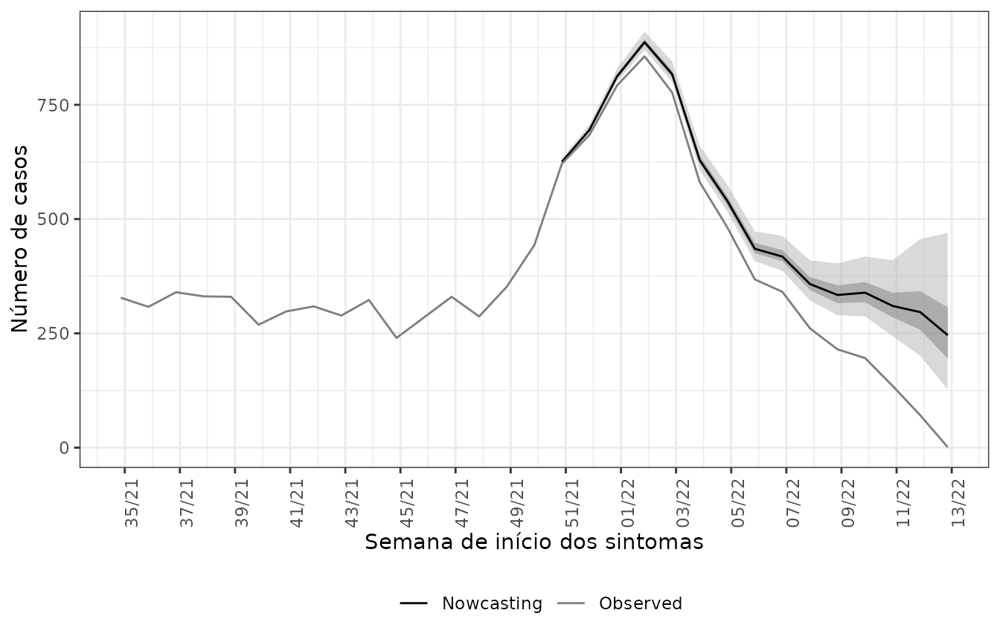
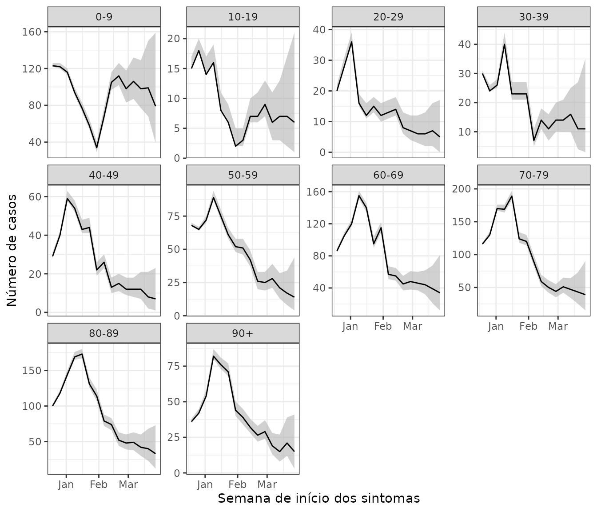
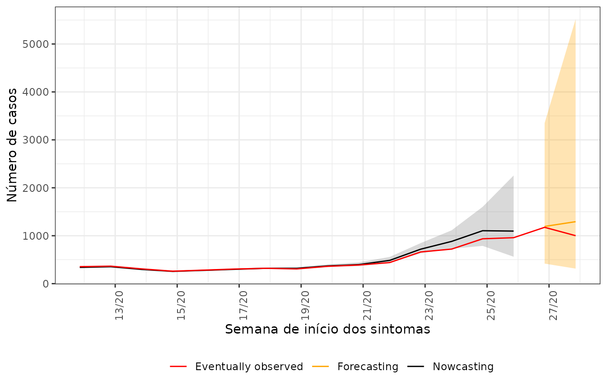

# Nowcasting com mgcv

## Resumo

Este é um artigo mais longo que explica o funcionamento e as escolhas
por trás do modelo de nowcasting com GAM, suas vantagens e limitações.

## Por que `nowcasting_mgcv()`

A
[`nowcasting_mgcv()`](https://covid19br.github.io/nowcaster/pt/reference/nowcasting_mgcv.md)
ajusta o mesmo modelo de nowcasting que a
[`nowcasting_inla()`](https://covid19br.github.io/nowcaster/pt/reference/nowcasting_inla.md),
um modelo binomial negativo para o triângulo de atraso com efeitos
suaves de tempo e de atraso, mas como um modelo aditivo generalizado
(GAM) com o [`mgcv`](https://CRAN.R-project.org/package=mgcv) no lugar
do `INLA`. O `mgcv` está no CRAN e é instalado junto com o `nowcaster`,
então esta função funciona sem nenhuma instalação adicional. Ela é uma
boa escolha quando o `INLA` não pode ser instalado ou quando é preciso
uma estimativa rápida.

## O modelo

Seja Y\_{t,d} o número de casos com início dos sintomas na semana t
notificados com atraso de d semanas. O modelo é

Y\_{t,d} \sim \text{NegBinom}(\lambda\_{t,d}, \phi), \qquad
\log(\lambda\_{t,d}) = \alpha + f_1(t) + f_2(d),

onde f_1 e f_2 são splines de regressão *thin plate* penalizadas e \phi
é o parâmetro de dispersão, todos estimados pela
[`mgcv::gam()`](https://rdrr.io/pkg/mgcv/man/gam.html). As células do
triângulo de atraso ainda não observadas (t + d além da semana presente)
são então preditas. A incerteza é propagada sorteando 1.000 conjuntos de
coeficientes da sua distribuição a posteriori aproximada e, para cada
conjunto, sorteando as contagens não observadas da distribuição binomial
negativa. Somando as contagens observadas e sorteadas sobre os atrasos,
obtemos 1.000 trajetórias da curva epidêmica, resumidas pela mediana e
pelos intervalos de 50% e 95%.

## Nowcasting não estruturado

Usamos os dados de SRAG de Belo Horizonte que acompanham o pacote. A
função precisa do conjunto de dados e dos nomes das colunas de data de
início dos sintomas e de notificação.

``` r

library(nowcaster)
library(dplyr)
library(ggplot2)

data(sragBH)
```

``` r

now_mgcv <- nowcasting_mgcv(dataset = sragBH,
                            date_onset = DT_SIN_PRI,
                            date_report = DT_DIGITA,
                            data.by.week = TRUE)
names(now_mgcv)
```

    #> [1] "total" "data"

``` r

head(now_mgcv$total)
```

    #> # A tibble: 6 × 7
    #>    Time dt_event   Median    LI    LS   LIb   LSb
    #>   <int> <date>      <dbl> <dbl> <dbl> <dbl> <dbl>
    #> 1    17 2021-12-19    625  621   633    623  627 
    #> 2    18 2021-12-26    695  687   707.   692  698 
    #> 3    19 2022-01-02    812  801   829    807  817 
    #> 4    20 2022-01-09    887  870   910.   881  893 
    #> 5    21 2022-01-16    817  800.  845    810  825.
    #> 6    22 2022-01-23    629  608   661    622  639

`total` traz a estimativa para cada semana de início dos sintomas
(`dt_event`): a mediana (`Median`), o intervalo de 50% (`LIb`, `LSb`) e
o intervalo de 95% (`LI`, `LS`). Com `data.by.week = TRUE`, `data` traz
o triângulo de atraso usado para ajustar o modelo, do qual obtemos a
curva como era observada na data do último registro:

``` r

observed <- now_mgcv$data |>
  group_by(dt_event) |>
  summarise(observed = sum(Y, na.rm = TRUE))

ggplot(now_mgcv$total, aes(x = dt_event)) +
  geom_ribbon(aes(ymin = LI, ymax = LS), fill = "grey70", alpha = 0.5) +
  geom_ribbon(aes(ymin = LIb, ymax = LSb), fill = "grey50", alpha = 0.5) +
  geom_line(aes(y = Median, colour = "Nowcasting")) +
  geom_line(data = observed, aes(y = observed, colour = "Observed")) +
  scale_colour_manual(values = c(Nowcasting = "black", Observed = "grey50"),
                      name = "") +
  scale_x_date(date_breaks = "2 weeks", date_labels = "%V/%y") +
  labs(x = "Semana de início dos sintomas", y = "Número de casos") +
  theme_bw() +
  theme(legend.position = "bottom", axis.text.x = element_text(angle = 90))
```



## Controlando a janela de estimação

Três argumentos, todos em semanas, controlam quais dados entram no
modelo:

- `Dmax`: o atraso máximo considerado (padrão 15). Casos notificados
  mais de `Dmax` semanas após o início dos sintomas são descartados.
- `wdw`: o tamanho da janela, contada para trás a partir da última
  semana de início dos sintomas, usada para ajustar o modelo (padrão
  30).
- `trim.data`: o número de semanas mais recentes a descartar antes do
  ajuste (padrão 0).

Uma janela menor torna o ajuste mais rápido e mais local:

``` r

now_short <- nowcasting_mgcv(dataset = sragBH,
                             date_onset = DT_SIN_PRI,
                             date_report = DT_DIGITA,
                             Dmax = 10,
                             wdw = 20)
tail(now_short$total)
```

    #> # A tibble: 6 × 7
    #>    Time dt_event   Median    LI    LS   LIb   LSb
    #>   <int> <date>      <dbl> <dbl> <dbl> <dbl> <dbl>
    #> 1    16 2022-02-20    355  322   398.  342    370
    #> 2    17 2022-02-27    344  302   402.  329    361
    #> 3    18 2022-03-06    368  312.  433   348.   389
    #> 4    19 2022-03-13    343  278.  429.  319.   371
    #> 5    20 2022-03-20    320  226   435.  284    360
    #> 6    21 2022-03-27    267  146   471.  217.   325

Mantenha `Dmax` em 9 semanas ou mais: a suavização do atraso usa 10
funções de base e precisa de pelo menos esse número de atrasos
distintos.

## Nowcasting estruturado por idade

Os atrasos diferem entre faixas etárias, então o modelo pode ser
ajustado com uma suavização de tempo e uma de atraso para cada classe
etária. Passe a coluna de idade em `age_col` e escolha as classes
etárias com `bins_age` (`"SI-PNI"`, `"10 years"`, `"5 years"` ou um
vetor de pontos de corte).

`method.group.gam` define como as suavizações são compartilhadas entre
as classes etárias:

- `"fs"` (padrão): uma suavização por fator,
  `s(Time, age_class, bs = "fs")`, em que as curvas das classes etárias
  compartilham um parâmetro de suavização;
- `"by"`: uma suavização independente para cada classe etária,
  `s(Time, by = age_class)`, mais um intercepto por classe.

``` r

now_age <- nowcasting_mgcv(dataset = sragBH,
                           date_onset = DT_SIN_PRI,
                           date_report = DT_DIGITA,
                           age_col = Idade,
                           bins_age = "10 years",
                           method.group.gam = "fs")
names(now_age)
```

    #> [1] "total" "age"

``` r

head(now_age$age)
```

    #> # A tibble: 6 × 9
    #>    Time dt_event   fx_etaria fx_etaria.num Median    LI    LS   LIb   LSb
    #>   <int> <date>     <fct>             <dbl>  <dbl> <dbl> <dbl> <dbl> <dbl>
    #> 1    17 2021-12-19 1                     1    123   122   126   122   124
    #> 2    17 2021-12-19 2                     2     15    15    17    15    15
    #> 3    17 2021-12-19 3                     3     20    20    22    20    20
    #> 4    17 2021-12-19 4                     4     30    30    31    30    30
    #> 5    17 2021-12-19 5                     5     29    29    31    29    30
    #> 6    17 2021-12-19 6                     6     68    68    70    68    68

O elemento `age` traz a estimativa para cada classe etária, enquanto
`total` soma as trajetórias sobre as classes etárias. As classes são
numeradas em ordem crescente de idade; com `bins_age = "10 years"`, a
classe 1 é de 0 a 9 anos e a classe 10 é de 90 anos ou mais:

``` r

age_labels <- c(paste0(seq(0, 80, 10), "-", seq(9, 89, 10)), "90+")

now_age$age |>
  mutate(age_class = factor(age_labels[fx_etaria.num], levels = age_labels)) |>
  ggplot(aes(x = dt_event, y = Median)) +
  geom_ribbon(aes(ymin = LI, ymax = LS), fill = "grey70", alpha = 0.6) +
  geom_line() +
  facet_wrap(~age_class, scales = "free_y") +
  labs(x = "Semana de início dos sintomas", y = "Número de casos") +
  theme_bw()
```



## Previsão

Definir `K` como um número positivo acrescenta `K` semanas além da
última semana de início dos sintomas ao triângulo de atraso, e o modelo
passa a prever também casos que ainda não começaram. Aqui cortamos os
dados em 4 de julho de 2020, como se estivéssemos fazendo o nowcasting
nessa data, e prevemos duas semanas à frente:

``` r

srag_2020 <- sragBH |>
  filter(DT_DIGITA <= as.Date("2020-07-04"))

now_forecast <- nowcasting_mgcv(dataset = srag_2020,
                                date_onset = DT_SIN_PRI,
                                date_report = DT_DIGITA,
                                K = 2)
tail(now_forecast$total, 4)
```

    #> # A tibble: 4 × 7
    #>    Time dt_event   Median    LI    LS   LIb   LSb
    #>   <int> <date>      <dbl> <dbl> <dbl> <dbl> <dbl>
    #> 1    25 2020-06-14  1104.  788. 1602.  988. 1247 
    #> 2    26 2020-06-21  1096.  562. 2256   856  1404.
    #> 3    27 2020-06-28  1194.  418. 3350.  839  1743.
    #> 4    28 2020-07-05  1293   314. 5517.  774. 2148

Como o conjunto de dados contém todos os casos notificados até 2022,
podemos comparar a estimativa com o que foi observado depois:

``` r

eventually_observed <- sragBH |>
  mutate(dt_event = DT_SIN_PRI - as.numeric(format(DT_SIN_PRI, "%w"))) |>
  count(dt_event, name = "observed") |>
  filter(dt_event >= min(now_forecast$total$dt_event),
         dt_event <= max(now_forecast$total$dt_event))

now_forecast$total |>
  mutate(part = ifelse(Time > max(Time) - 2, "Forecasting", "Nowcasting")) |>
  ggplot(aes(x = dt_event)) +
  geom_ribbon(aes(ymin = LI, ymax = LS, fill = part), alpha = 0.3) +
  geom_line(aes(y = Median, colour = part)) +
  geom_line(data = eventually_observed,
            aes(y = observed, colour = "Eventually observed")) +
  scale_colour_manual(values = c(Nowcasting = "black", Forecasting = "orange",
                                 `Eventually observed` = "red"), name = "") +
  scale_fill_manual(values = c(Nowcasting = "grey50", Forecasting = "orange"),
                    guide = "none") +
  scale_x_date(date_breaks = "2 weeks", date_labels = "%V/%y") +
  labs(x = "Semana de início dos sintomas", y = "Número de casos") +
  theme_bw() +
  theme(legend.position = "bottom", axis.text.x = element_text(angle = 90))
```



As duas últimas semanas são a previsão. Seus intervalos são bem mais
largos, pois nenhum caso com início dos sintomas nessas semanas havia
sido observado naquele momento.

## Trajetórias e tendência

Com `trajectories = TRUE` a função também retorna as 1.000 trajetórias
sorteadas. Elas podem ser resumidas de outras formas, por exemplo para
classificar a tendência da curva nas últimas semanas com
[`slope.estimate.quant()`](https://covid19br.github.io/nowcaster/pt/reference/slope.estimate.quant.md)
(que precisa do pacote `lme4`). A função ajusta uma reta a cada
trajetória nas últimas `window` semanas e retorna `1` se a curva está
crescendo, `0.5` se provavelmente crescendo, `0` se estável ou incerta,
`-0.5` se provavelmente caindo e `-1` se caindo:

``` r

now_traj <- nowcasting_mgcv(dataset = srag_2020,
                            date_onset = DT_SIN_PRI,
                            date_report = DT_DIGITA,
                            trajectories = TRUE)
head(now_traj$trajectories)
```

    #> # A tibble: 6 × 4
    #> # Groups:   Time, dt_event [6]
    #>   sample  Time dt_event       Y
    #>   <chr>  <int> <date>     <dbl>
    #> 1 1         12 2020-03-15   349
    #> 2 1         13 2020-03-22   351
    #> 3 1         14 2020-03-29   298
    #> 4 1         15 2020-04-05   267
    #> 5 1         16 2020-04-12   278
    #> 6 1         17 2020-04-19   303

``` r

slope.estimate.quant(trajectories = now_traj$trajectories, window = 3)
```

    #> [1] 0

## Veja também

- [Primeiros
  passos](https://covid19br.github.io/nowcaster/pt/articles/nowcaster.html),
  a mesma análise com a
  [`nowcasting_inla()`](https://covid19br.github.io/nowcaster/pt/reference/nowcasting_inla.md).
- [Nowcasting com
  INLA](https://covid19br.github.io/nowcaster/pt/articles/1_nowcasting_inla.html),
  com os detalhes do modelo estruturado por idade.
- [nowcasting_inla() ou
  nowcasting_mgcv()](https://covid19br.github.io/nowcaster/pt/articles/5_inla_vs_mgcv.html),
  os mesmos exemplos com as duas funções lado a lado.
