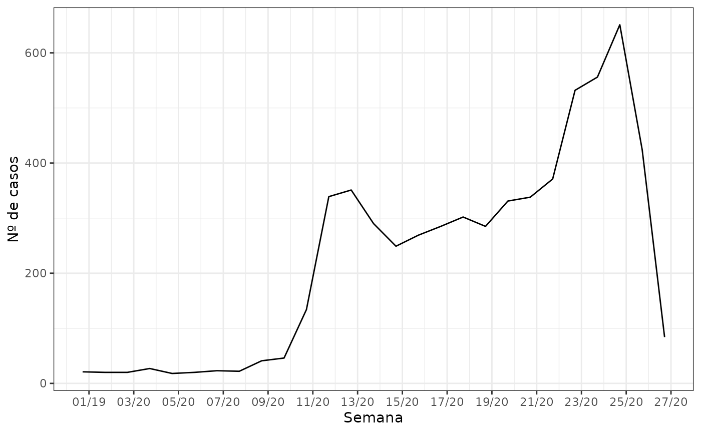
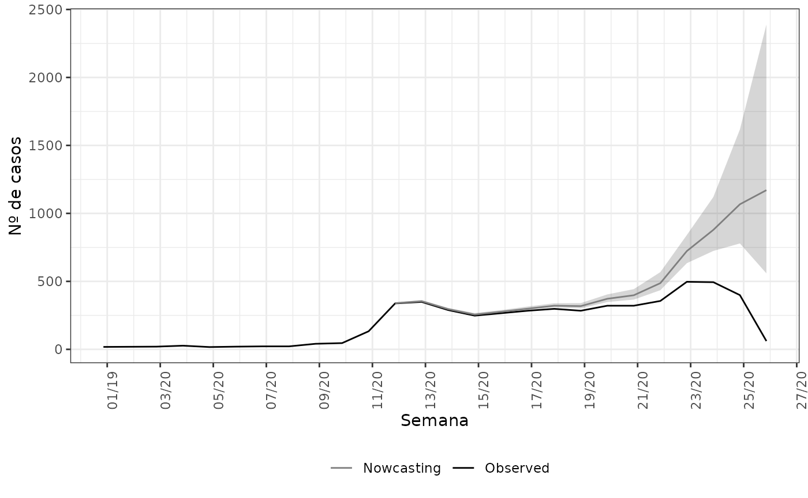
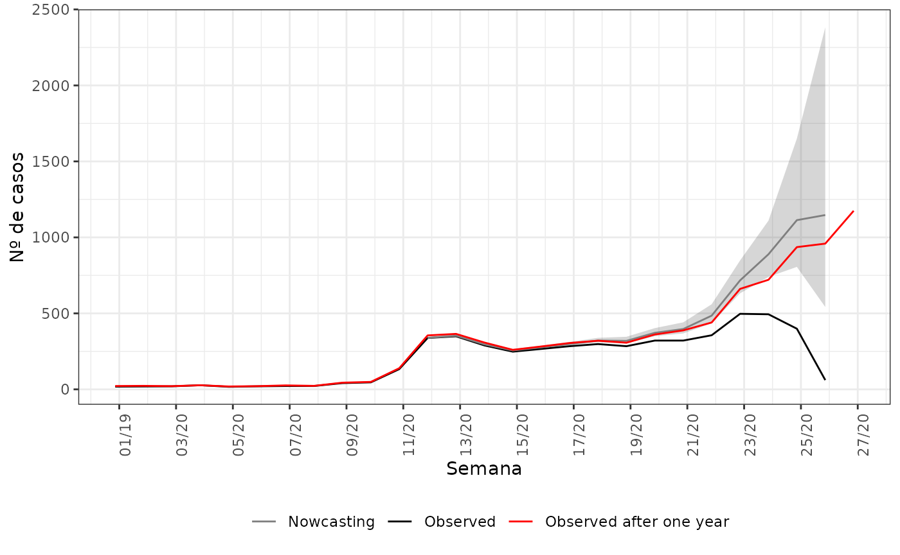

# Nowcasting para a tomada de decisão

## Resumo

Um exemplo curto de como a estimativa do nowcasting pode ajudar no
processo de tomada de decisão.

## Nowcasting como ferramenta de apoio à decisão

Fazer o nowcasting de uma curva em ascensão, ou em qualquer outro
momento, pode dar suporte quantitativo à tomada de decisão. Em crises de
saúde pública, o mais necessário é uma forma de antecipar, ao menos, o
que está acontecendo no momento. O nowcasting é a ferramenta para esse
tipo de pergunta e pode trazer informações dos dados que apoiem as
decisões necessárias.

Começamos esta seção cortando os dados originais em um momento de
aparente queda das hospitalizações por SRAG em Belo Horizonte, município
que teve uma resposta rápida à pandemia de Covid-19. A pressão sobre o
sistema de saúde lá demorou mais que no resto do país, e os dados
naquele momento mostravam uma queda. Filtramos todos os casos digitados
até 4 de julho de 2020, pela data de digitação, data em que os casos
aparecem na base de dados.

``` r

library(tidyverse)
library(lubridate)
library(nowcaster)

## To see Nowcasting as if we were on the verge of rise in the curve
data("sragBH")
srag_now<-sragBH |> 
  filter(DT_DIGITA <= "2020-07-04")

# We now call an internal function to construct a count of cases by age to each date of onset
data_by_week <- nowcaster:::data.w_no_age(dataset = srag_now, 
                              date_onset = DT_SIN_PRI, 
                              date_report = DT_DIGITA) |> 
  group_by(date_onset) |> 
  tally()

data_by_week |>  
  ggplot(aes(x = date_onset, 
             y = n))+
  geom_line()+
  theme_bw()+
  labs(x = 'Date of onset of symptoms', 
       y = 'Nº de casos')+
  scale_color_manual(values = c('grey50', 'black'), 
                     name = '')+
  scale_x_date(date_breaks = '2 weeks', 
               date_labels = '%V/%y', 
               name = 'Semana')
```



### Ajuste do modelo

Use as abas para ver a análise com a
[`nowcasting_inla()`](https://covid19br.github.io/nowcaster/pt/reference/nowcasting_inla.md)
(INLA) ou com a
[`nowcasting_mgcv()`](https://covid19br.github.io/nowcaster/pt/reference/nowcasting_mgcv.md)
(mgcv); escolher uma aba troca todas as abas da página.

Sobre esses dados filtrados, estimamos os casos que já iniciaram
sintomas mas ainda não foram notificados, ou seja, que ainda não estão
na base. Basta passar à função `nowcasting_inla` o conjunto de dados
filtrado e as colunas `date_onset` e `date_report`, e pedir que a função
retorne a curva epidêmica por semana epidemiológica.

- INLA
- mgcv

``` r

nowcasting_bh_no_age <- nowcasting_inla(dataset = srag_now, 
                                        date_onset = DT_SIN_PRI, 
                                        date_report = DT_DIGITA, 
                                        data.by.week = T)
head(nowcasting_bh_no_age$data)
```

    #> # A tibble: 6 × 4
    #>   dt_event   delay     Y  Time
    #>   <date>     <dbl> <dbl> <int>
    #> 1 2019-12-29     0     1     1
    #> 2 2019-12-29     1     2     1
    #> 3 2019-12-29     2     4     1
    #> 4 2019-12-29     3     5     1
    #> 5 2019-12-29     4     2     1
    #> 6 2019-12-29     5     2     1

``` r

nowcasting_bh_no_age_mgcv <- nowcasting_mgcv(dataset = srag_now, 
                                        date_onset = DT_SIN_PRI, 
                                        date_report = DT_DIGITA, 
                                        data.by.week = T)
head(nowcasting_bh_no_age_mgcv$data)
```

    #> # A tibble: 6 × 4
    #>   dt_event   delay     Y  Time
    #>   <date>     <dbl> <dbl> <int>
    #> 1 2019-12-29     0     1     1
    #> 2 2019-12-29     1     2     1
    #> 3 2019-12-29     2     4     1
    #> 4 2019-12-29     3     5     1
    #> 5 2019-12-29     4     2     1
    #> 6 2019-12-29     5     2     1

### O triângulo de atraso

O triângulo de atraso depende apenas dos dados, então é o mesmo para os
dois modelos.

Antes de ver o resultado do nowcasting, olhamos uma etapa intermediária
do processo, o triângulo de atraso, que organiza os dados para o
nowcasting. O triângulo de atraso é apenas uma tabela com o número de
casos para cada atraso (em dias ou semanas inteiras) entre a data de
início dos sintomas e a data de notificação, para cada data de início
dos sintomas. A parte mais próxima do presente tem contagens menores e
atrasos menores: como o sistema leva tempo para processar os casos, os
casos mais recentes ainda são menos numerosos que os antigos, que já
tiveram tempo de ser processados.

A partir dos dados no formato semanal, montamos as contagens de casos
por atraso. Tabulando o atraso contra a data de início dos primeiros
sintomas, vemos o padrão de atraso dos casos.

``` r

library(dplyr)

data_triangle <- nowcasting_bh_no_age$data |> 
  filter(delay < 30) |> 
  arrange(delay) |> 
  select(-Time)

data_triangle |> 
  filter(dt_event >= (max(dt_event) - 84),
         delay <= 10) |> 
  tidyr::spread(key = delay, value = Y)
```

    #> # A tibble: 13 × 12
    #>    dt_event     `0`   `1`   `2`   `3`   `4`   `5`   `6`   `7`   `8`   `9`  `10`
    #>    <date>     <dbl> <dbl> <dbl> <dbl> <dbl> <dbl> <dbl> <dbl> <dbl> <dbl> <dbl>
    #>  1 2020-03-29    23    76    70    18    27    20    16    15    11     6     2
    #>  2 2020-04-05    15   103    38    25    24     8    10     8     5     4     7
    #>  3 2020-04-12    24    79    63    30    23    21     7    12     3     4     0
    #>  4 2020-04-19    17   111    80    22    15    10    16     3     5     5    NA
    #>  5 2020-04-26    22   143    51    26    17    16     4    12     7    NA    NA
    #>  6 2020-05-03    39   106    87    24     9     5     8     6    NA    NA    NA
    #>  7 2020-05-10    37   154    68    32     8    12    10    NA    NA    NA    NA
    #>  8 2020-05-17    31   153    80    20    22    15    NA    NA    NA    NA    NA
    #>  9 2020-05-24    41   154    70    67    24    NA    NA    NA    NA    NA    NA
    #> 10 2020-05-31    34   174   191    98    NA    NA    NA    NA    NA    NA    NA
    #> 11 2020-06-07    22   240   232    NA    NA    NA    NA    NA    NA    NA    NA
    #> 12 2020-06-14    44   355    NA    NA    NA    NA    NA    NA    NA    NA    NA
    #> 13 2020-06-21    61    NA    NA    NA    NA    NA    NA    NA    NA    NA    NA

Olhamos apenas os casos com 10 semanas de atraso ou menos. Por padrão, o
atraso máximo considerado no nowcasting é de 15 semanas, e pode ser
alterado pelo parâmetro `Dmax`.

### Estimativa do nowcasting

Agrupado e somado pela data de início dos sintomas, aqui `DT_SIN_PRI`,
este elemento é a curva epidemiológica observada. Para ilustrar,
plotamos a estimativa e a curva epidemiológica juntas.

- INLA
- mgcv

``` r

library(ggplot2)

dados_by_week <- nowcasting_bh_no_age$data |> 
  dplyr::group_by(dt_event) |> 
  dplyr::reframe(
    observed = sum(Y, na.rm = T)
  )

nowcasting_bh_no_age$total |> 
  ggplot(aes(x = dt_event, y = Median, 
             col = 'Nowcasting')) +
  geom_line(data = dados_by_week, 
            aes(x = dt_event, y = observed, 
                col = 'Observed'))+
  geom_ribbon(aes(ymin = LI, ymax = LS), colour = NA, 
              alpha = 0.2, 
              show.legend = F)+
  geom_line()+
  theme_bw()+
  theme(legend.position = "bottom", 
        axis.text.x = element_text(angle = 90)) +
  scale_color_manual(values = c('grey50', 'black'), 
                     name = '')+
  scale_x_date(date_breaks = '2 weeks', 
               date_labels = '%V/%y', 
               name = 'Semana')+
  labs(x = '', 
       y = 'Nº de casos')
```



``` r

library(ggplot2)

dados_by_week <- nowcasting_bh_no_age_mgcv$data |> 
  dplyr::group_by(dt_event) |> 
  dplyr::reframe(
    observed = sum(Y, na.rm = T)
  )

nowcasting_bh_no_age_mgcv$total |> 
  ggplot(aes(x = dt_event, y = Median, 
             col = 'Nowcasting')) +
  geom_line(data = dados_by_week, 
            aes(x = dt_event, y = observed, 
                col = 'Observed'))+
  geom_ribbon(aes(ymin = LI, ymax = LS), colour = NA, 
              alpha = 0.2, 
              show.legend = F)+
  geom_line()+
  theme_bw()+
  theme(legend.position = "bottom", 
        axis.text.x = element_text(angle = 90)) +
  scale_color_manual(values = c('grey50', 'black'), 
                     name = '')+
  scale_x_date(date_breaks = '2 weeks', 
               date_labels = '%V/%y', 
               name = 'Semana')+
  labs(x = '', 
       y = 'Nº de casos')
```


### Comparando com o que aconteceu

Como esperado, o nowcasting estimou uma curva em ascensão quando o que
se observava era uma queda. Acrescentamos ao gráfico o que de fato
aconteceu naquele período, com os dados inseridos depois da data em que
o nowcasting estimou a subida da curva de hospitalizações por SRAG.

- INLA
- mgcv

``` r

nowcasting_bh_no_age$total %>% 
  ggplot(aes(x = dt_event, y = Median, col = 'Nowcasting')) +
  geom_line(data = dados_by_week, 
            aes(x = dt_event, y = observed, col = 'Observed'))+
  geom_ribbon(aes(ymin = LI, ymax = LS), colour = NA, 
              alpha = 0.2, 
              show.legend = F)+
  geom_line()+
  geom_line( data = sragBH %>%
               filter(DT_SIN_PRI <= "2020-07-04") %>% 
               mutate(
                 D_SIN_PRI_2 = DT_SIN_PRI - as.numeric(format(DT_SIN_PRI, "%w"))
               ) %>% 
               group_by(D_SIN_PRI_2) %>% 
               tally(), 
             mapping = aes(x = D_SIN_PRI_2, y = n, 
                           color = "Observed after one year")) + 
  theme_bw() +
  theme(legend.position = "bottom", 
        axis.text.x = element_text(angle = 90)) +
  scale_color_manual(values = c('grey50', 'black', 'red'), 
                     name = '')+
  scale_x_date(date_breaks = '2 weeks', 
               date_labels = '%V/%y', 
               name = 'Semana')+
  labs(x = '', 
       y = 'Nº de casos')
```


``` r

nowcasting_bh_no_age_mgcv$total %>% 
  ggplot(aes(x = dt_event, y = Median, col = 'Nowcasting')) +
  geom_line(data = dados_by_week, 
            aes(x = dt_event, y = observed, col = 'Observed'))+
  geom_ribbon(aes(ymin = LI, ymax = LS), colour = NA, 
              alpha = 0.2, 
              show.legend = F)+
  geom_line()+
  geom_line( data = sragBH %>%
               filter(DT_SIN_PRI <= "2020-07-04") %>% 
               mutate(
                 D_SIN_PRI_2 = DT_SIN_PRI - as.numeric(format(DT_SIN_PRI, "%w"))
               ) %>% 
               group_by(D_SIN_PRI_2) %>% 
               tally(), 
             mapping = aes(x = D_SIN_PRI_2, y = n, 
                           color = "Observed after one year")) + 
  theme_bw() +
  theme(legend.position = "bottom", 
        axis.text.x = element_text(angle = 90)) +
  scale_color_manual(values = c('grey50', 'black', 'red'), 
                     name = '')+
  scale_x_date(date_breaks = '2 weeks', 
               date_labels = '%V/%y', 
               name = 'Semana')+
  labs(x = '', 
       y = 'Nº de casos')
```



### Nowcasting e tomada de decisão

Isso encerra o primeiro exemplo simples de estimativa dos eventos já
iniciados mas ainda não notificados, isto é, o nowcasting. A relevância
do nowcasting para as decisões em saúde pública vem do entendimento de
que o que está nas bases de dados é apenas um retrato da situação em
tempo real. O gráfico acima pode ajudar gestores a decidir o que fazer
diante de uma curva crescente de casos, hospitalizações ou óbitos.

## Conclusão

Neste artigo defendemos o uso do nowcasting como ferramenta de apoio à
tomada de decisão. Comparando a estimativa com os dados disponíveis um
ano depois, verificamos a qualidade das estimativas: o nowcasting havia
produzido, no momento da observação dos dados, uma boa estimativa do
número real de casos.
