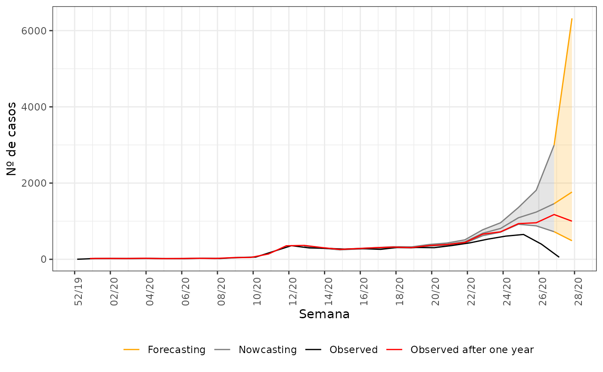
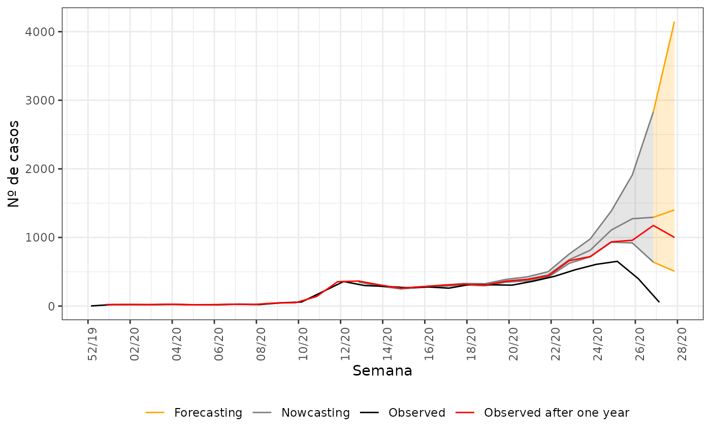
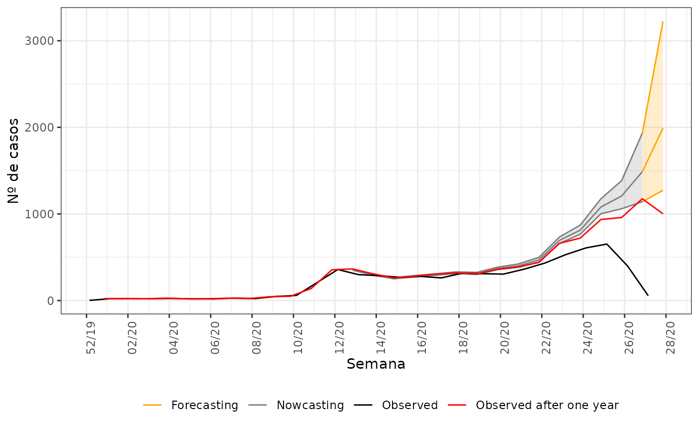
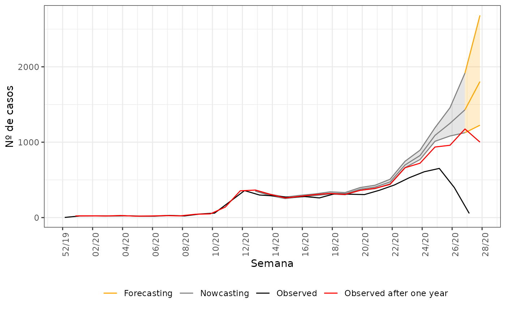

# Além do nowcasting: previsão

## Resumo

Depois de entender como o nowcasting funciona, acrescentamos datas não
observadas ao triângulo de atraso e fazemos previsões (*forecasting*),
isto é, projetamos o número de casos além dos dados já observados.

## Previsão

Nowcasting é a estimativa dos eventos que já começaram mas ainda não
foram notificados. Em epidemiologia, esses eventos são, por exemplo,
casos de uma doença infecciosa que já iniciaram os primeiros sintomas
mas ainda não foram captados pelo sistema de notificação. Previsão é
simplesmente a estimativa dos eventos que ainda não iniciaram sintomas,
isto é, casos provavelmente no período de incubação. Na estrutura de
qualquer base de dados, são os casos com data de início dos sintomas
posterior à data presente. Na linguagem do triângulo de atraso, prever é
estimar a parte completamente não observada.

## Parâmetro K \> 0

A função `nowcasting_inla` tem um parâmetro que faz o modelo passado ao
`inla` construir o triângulo de atraso com datas posteriores à data
presente. Isso é feito definindo o parâmetro `K` com um valor maior que
0, como K = 1,2,3,\dots. O resto segue como em qualquer outro exemplo de
nowcasting. Faremos a previsão como foi feito o nowcasting no artigo
[Nowcasting para a tomada de
decisão](https://covid19br.github.io/nowcaster/pt/articles/3_nowcasting_importance.html).

Primeiro, cortamos os dados do pacote em uma data de interesse; para
entender por que cortamos nessa data, veja o artigo [Nowcasting para a
tomada de
decisão](https://covid19br.github.io/nowcaster/pt/articles/3_nowcasting_importance.html).
Em seguida, passamos à função `nowcasting_inla` as colunas de data de
início dos sintomas e de notificação, pedimos o data.frame com as
contagens de casos por semana e definimos o parâmetro `K` com o
horizonte de previsão desejado; aqui prevemos uma semana à frente da
data presente.

Antes da previsão, construímos a curva de contagens de casos a partir
dos dados usando a função interna `data.w_no_age`, somando as contagens
de casos para cada data de início dos primeiros sintomas presente na
base.

``` r

library(tidyverse)
library(lubridate)
library(nowcaster)

## To see Nowcasting as if we were on the verge of rise in the curve
data("sragBH")
srag_now <- sragBH |> 
  filter(DT_DIGITA <= "2020-07-06")

data_by_week <- nowcaster:::data.w_no_age(dataset = srag_now, 
                             date_onset = DT_SIN_PRI, 
                             date_report = DT_DIGITA, 
                             K = 0) |> 
  group_by(date_onset) |> 
  tally()

data_by_week |>  
  ggplot(aes(x = date_onset, 
             y = n))+
  geom_line()+
  theme_bw()+
  labs(x = 'Date of onset of symptoms', 
       y = 'Nº de casos')+
  scale_color_manual(values = c('grey50', 'black'), 
                     name = '')+
  scale_x_date(date_breaks = '2 weeks', 
               date_labels = '%V/%y', 
               name = 'Semana')
```


### Previsão uma semana à frente

Use as abas para ver a análise com a
[`nowcasting_inla()`](https://covid19br.github.io/nowcaster/pt/reference/nowcasting_inla.md)
(INLA) ou com a
[`nowcasting_mgcv()`](https://covid19br.github.io/nowcaster/pt/reference/nowcasting_mgcv.md)
(mgcv); escolher uma aba troca todas as abas da página.

Agora, para prever uma semana à frente basta usar `K = 1` e seguir como
numa chamada normal de nowcasting:

- INLA
- mgcv

``` r

nowcasting_bh_no_age <- nowcasting_inla(dataset = srag_now, 
                                        date_onset = DT_SIN_PRI, 
                                        date_report = DT_DIGITA, 
                                        data.by.week = T, 
                                        K = 1)
head(nowcasting_bh_no_age$data)
```

    #> # A tibble: 6 × 4
    #>   dt_event   delay     Y  Time
    #>   <date>     <dbl> <dbl> <int>
    #> 1 2019-12-29     0     1     1
    #> 2 2019-12-29     1     2     1
    #> 3 2019-12-29     2     4     1
    #> 4 2019-12-29     3     5     1
    #> 5 2019-12-29     4     2     1
    #> 6 2019-12-29     5     2     1

``` r

nowcasting_bh_no_age_mgcv <- nowcasting_mgcv(dataset = srag_now, 
                                        date_onset = DT_SIN_PRI, 
                                        date_report = DT_DIGITA, 
                                        data.by.week = T, 
                                        K = 1)
head(nowcasting_bh_no_age_mgcv$data)
```

    #> # A tibble: 6 × 4
    #>   dt_event   delay     Y  Time
    #>   <date>     <dbl> <dbl> <int>
    #> 1 2019-12-29     0     1     1
    #> 2 2019-12-29     1     2     1
    #> 3 2019-12-29     2     4     1
    #> 4 2019-12-29     3     5     1
    #> 5 2019-12-29     4     2     1
    #> 6 2019-12-29     5     2     1

### Conferindo a previsão

Para visualizar a previsão, plotamos a curva observada e as estimativas
do nowcasting e da previsão, com cores diferentes para cada parte.
Plotamos também a curva observada um ano depois, para validar a
estimativa.

- INLA
- mgcv

``` r

## Nowcasting estimate filtering
nowcasting_estimate<-nowcasting_bh_no_age$total |> 
  filter(dt_event <= "2020-06-28")
## Forecasting estimate filtering
forecasting_estimate<-nowcasting_bh_no_age$total |> 
  filter(dt_event >= "2020-06-28")

## One year after observed
data_one_year_after<-sragBH %>%
  filter(DT_SIN_PRI <= "2020-07-11") %>% 
  mutate(
    D_SIN_PRI_2 = DT_SIN_PRI - as.numeric(format(DT_SIN_PRI, "%w"))
  ) %>% 
  group_by(D_SIN_PRI_2) %>% 
  tally()


## Plotting
nowcasting_estimate |> 
  ggplot(aes(x = dt_event, y = Median, col = "Nowcasting"))+
  geom_line()+
  geom_ribbon(aes(ymin = LI, ymax = LS, col = "Nowcasting", fill = "Nowcasting"), 
              alpha = 0.2, 
              show.legend = F)+
  geom_line(data = forecasting_estimate, 
            aes(x = dt_event, y = Median, col = "Forecasting"))+
  geom_ribbon(data = forecasting_estimate, 
              aes(ymin = LI, ymax = LS, col = "Forecasting", fill = "Forecasting"), 
              alpha = 0.2,
              show.legend = F)+
  geom_line(data = data_by_week, 
            aes(date_onset, y = n, col = 'Observed'))+
  geom_line(data = data_one_year_after, 
            mapping = aes(x = D_SIN_PRI_2, y = n, 
                          color = "Observed after one year")) + 
  theme_bw() +
  theme(legend.position = "bottom", 
        axis.text.x = element_text(angle = 90)) +
  scale_color_manual(values = c('orange','grey50', 'black', 'red'), 
                     name = '')+
  scale_fill_manual(values = c('orange','grey50'), 
                     name = '')+
  scale_x_date(date_breaks = '2 weeks', 
               date_labels = '%V/%y', 
               name = 'Semana')+
  labs(x = '', 
       y = 'Nº de casos')
```



``` r

## Nowcasting estimate filtering
nowcasting_estimate<-nowcasting_bh_no_age_mgcv$total |> 
  filter(dt_event <= "2020-06-28")
## Forecasting estimate filtering
forecasting_estimate<-nowcasting_bh_no_age_mgcv$total |> 
  filter(dt_event >= "2020-06-28")

## One year after observed
data_one_year_after<-sragBH %>%
  filter(DT_SIN_PRI <= "2020-07-11") %>% 
  mutate(
    D_SIN_PRI_2 = DT_SIN_PRI - as.numeric(format(DT_SIN_PRI, "%w"))
  ) %>% 
  group_by(D_SIN_PRI_2) %>% 
  tally()


## Plotting
nowcasting_estimate |> 
  ggplot(aes(x = dt_event, y = Median, col = "Nowcasting"))+
  geom_line()+
  geom_ribbon(aes(ymin = LI, ymax = LS, col = "Nowcasting", fill = "Nowcasting"), 
              alpha = 0.2, 
              show.legend = F)+
  geom_line(data = forecasting_estimate, 
            aes(x = dt_event, y = Median, col = "Forecasting"))+
  geom_ribbon(data = forecasting_estimate, 
              aes(ymin = LI, ymax = LS, col = "Forecasting", fill = "Forecasting"), 
              alpha = 0.2,
              show.legend = F)+
  geom_line(data = data_by_week, 
            aes(date_onset, y = n, col = 'Observed'))+
  geom_line(data = data_one_year_after, 
            mapping = aes(x = D_SIN_PRI_2, y = n, 
                          color = "Observed after one year")) + 
  theme_bw() +
  theme(legend.position = "bottom", 
        axis.text.x = element_text(angle = 90)) +
  scale_color_manual(values = c('orange','grey50', 'black', 'red'), 
                     name = '')+
  scale_fill_manual(values = c('orange','grey50'), 
                     name = '')+
  scale_x_date(date_breaks = '2 weeks', 
               date_labels = '%V/%y', 
               name = 'Semana')+
  labs(x = '', 
       y = 'Nº de casos')
```



## A incerteza cresce

Quanto mais à frente da data presente tentamos prever, mais a incerteza
cresce. Isso se vê na abertura dos intervalos no último gráfico. Embora
largo, o intervalo ainda contém a curva realizada, indicando que acerta
ao menos a tendência da curva. Isso pode apoiar decisões de planejamento
para além da data presente. Para horizontes de previsão maiores que 1
semana, o intervalo será ainda mais largo; para ajudar um pouco, podemos
fazer a previsão impondo uma estrutura aos dados. Agora fazemos a
previsão passando a coluna de idade para a função de nowcasting, o que
pode reduzir a abertura do intervalo.

### Previsão por idade

- INLA
- mgcv

``` r

nowcasting_bh_age <- nowcasting_inla(dataset = srag_now, 
                                     date_onset = DT_SIN_PRI, 
                                     date_report = DT_DIGITA, 
                                     data.by.week = T,
                                     K = 1,
                                     age_col = Idade)
head(nowcasting_bh_age$data)
```

    #> # A tibble: 6 × 5
    #>   dt_event   delay fx_etaria     Y  Time
    #>   <date>     <dbl> <fct>     <dbl> <int>
    #> 1 2019-12-29     0 1             0     1
    #> 2 2019-12-29     0 2             0     1
    #> 3 2019-12-29     0 3             0     1
    #> 4 2019-12-29     0 4             0     1
    #> 5 2019-12-29     0 5             0     1
    #> 6 2019-12-29     0 6             0     1

``` r

nowcasting_bh_age_mgcv <- nowcasting_mgcv(dataset = srag_now, 
                                     date_onset = DT_SIN_PRI, 
                                     date_report = DT_DIGITA, 
                                     data.by.week = T,
                                     K = 1,
                                     age_col = Idade)
head(nowcasting_bh_age_mgcv$data)
```

    #> # A tibble: 6 × 5
    #>   dt_event   delay fx_etaria     Y  Time
    #>   <date>     <dbl> <fct>     <dbl> <int>
    #> 1 2019-12-29     0 1             0     1
    #> 2 2019-12-29     0 2             0     1
    #> 3 2019-12-29     0 3             0     1
    #> 4 2019-12-29     0 4             0     1
    #> 5 2019-12-29     0 5             0     1
    #> 6 2019-12-29     0 6             0     1

### Conferindo a previsão por idade

E plotamos novamente as estimativas do nowcasting e da previsão:

- INLA
- mgcv

``` r

## Nowcasting estimate filtering
nowcasting_estimate<-nowcasting_bh_age$total |> 
  filter(dt_event <= "2020-06-28")
## Forecasting estimate filtering
forecasting_estimate<-nowcasting_bh_age$total |> 
  filter(dt_event >= "2020-06-28")

## Plotting
nowcasting_estimate |> 
  ggplot(aes(x = dt_event, y = Median, col = "Nowcasting"))+
  geom_line()+
  geom_ribbon(aes(ymin = LI, ymax = LS, col = "Nowcasting", fill = "Nowcasting"), 
              alpha = 0.2, 
              show.legend = F)+
  geom_line(data = forecasting_estimate, 
            aes(x = dt_event, y = Median, col = "Forecasting"))+
  geom_ribbon(data = forecasting_estimate, 
              aes(ymin = LI, ymax = LS, col = "Forecasting", fill = "Forecasting"), 
              alpha = 0.2,
              show.legend = F)+
  geom_line(data = data_by_week, 
            aes(date_onset, y = n, col = 'Observed'))+
  geom_line(data = data_one_year_after, 
            mapping = aes(x = D_SIN_PRI_2, y = n, 
                          color = "Observed after one year")) + 
  theme_bw() +
  theme(legend.position = "bottom", 
        axis.text.x = element_text(angle = 90)) +
  scale_color_manual(values = c('orange','grey50', 'black', 'red'), 
                     name = '')+
  scale_fill_manual(values = c('orange','grey50'), 
                     name = '')+
  scale_x_date(date_breaks = '2 weeks', 
               date_labels = '%V/%y', 
               name = 'Semana')+
  labs(x = '', 
       y = 'Nº de casos')
```



``` r

## Nowcasting estimate filtering
nowcasting_estimate<-nowcasting_bh_age_mgcv$total |> 
  filter(dt_event <= "2020-06-28")
## Forecasting estimate filtering
forecasting_estimate<-nowcasting_bh_age_mgcv$total |> 
  filter(dt_event >= "2020-06-28")

## Plotting
nowcasting_estimate |> 
  ggplot(aes(x = dt_event, y = Median, col = "Nowcasting"))+
  geom_line()+
  geom_ribbon(aes(ymin = LI, ymax = LS, col = "Nowcasting", fill = "Nowcasting"), 
              alpha = 0.2, 
              show.legend = F)+
  geom_line(data = forecasting_estimate, 
            aes(x = dt_event, y = Median, col = "Forecasting"))+
  geom_ribbon(data = forecasting_estimate, 
              aes(ymin = LI, ymax = LS, col = "Forecasting", fill = "Forecasting"), 
              alpha = 0.2,
              show.legend = F)+
  geom_line(data = data_by_week, 
            aes(date_onset, y = n, col = 'Observed'))+
  geom_line(data = data_one_year_after, 
            mapping = aes(x = D_SIN_PRI_2, y = n, 
                          color = "Observed after one year")) + 
  theme_bw() +
  theme(legend.position = "bottom", 
        axis.text.x = element_text(angle = 90)) +
  scale_color_manual(values = c('orange','grey50', 'black', 'red'), 
                     name = '')+
  scale_fill_manual(values = c('orange','grey50'), 
                     name = '')+
  scale_x_date(date_breaks = '2 weeks', 
               date_labels = '%V/%y', 
               name = 'Semana')+
  labs(x = '', 
       y = 'Nº de casos')
```



## Conclusão

Neste artigo exploramos as previsões que o modelo pode produzir. Usamos
o parâmetro `K` diferente de 0, ou seja, pedimos uma estimativa que vai
além dos dados parcialmente não observados. Comparamos ainda a previsão
que considera a classe etária como outro preditor, como explorado em
[Nowcasting com
INLA](https://covid19br.github.io/nowcaster/pt/articles/1_nowcasting_inla.html):
ajustamos o modelo a cada classe etária presente nos dados, agora com
`K` igual a 1, o que acrescenta uma linha de datas completamente não
observadas ao triângulo de atraso.
