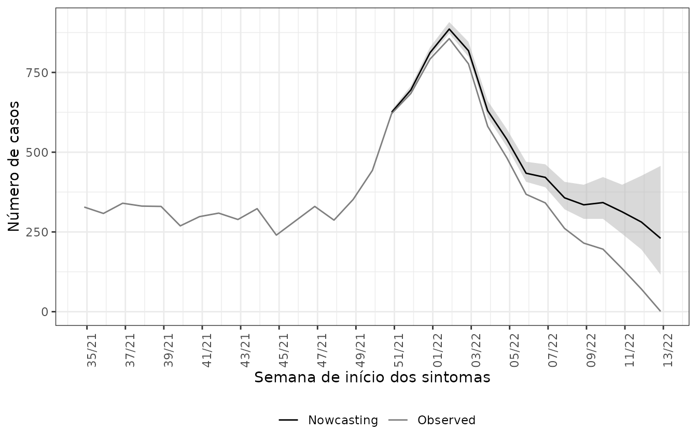
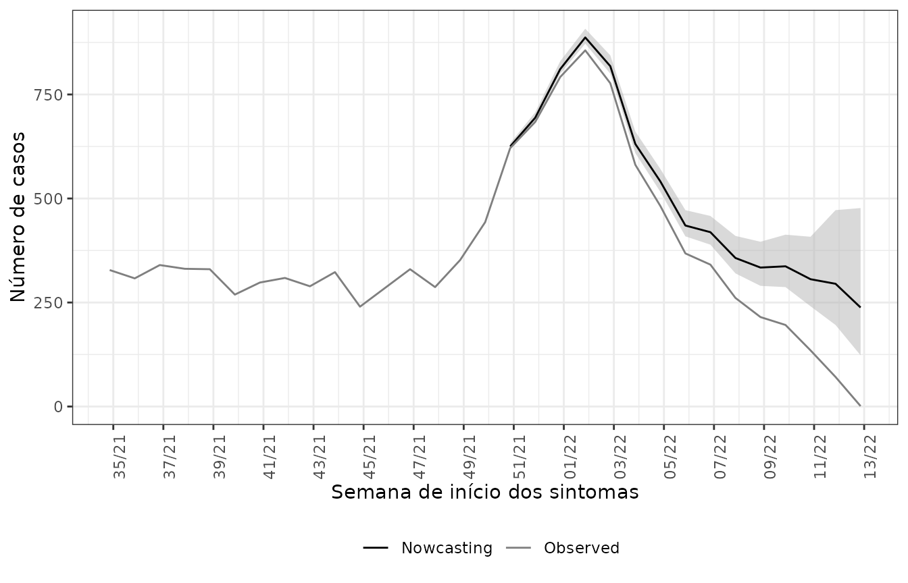
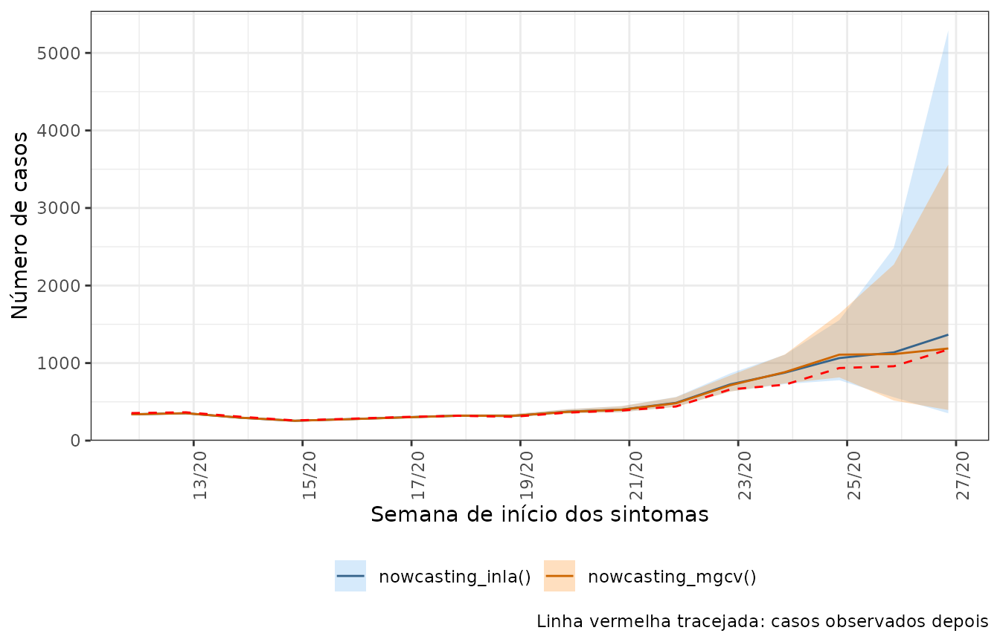

# nowcasting_inla() ou nowcasting_mgcv()

## Duas funções, um modelo

O `nowcaster` tem duas funções principais que ajustam o mesmo modelo: um
modelo binomial negativo para o triângulo de atraso, com um efeito suave
para a semana de início dos sintomas e outro para o atraso de
notificação.

- [`nowcasting_inla()`](https://covid19br.github.io/nowcaster/pt/reference/nowcasting_inla.md)
  ajusta o modelo de forma totalmente Bayesiana com o
  [`INLA`](https://www.r-inla.org/download-install), com prioris de
  passeio aleatório para os efeitos de tempo e de atraso.
- [`nowcasting_mgcv()`](https://covid19br.github.io/nowcaster/pt/reference/nowcasting_mgcv.md)
  ajusta o modelo como um modelo aditivo generalizado com o
  [`mgcv`](https://CRAN.R-project.org/package=mgcv), com splines
  penalizadas para os efeitos de tempo e de atraso.

As duas recebem os mesmos argumentos principais e retornam a mesma
saída, então trocar uma pela outra é só uma questão de mudar o nome da
função. Neste artigo cada exemplo aparece para as duas funções: **use as
abas acima de cada bloco de código para alternar entre elas**. Escolher
uma aba troca todos os exemplos da página.

|  | [`nowcasting_inla()`](https://covid19br.github.io/nowcaster/pt/reference/nowcasting_inla.md) | [`nowcasting_mgcv()`](https://covid19br.github.io/nowcaster/pt/reference/nowcasting_mgcv.md) |
|----|----|----|
| Motor de ajuste | `INLA` (fora do CRAN) | `mgcv` (no CRAN, instalado com o `nowcaster`) |
| Efeitos de tempo e atraso | passeios aleatórios (`rw2`, `rw1`) | splines *thin plate* penalizadas |
| Incerteza | amostras a posteriori do campo latente e dos hiperparâmetros | amostras dos coeficientes, dispersão fixada na estimativa |
| Opções extras | `zero_inflated`, `timeREmodel`, `INLAoutput`, `WAIC`, `DIC` | `method.group.gam` |

## Dados

``` r

library(nowcaster)
library(dplyr)
library(ggplot2)

data(sragBH)

# Função auxiliar para plotar a estimativa com a curva observada na época
plot_nowcast <- function(estimate, observed) {
  ggplot(estimate, aes(x = dt_event)) +
    geom_ribbon(aes(ymin = LI, ymax = LS), fill = "grey70", alpha = 0.5) +
    geom_line(aes(y = Median, colour = "Nowcasting")) +
    geom_line(data = observed, aes(y = observed, colour = "Observed")) +
    scale_colour_manual(values = c(Nowcasting = "black", Observed = "grey50"),
                        name = "") +
    scale_x_date(date_breaks = "2 weeks", date_labels = "%V/%y") +
    labs(x = "Semana de início dos sintomas", y = "Número de casos") +
    theme_bw() +
    theme(legend.position = "bottom", axis.text.x = element_text(angle = 90))
}
```

## Nowcasting

### Ajuste

- INLA
- mgcv

``` r

now_inla <- nowcasting_inla(dataset = sragBH,
                            date_onset = DT_SIN_PRI,
                            date_report = DT_DIGITA,
                            data.by.week = TRUE)
head(now_inla$total)
```

    #> # A tibble: 6 × 7
    #>    Time dt_event   Median    LI    LS   LIb   LSb
    #>   <int> <date>      <dbl> <dbl> <dbl> <dbl> <dbl>
    #> 1    17 2021-12-19    625   621  632    623   627
    #> 2    18 2021-12-26    695   687  708    692   699
    #> 3    19 2022-01-02    812   800  829    808   817
    #> 4    20 2022-01-09    886   872  908.   880   893
    #> 5    21 2022-01-16    818   799  846    811   826
    #> 6    22 2022-01-23    630   609  661    622   640

``` r

now_mgcv <- nowcasting_mgcv(dataset = sragBH,
                            date_onset = DT_SIN_PRI,
                            date_report = DT_DIGITA,
                            data.by.week = TRUE)
head(now_mgcv$total)
```

    #> # A tibble: 6 × 7
    #>    Time dt_event   Median    LI    LS   LIb   LSb
    #>   <int> <date>      <dbl> <dbl> <dbl> <dbl> <dbl>
    #> 1    17 2021-12-19    625   621  633    623   627
    #> 2    18 2021-12-26    694   687  707    691   698
    #> 3    19 2022-01-02    811   800  830    807   817
    #> 4    20 2022-01-09    887   872  908    880   894
    #> 5    21 2022-01-16    818   800  844.   811   826
    #> 6    22 2022-01-23    631   609  661    623   639

### Gráfico

O triângulo de atraso no elemento `data` é o mesmo para as duas funções;
somando sobre os atrasos obtemos a curva observada na data do último
registro.

- INLA
- mgcv

``` r

observed <- now_inla$data |>
  group_by(dt_event) |>
  summarise(observed = sum(Y, na.rm = TRUE))

plot_nowcast(now_inla$total, observed)
```



``` r

observed <- now_mgcv$data |>
  group_by(dt_event) |>
  summarise(observed = sum(Y, na.rm = TRUE))

plot_nowcast(now_mgcv$total, observed)
```



## Nowcasting por idade

Com `age_col`, as duas funções ajustam o modelo estruturado, com efeitos
de tempo e de atraso para cada classe etária. A
[`nowcasting_inla()`](https://covid19br.github.io/nowcaster/pt/reference/nowcasting_inla.md)
usa um efeito independente por classe etária nos passeios aleatórios; a
[`nowcasting_mgcv()`](https://covid19br.github.io/nowcaster/pt/reference/nowcasting_mgcv.md)
usa uma suavização por fator (`method.group.gam = "fs"`, o padrão) ou
uma suavização por classe etária (`method.group.gam = "by"`).

### Ajuste

- INLA
- mgcv

``` r

now_age_inla <- nowcasting_inla(dataset = sragBH,
                                date_onset = DT_SIN_PRI,
                                date_report = DT_DIGITA,
                                age_col = Idade,
                                bins_age = "10 years")
head(now_age_inla$age)
```

    #> # A tibble: 6 × 9
    #>    Time dt_event   fx_etaria fx_etaria.num Median    LI    LS   LIb   LSb
    #>   <int> <date>     <fct>             <dbl>  <dbl> <dbl> <dbl> <dbl> <dbl>
    #> 1    17 2021-12-19 1                     1    123   122   126   122   123
    #> 2    17 2021-12-19 2                     2     15    15    16    15    15
    #> 3    17 2021-12-19 3                     3     20    20    22    20    20
    #> 4    17 2021-12-19 4                     4     30    30    31    30    30
    #> 5    17 2021-12-19 5                     5     29    29    31    29    30
    #> 6    17 2021-12-19 6                     6     68    68    70    68    69

``` r

now_age_mgcv <- nowcasting_mgcv(dataset = sragBH,
                                date_onset = DT_SIN_PRI,
                                date_report = DT_DIGITA,
                                age_col = Idade,
                                bins_age = "10 years")
head(now_age_mgcv$age)
```

    #> # A tibble: 6 × 9
    #>    Time dt_event   fx_etaria fx_etaria.num Median    LI    LS   LIb   LSb
    #>   <int> <date>     <fct>             <dbl>  <dbl> <dbl> <dbl> <dbl> <dbl>
    #> 1    17 2021-12-19 1                     1    123   122   126   122   124
    #> 2    17 2021-12-19 2                     2     15    15    17    15    15
    #> 3    17 2021-12-19 3                     3     20    20    22    20    20
    #> 4    17 2021-12-19 4                     4     30    30    31    30    30
    #> 5    17 2021-12-19 5                     5     29    29    31    29    30
    #> 6    17 2021-12-19 6                     6     68    68    70    68    69

## Previsão

Com `K > 0` as duas funções também preveem as semanas seguintes à última
semana de início dos sintomas. Aqui cortamos os dados em 4 de julho de
2020 e prevemos uma semana à frente.

``` r

srag_2020 <- sragBH |>
  filter(DT_DIGITA <= as.Date("2020-07-04"))
```

### Ajuste

- INLA
- mgcv

``` r

fc_inla <- nowcasting_inla(dataset = srag_2020,
                           date_onset = DT_SIN_PRI,
                           date_report = DT_DIGITA,
                           K = 1)
tail(fc_inla$total, 3)
```

    #> # A tibble: 3 × 7
    #>    Time dt_event   Median    LI    LS   LIb   LSb
    #>   <int> <date>      <dbl> <dbl> <dbl> <dbl> <dbl>
    #> 1    25 2020-06-14  1064.  779  1554.  954  1228.
    #> 2    26 2020-06-21  1138   559. 2486.  874. 1465.
    #> 3    27 2020-06-28  1366   352. 5291.  870. 2050.

``` r

fc_mgcv <- nowcasting_mgcv(dataset = srag_2020,
                           date_onset = DT_SIN_PRI,
                           date_report = DT_DIGITA,
                           K = 1)
tail(fc_mgcv$total, 3)
```

    #> # A tibble: 3 × 7
    #>    Time dt_event   Median    LI    LS   LIb   LSb
    #>   <int> <date>      <dbl> <dbl> <dbl> <dbl> <dbl>
    #> 1    25 2020-06-14  1108.  815  1637.  987  1257 
    #> 2    26 2020-06-21  1116   517. 2271   836. 1430.
    #> 3    27 2020-06-28  1188   395  3559.  826  1782.

## Comparando as estimativas

Colocar as duas estimativas no mesmo gráfico, junto com a curva
observada depois, mostra o quanto elas se aproximam.

``` r

eventually_observed <- sragBH |>
  mutate(dt_event = DT_SIN_PRI - as.numeric(format(DT_SIN_PRI, "%w"))) |>
  count(dt_event, name = "observed")

both <- bind_rows(
  fc_inla$total |> mutate(model = "nowcasting_inla()"),
  fc_mgcv$total |> mutate(model = "nowcasting_mgcv()")
)

ggplot(both, aes(x = dt_event)) +
  geom_ribbon(aes(ymin = LI, ymax = LS, fill = model), alpha = 0.25) +
  geom_line(aes(y = Median, colour = model)) +
  geom_line(data = eventually_observed |>
              filter(dt_event >= min(both$dt_event),
                     dt_event <= max(both$dt_event)),
            aes(y = observed), colour = "red", linetype = "dashed") +
  scale_colour_manual(values = c("steelblue4", "darkorange3"), name = "") +
  scale_fill_manual(values = c("steelblue2", "darkorange1"), name = "") +
  scale_x_date(date_breaks = "2 weeks", date_labels = "%V/%y") +
  labs(x = "Semana de início dos sintomas", y = "Número de casos",
       caption = "Linha vermelha tracejada: casos observados depois") +
  theme_bw() +
  theme(legend.position = "bottom", axis.text.x = element_text(angle = 90))
```



A largura dos intervalos de 95% nas semanas mais recentes:

``` r

both |>
  group_by(model) |>
  slice_tail(n = 4) |>
  mutate(width_95 = LS - LI) |>
  select(model, dt_event, Median, LI, LS, width_95)
```

    #> # A tibble: 8 × 6
    #> # Groups:   model [2]
    #>   model             dt_event   Median    LI    LS width_95
    #>   <chr>             <date>      <dbl> <dbl> <dbl>    <dbl>
    #> 1 nowcasting_inla() 2020-06-07   876   729. 1108.     379.
    #> 2 nowcasting_inla() 2020-06-14  1064.  779  1554.     775.
    #> 3 nowcasting_inla() 2020-06-21  1138   559. 2486.    1928.
    #> 4 nowcasting_inla() 2020-06-28  1366   352. 5291.    4939.
    #> 5 nowcasting_mgcv() 2020-06-07   883   738  1111.     373.
    #> 6 nowcasting_mgcv() 2020-06-14  1108.  815  1637.     822.
    #> 7 nowcasting_mgcv() 2020-06-21  1116   517. 2271     1754.
    #> 8 nowcasting_mgcv() 2020-06-28  1188   395  3559.    3164.

## Qual usar

- [`nowcasting_mgcv()`](https://covid19br.github.io/nowcaster/pt/reference/nowcasting_mgcv.md)
  precisa apenas de pacotes do CRAN. É uma boa escolha padrão quando o
  `INLA` não está disponível ou para uso de rotina.
- [`nowcasting_inla()`](https://covid19br.github.io/nowcaster/pt/reference/nowcasting_inla.md)
  é a versão totalmente Bayesiana do modelo. Ela propaga a incerteza de
  todos os parâmetros, inclusive a dispersão, e oferece as opções do
  modelo original (inflação de zeros, outros modelos latentes para o
  tempo, comparação de modelos com WAIC e DIC).

As duas funções compartilham a preparação dos dados e o resumo das
trajetórias, então as diferenças entre suas estimativas vêm apenas do
ajuste do modelo.
