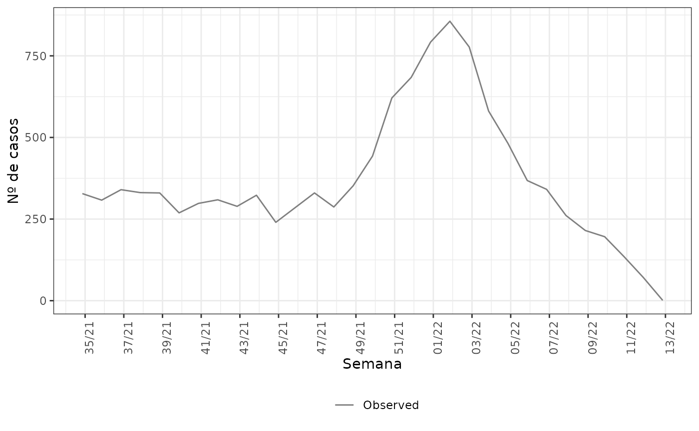
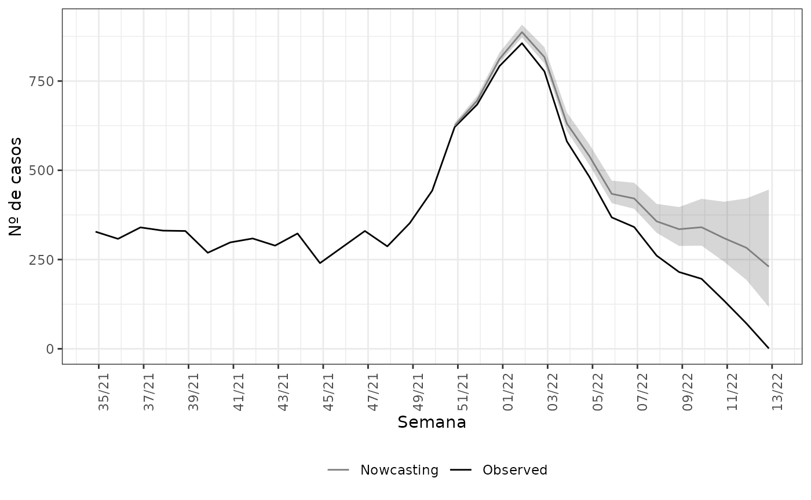
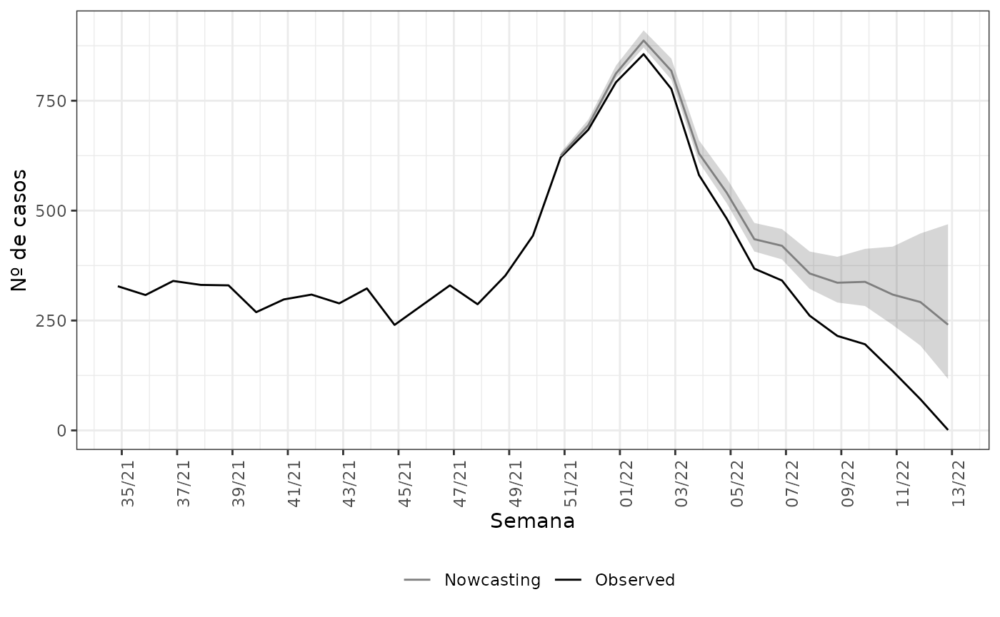

# Primeiros passos

## Primeiro exemplo

Ao ser carregado, o pacote disponibiliza um conjunto de dados (*lazy
data*), `sragBH`, com registros anonimizados de Síndrome Respiratória
Aguda Grave (SRAG) notificados no município de Belo Horizonte, de março
de 2020 a abril de 2022. Para carregá-lo, basta escrever:

``` r

library(nowcaster)
# Loading Belo Horizonte SARI data set
data(sragBH)
```

E damos uma olhada nos dados:

``` r

head(sragBH)
```

    #>   DT_SIN_PRI  DT_DIGITA CLASSI_FIN EVOLUCAO CO_MUN_RES Idade fx_etaria
    #> 1 2020-02-11 2020-03-05          4        1     310620    59   50 - 59
    #> 2 2020-01-21 2020-02-06          4        1     310620    79   70 - 79
    #> 3 2020-03-30 2020-04-17          4        1     310620    72   70 - 79
    #> 4 2020-03-26 2020-04-02          4        1     310620    82      80 +
    #> 5 2020-03-20 2020-04-13          4        1     310620    50   50 - 59
    #> 6 2020-04-07 2020-04-22          5        1     310620    74   70 - 79

É um data.frame com 7 variáveis e 65.404 observações. Usaremos apenas as
duas primeiras colunas, “DT_SIN_PRI” (data de início dos sintomas) e
“DT_DIGITA” (data de digitação), além da coluna “Idade” (idade em anos)
para o nowcasting estruturado por idade.

A chamada da função é direta: ela precisa apenas de um conjunto de dados
como entrada, aqui o `LazyData` carregado no *namespace* do pacote. A
função tem 3 parâmetros obrigatórios: `dataset`, o conjunto de dados a
ser corrigido, `date_onset`, o nome da coluna com a data de início dos
sintomas, e `date_report`, o nome da coluna com a data de notificação
dos casos. Aqui essas colunas são “DT_SIN_PRI” e “DT_DIGITA”,
respectivamente.

### Estimativa do nowcasting

Use as abas para ver a mesma análise com a
[`nowcasting_inla()`](https://covid19br.github.io/nowcaster/pt/reference/nowcasting_inla.md)
(INLA) ou com a
[`nowcasting_mgcv()`](https://covid19br.github.io/nowcaster/pt/reference/nowcasting_mgcv.md)
(mgcv). Escolher uma aba troca todas as abas da página.

- INLA
- mgcv

``` r

nowcasting_bh_no_age <- nowcasting_inla(dataset = sragBH, 
                                        date_onset = "DT_SIN_PRI", 
                                        date_report = "DT_DIGITA", 
                                        data.by.week = T)
head(nowcasting_bh_no_age$total)
```

    #> # A tibble: 6 × 7
    #>    Time dt_event   Median    LI    LS   LIb   LSb
    #>   <int> <date>      <dbl> <dbl> <dbl> <dbl> <dbl>
    #> 1    17 2021-12-19    625  621   633    623   627
    #> 2    18 2021-12-26    695  687   708    692   699
    #> 3    19 2022-01-02    812  801.  830    807   817
    #> 4    20 2022-01-09    887  872.  908    880   894
    #> 5    21 2022-01-16    817  799   845.   810   826
    #> 6    22 2022-01-23    631  610   662    622   640

``` r

nowcasting_bh_no_age_mgcv <- nowcasting_mgcv(dataset = sragBH, 
                                        date_onset = "DT_SIN_PRI", 
                                        date_report = "DT_DIGITA", 
                                        data.by.week = T)
head(nowcasting_bh_no_age_mgcv$total)
```

    #> # A tibble: 6 × 7
    #>    Time dt_event   Median    LI    LS   LIb   LSb
    #>   <int> <date>      <dbl> <dbl> <dbl> <dbl> <dbl>
    #> 1    17 2021-12-19    625   621  632    623   627
    #> 2    18 2021-12-26    694   687  707.   692   698
    #> 3    19 2022-01-02    812   801  830    807   817
    #> 4    20 2022-01-09    887   871  910    881   894
    #> 5    21 2022-01-16    818   798  846    810   826
    #> 6    22 2022-01-23    630   610  660    622   640

### A curva epidêmica observada

Esta chamada retorna, no primeiro elemento, `total`, a estimativa do
nowcasting (`Median`) e seus intervalos em dois níveis: `LIb` e `LSb`
são os limites inferior e superior do intervalo de 50%, e `LI` e `LS`
são os limites inferior e superior do intervalo de 95%. Na
[`nowcasting_inla()`](https://covid19br.github.io/nowcaster/pt/reference/nowcasting_inla.md)
estes são intervalos de credibilidade a posteriori.

No segundo elemento, `data`, retorna os dados que, agrupados e somados,
dão a curva epidêmica. Vamos olhar esse elemento.

- INLA
- mgcv

``` r

library(ggplot2)
library(dplyr)

dados_by_week <- nowcasting_bh_no_age$data |> 
  dplyr::group_by(dt_event) |> 
  dplyr::reframe(
    observed = sum(Y, na.rm = T)
  ) |>
  dplyr::filter(dt_event >= max(dt_event)-270)

dados_by_week |> 
  ggplot()+
  geom_line(data = dados_by_week, 
            aes(dt_event, 
                y = observed, 
                col = 'Observed'))+
  theme_bw()+
  theme(legend.position = "bottom", 
        axis.text.x = element_text(angle = 90)) +
  scale_color_manual(values = c('grey50', 'black'), 
                     name = '')+
  scale_x_date(date_breaks = '2 weeks', 
               date_labels = '%V/%y', 
               name = 'Semana')+
  labs(x = '', 
       y = 'Nº de casos')
```


``` r

library(ggplot2)
library(dplyr)

dados_by_week_mgcv <- nowcasting_bh_no_age_mgcv$data |> 
  dplyr::group_by(dt_event) |> 
  dplyr::reframe(
    observed = sum(Y, na.rm = T)
  ) |>
  dplyr::filter(dt_event >= max(dt_event)-270)

dados_by_week_mgcv |> 
  ggplot()+
  geom_line(data = dados_by_week_mgcv, 
            aes(dt_event, 
                y = observed, 
                col = 'Observed'))+
  theme_bw()+
  theme(legend.position = "bottom", 
        axis.text.x = element_text(angle = 90)) +
  scale_color_manual(values = c('grey50', 'black'), 
                     name = '')+
  scale_x_date(date_breaks = '2 weeks', 
               date_labels = '%V/%y', 
               name = 'Semana')+
  labs(x = '', 
       y = 'Nº de casos')
```



### Nowcasting e a curva observada

Agrupado e somado pela data de início dos sintomas, aqui `DT_SIN_PRI`,
este elemento é a curva epidemiológica observada. Para ver como a
estimativa se compara à curva observada, plotamos as duas juntas.

- INLA
- mgcv

``` r

nowcasting_bh_no_age$total |> 
  ggplot(aes(x = dt_event, y = Median, 
             col = 'Nowcasting')) +
  geom_line(data = dados_by_week, 
            aes(y = observed, 
                col = 'Observed'))+
  geom_ribbon(aes(ymin = LI, ymax = LS), colour = NA, 
              alpha = 0.2, 
              show.legend = F)+
  geom_line()+
  theme_bw()+
  theme(legend.position = "bottom", 
        axis.text.x = element_text(angle = 90)) +
  scale_color_manual(values = c('grey50', 'black'), 
                     name = '')+
  scale_x_date(date_breaks = '2 weeks', 
               date_labels = '%V/%y', 
               name = 'Semana')+
  labs(x = '', 
       y = 'Nº de casos')
```



``` r

nowcasting_bh_no_age_mgcv$total |> 
  ggplot(aes(x = dt_event, y = Median, 
             col = 'Nowcasting')) +
  geom_line(data = dados_by_week_mgcv, 
            aes(y = observed, 
                col = 'Observed'))+
  geom_ribbon(aes(ymin = LI, ymax = LS), colour = NA, 
              alpha = 0.2, 
              show.legend = F)+
  geom_line()+
  theme_bw()+
  theme(legend.position = "bottom", 
        axis.text.x = element_text(angle = 90)) +
  scale_color_manual(values = c('grey50', 'black'), 
                     name = '')+
  scale_x_date(date_breaks = '2 weeks', 
               date_labels = '%V/%y', 
               name = 'Semana')+
  labs(x = '', 
       y = 'Nº de casos')
```



## Próximos passos

Este é um exemplo em que a estimativa foi feita sem considerar nenhum
tipo de estrutura nos dados, o primeiro pressuposto do nowcasting. Para
mais detalhes sobre o modelo de nowcasting por trás de cada função, veja
os artigos [Nowcasting com
INLA](https://covid19br.github.io/nowcaster/pt/articles/1_nowcasting_inla.html)
e [Nowcasting com
mgcv](https://covid19br.github.io/nowcaster/pt/articles/2_nowcasting_mgcv.html).
